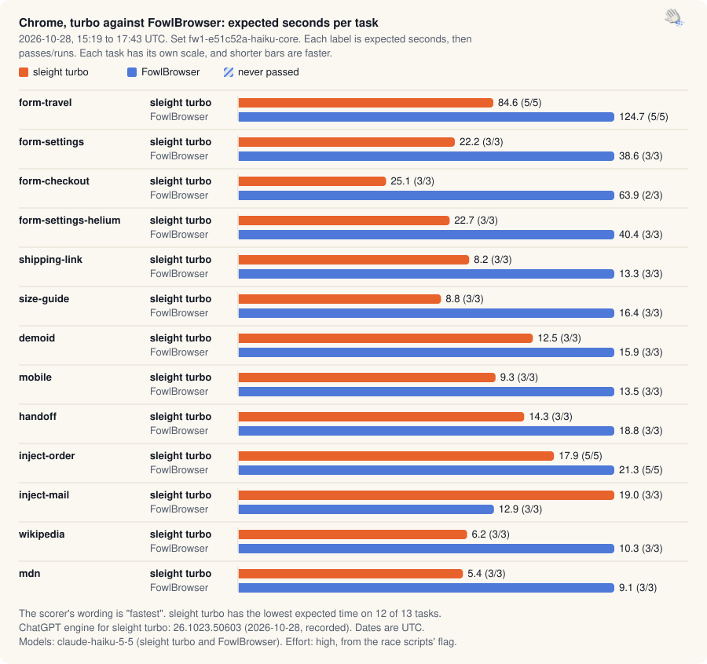

<h1 align="center"> sleight</h1>
<p align="center"><strong>Your coding agent clicks, types and drags in Mac apps while you keep working.</strong></p>

<p align="center">
  <a href="https://github.com/Land-o-Clusters/sleight/releases/latest"></a> 
   
</p>

sleight is an MIT-licensed plugin for Claude Code, Codex, Grok CLI and Cursor (install not yet run). Grok Bot uses its local shell. Ask it to work out a sum in Calculator or edit a document, and it operates that app in the background.

You need an Apple Silicon Mac. The [ChatGPT desktop app](https://chatgpt.com/download/) is required in `/Applications` because sleight runs its computer-use engine.
You don't need a ChatGPT account or sign-in. sleight uses your coding agent's account or API access, without a separate Codex sign-in.

<a id="install-validation"></a>

> [!IMPORTANT]
> sleight is unofficial. OpenAI and Anthropic don't endorse or support it. A ChatGPT update can break it.
> The new install flow and setup in a fresh macOS user haven't run live. Install time and typical task cost are unmeasured.
> See [requirements](INSTALL.md#requirements) for tested macOS versions. sleight contains no OpenAI code.

<p align="center"></p>
<p align="center"><sub>Claude plays macOS Chess through sleight. Every move is a drag, and the action log on the right records each one.</sub></p>

LCU, Cua, Peekaboo and FowlBrowser are competing computer-use tools. An arm means one agent setup.

<!-- hub:claim -->
sleight's own 9-task native Mac benchmark: 251.2 s total expected time. Claude computer use: 453.9 s.<br>
Expected time is mean time per attempt divided by the pass rate, estimating time to a correct result when failed attempts are retried.<br>
[Benchmark hub](docs/results/README.md) · [Interactive page](https://land-o-clusters.github.io/sleight/results/explore.html)
<!-- /hub:claim -->

## Install

```text
Install sleight from https://github.com/Land-o-Clusters/sleight and check it with its doctor.
```

Paste that into your coding agent. It follows [INSTALL.md](INSTALL.md), stopping for your admin password, macOS permissions, Chrome's debugging switch and app approvals.

## Where it runs

| Host | Install route and validation | Limits |
| --- | --- | --- |
| Claude Code 2.1.288 or later | [Plugin](INSTALL.md#claude-code). Native and app claims on 2.1.289. | No known host-specific gaps. |
| Codex CLI | [Plugin](INSTALL.md#codex). Calculator and TextEdit passed on 0.160.0 after first-call retries, fixed since but not rerun live. | Turbo needs trusted hooks and awaits a live check. |
| Grok CLI | [Direct MCP](INSTALL.md#grok-cli). Handshake on 1.0.13. Model and app tasks untested. | Turbo off. Results capped at 20,000 bytes. |
| Grok Bot (preview) | [Local shell](INSTALL.md#grok-bot) via `sleight-mcp js`. One live read passed. | Turbo off. Approvals wait in the menu bar glove ([limits](docs/known-problems.md#hosts-and-platform)). |
| Other MCP clients | [Stdio config](INSTALL.md#other-mcp-clients), tested with our own client. | Turbo unavailable. |
| Cursor | [Plugin](INSTALL.md#cursor), with marketplace install unverified. | Turbo unavailable. |

The action pane, status line and `/sleight` are Claude Code only ([host details](docs/other-hosts.md)).

To install by hand, follow [INSTALL.md](INSTALL.md). If Computer Use is already on in ChatGPT or Codex, installing the plugin is enough. Otherwise run `./bin/sleight-mcp setup` from the installed plugin folder ([Computer Use](INSTALL.md#computer-use)). It uses ChatGPT's Node runtime. npm isn't needed.

sleight drives native apps, including Electron apps such as VS Code, Slack and Spotify, through the engine. Safari and Firefox use the engine's accessibility path. The engine refuses terminals and OpenAI's own apps ([how it works](docs/how-it-works.md)).

## Turbo

Turbo drives Chrome and Helium directly. It is on by default after you enable Chrome's one-time debugging switch. The browser asks you to allow each connection ([setup](INSTALL.md#computer-use)).

In the [turbo race](docs/results/browser-turbo.md), Chrome had the lowest expected time on 12 of 13 tasks, 296.8 s total against FowlBrowser's 447.8 s (2026-10-18 to 2026-10-19). Helium had the lowest expected time on 10 of 13, 264.1 s total against 343.6 s (2026-10-18 to 2026-10-19).

<picture><source media="(prefers-color-scheme: dark)" srcset="docs/results/img/family-browser-turbo-chrome-dark.svg"></picture>

From the installed plugin folder, you run `./bin/sleight-mcp turbo on` (Chrome first, then Helium), `./bin/sleight-mcp turbo on --browser helium` to choose Helium, or `./bin/sleight-mcp turbo off` to opt out until you turn it on again ([settings](docs/settings.md#turbo)).

## New in 1.4.0

- Text drags move between windows, repair spacing and keep empty final lines. Opened-file handles keep their document window. sleight refuses formatted cross-window moves.
- sleight rejects malformed native arguments before the engine sends input and reports the correct signature. It handles shutdown while the engine loads.
- Turbo fills multi-selects and accepts modifier clicks on safe targets. Shorter replies explain field values, batch boundaries and viewport markers.
- Requested sign-ups count as confirmed when your message names the username or email and password ([limits](docs/settings.md#requested-sign-ups)).
- Opt-in [local stats](docs/settings.md#stats) report action times and reads saved.
- Grok CLI adds direct MCP (10 tools in its 1.0.13 handshake). Cursor adds a plugin, with install not yet run. Grok Bot adds the local shell route as a preview: one live Calculator read passed, and its approvals wait in the menu bar glove.
- Protected consent buttons require physical input ([accessibility limits](docs/known-problems.md#protected-consent-input)). Chrome and Helium turbo is on by default after Chrome's debugging consent.
- The ghost hand is off by default: textedit-drag took 31 to 37 s with it, 23 to 26 s without (3 runs a side, [details](docs/known-problems.md)).

Release validation for 1.4.1 (2026-10-22, Haiku 5.5 at high effort, engine 26.1016.51333): the full check passed (12,770 tests), and 1.4.1 ran against 1.4.0 on sleight's own tasks. In Chrome both passed all 13 tasks 3 times, at 218.9 s total expected time against 213.0 s. On 8 native held-out tasks, run on the same harness, 1.4.1's mean total was 501.7 s (7 runs) against 1.4.0's 515.8 s (3 runs). One Opus 5.5 round passed all 13 Chrome tasks in 237.3 s. The 1.4.1 benchmark harness makes native tasks slower than 1.4.0's harness, measured but not yet explained ([known problems](docs/known-problems.md#native-harness-in-141)).

<!-- hub:headline -->
<picture>
  <source media="(prefers-color-scheme: dark)" srcset="docs/results/img/headline-native-dark.svg">
  
</picture>

<sub>Native claim, 2026-10-17 to 2026-10-18: sleight's total expected time over 9 tasks is 251.2 s against Claude computer use at 453.9 s, and LCU, Codex, Cua and Peekaboo have no total because each never passed at least one task.</sub>
<!-- /hub:headline -->

## How fast

<!-- hub:benchmarks -->
- [Native claim](docs/results/native-claim.md): "fastest", sleight's total expected time 251.2 s over 9 tasks (197 runs, 2026-10-17 to 2026-10-18). Engine 26.1007.71326, 2026-10-17 to 2026-10-18.
- [App claim](docs/results/app-claim.md): "fastest", sleight's total expected time 56.8 s over 3 tasks (60 runs, 2026-10-18, 02:39 to 03:16 UTC). Engine 26.1007.71326, 2026-10-18.
- [Chrome and Helium: turbo against FowlBrowser](docs/results/browser-turbo.md): in Chrome, the lowest expected time on 12 of 13 and a total of 296.8 s against FowlBrowser's 447.8 s (`sleight-turbo-rel131`). In Helium, the lowest expected time on 10 of 13 and a total of 264.1 s against FowlBrowser's 343.6 s (`sleight-turbo-rel130`). 14 gate studies. Engine 26.1013.40934, 2026-10-19.
- [Safari and Firefox: the engine path against Codex, LCU, Cua and Peekaboo](docs/results/browser-race.md): in Safari sleight has completed every task and is fastest on 12 of 12 tasks. It is the only arm with a total (682.3 s) (`sleight-fs2on`, 2026-10-18). In Firefox sleight has completed every task and is fastest on 12 of 12 tasks. Its total is 455.0 s (`sleight-fs2on`, 2026-10-18). Engine 26.1007.71326, 2026-10-18 and engine 26.1013.40934, 2026-10-19.
- [Experiments](docs/results/ab-tests.md): 17 studies with run data. The catalog has 96 benchmark write-ups and includes studies without structured run data.
- [Validation: build A against build B](docs/results/validation.md): 1 scored bank: 1 validation, 0 re-measure. 6 more have no score file. 21 A/B groups in all. Build B has a higher expected time or a lower pass rate than build A on 37 of 72 task comparisons. Newest scored bank: validation-140-final (2026-10-20).
- [Release passes and the earlier head-to-heads](docs/results/release-passes.md): 7 release passes (2026-10-05 to 2026-10-09), 115 results files in all.

<picture>
  <source media="(prefers-color-scheme: dark)" srcset="docs/results/img/overview-dark.svg">
  
</picture>

<sub>Total expected seconds of sleight against the next-best arm with a total, in the newest complete set of each benchmark. Native apps, 251.2 s against Claude computer use at 453.9 s. VS Code, Slack, Spotify, 56.8 s against LCU at 101.3 s. Chrome, turbo, 296.8 s against FowlBrowser at 447.8 s. Helium, turbo, 264.1 s against FowlBrowser at 343.6 s. Safari, engine path, 682.3 s, and no other arm has a total. Firefox, engine path, 455.0 s against Cua at 2541.4 s.</sub>
<!-- /hub:benchmarks -->

## How it works

<picture><source media="(prefers-color-scheme: dark)" srcset="docs/assets/architecture-dark.svg"></picture>

The engine is the computer-use software bundled with ChatGPT. sleight's launcher starts it on ChatGPT's own Node runtime. The relay connects it to your agent and shows approval cards. In Claude Code, a UI extension (the mod) draws the action pane and ends the engine's turn after each of yours ([how it works](docs/how-it-works.md)).

## Safety

These are the intended checks. [Known problems](docs/known-problems.md#approvals-and-guards) lists guards with only unit coverage and what has run live.

- Each app gets one approval card with Allow, Always allow and Decline.
- Always allow, payment and consent buttons accept only a person's click or key press.
- VoiceOver, Switch Control, Voice Control and screen-sharing users need a physical keyboard or pointer for these cards in 1.4.0 ([limits and planned alternative](docs/known-problems.md#protected-consent-input)).
- A payment goes ahead without another prompt only when your own message names what to pay, the amount and what to pay with. When a page tries to pay, sleight always asks ([settings](docs/settings.md#payments-you-asked-for)).
- sleight treats page text as untrusted input when checking actions and approvals. The `js` tool runs JavaScript as you, so Claude Code asks before each call unless you allow `mcp__plugin_sleight_computer__js`.
- sleight never switches Spaces or takes focus, except for Chrome's own consent prompt. A few fallbacks (foreground drag, `hover`, some menu bar icons) move the pointer briefly, each after you've stopped typing for 2 s.

## More

- [INSTALL.md](INSTALL.md) for every host, setup, update and uninstall. [Settings](docs/settings.md) lists every switch with its default, and [privacy](docs/privacy.md) what sleight writes on your Mac (it doesn't call the network itself).
- [Known problems](docs/known-problems.md) with the runs that showed each one, the [benchmark method](docs/benchmark.md), the [changelog](CHANGELOG.md) and the [roadmap](docs/status/ROADMAP.md).

## Credits

- [@argofowl](https://x.com/argofowl) showed that the ChatGPT app's computer-use server works outside Codex.
- [LCU](https://github.com/amontlabs/lcu), started by 0xpolarzero, takes the same idea across several harnesses, and its notes mapped out the runtime's lifecycle.
- Turbo includes [playwright-core](https://github.com/microsoft/playwright) 1.64.0, unmodified, with its notices in [THIRD-PARTY-NOTICES.md](plugins/sleight/THIRD-PARTY-NOTICES.md).

## License

[MIT](LICENSE). The ChatGPT app and its computer-use runtime belong to OpenAI, under OpenAI's terms, and sleight doesn't include or redistribute either. ChatGPT, Codex, Claude, Cursor, Chrome, Safari, Firefox, Helium, Microsoft Word, Excel, VS Code, Slack, Spotify and other app names are trademarks of their owners, who don't endorse or sponsor sleight, and appear here to describe compatibility and benchmark results.
