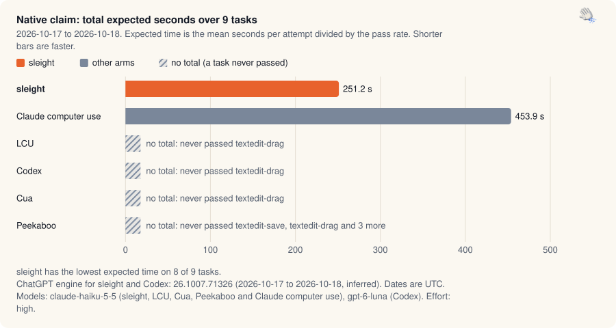
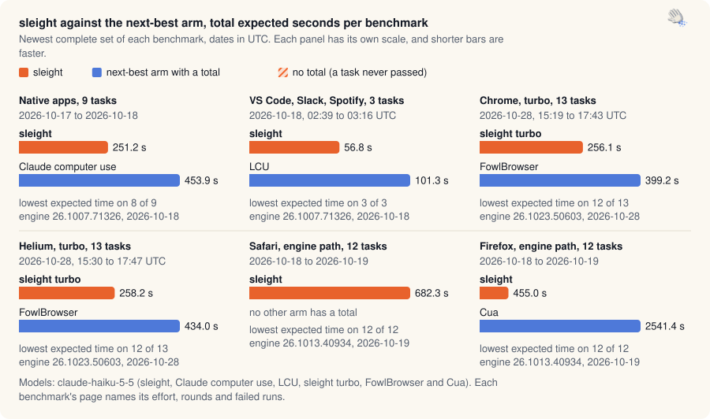

Benchmarks · [Native](native-claim.md) · [Apps](app-claim.md) · [Chrome and Helium](browser-turbo.md) · [Safari and Firefox](browser-race.md) · [Experiments](ab-tests.md) · [Validation](validation.md) · [Releases](release-passes.md) · [Insights](insights.md) · [Interactive](https://land-o-clusters.github.io/sleight/results/explore.html)

# Benchmark results

The results include failed runs, with methods and exclusions for each benchmark family. The claim scorers compute the figures from recorded runs.

<picture>
  <source media="(prefers-color-scheme: dark)" srcset="img/headline-native-dark.svg">
  
</picture>

<sub>Native claim, 2026-10-17 to 2026-10-18: sleight's total expected time over 9 tasks is 251.2 s against Claude computer use at 453.9 s, and LCU, Codex, Cua and Peekaboo have no total because each never passed at least one task.</sub>

<picture>
  <source media="(prefers-color-scheme: dark)" srcset="img/overview-dark.svg">
  
</picture>

<sub>Total expected seconds of sleight against the next-best arm with a total, in the newest complete set of each benchmark. Native apps, 251.2 s against Claude computer use at 453.9 s. VS Code, Slack, Spotify, 56.8 s against LCU at 101.3 s. Chrome, turbo, 296.8 s against FowlBrowser at 447.8 s. Helium, turbo, 264.1 s against FowlBrowser at 343.6 s. Safari, engine path, 682.3 s, and no other arm has a total. Firefox, engine path, 455.0 s against Cua at 2541.4 s.</sub>

The [interactive page](https://land-o-clusters.github.io/sleight/results/explore.html) has the same data with sorting, filters and a chart per task. Its source is [explore.html](explore.html) in this folder.

| Family | What it measures | Where it stands | Data |
| --- | --- | --- | --- |
| [Native claim](native-claim.md) | The 9 native Mac app tasks, sleight against LCU, Codex, Cua, Peekaboo and Claude's own computer use. | Lowest expected time on 8 of 9 tasks. Total 251.2 s. | [json](data/native-claim.json) |
| [App claim](app-claim.md) | VS Code, Slack and Spotify tasks with the same arms. | Lowest expected time on 3 of 3 tasks. Total 56.8 s. | [json](data/app-claim.json) |
| [Chrome and Helium: turbo against FowlBrowser](browser-turbo.md) | Turbo in Chrome and Helium, in the real-window race and the earlier gate rounds. | Chrome: lowest expected time on 12 of 13 tasks, total 296.8 s. Helium: lowest expected time on 10 of 13 tasks, total 264.1 s. | [json](data/browser-turbo.json) |
| [Safari and Firefox: the engine path against Codex, LCU, Cua and Peekaboo](browser-race.md) | sleight's engine path in Safari and Firefox against Codex, LCU, Cua and Peekaboo. | Safari: sleight has completed every task and is fastest on 12 of 12 tasks. It is the only arm with a total (682.3 s). Firefox: sleight has completed every task and is fastest on 12 of 12 tasks. Its total is 455.0 s. | [json](data/browser-race.json) |
| [Experiments](ab-tests.md) | sleight against sleight, for skill, wording, tool and turbo changes. | 17 studies with run data. The catalog has 96 benchmark write-ups and includes studies without structured run data. | [json](data/ab-tests.json) |
| [Validation: build A against build B](validation.md) | sleight against its own earlier build on the same tasks, from the validation and re-measure banks. | 1 scored bank: 1 validation, 0 re-measure. 6 more have no score file. 21 A/B groups in all. Build B has a higher expected time or a lower pass rate than build A on 37 of 72 task comparisons. Newest scored bank: validation-140-final (2026-10-20). | [json](data/validation.json) |
| [Release passes and the earlier head-to-heads](release-passes.md) | The per-release regression passes and the first native head-to-heads. | 7 release passes (2026-10-05 to 2026-10-09), 115 results files in all. | [json](data/release-passes.json) |

[Insights](insights.md) covers what the runs taught us about run-to-run variation, Haiku against Opus, which tuning paid off, and engine quirks.

<details><summary>Run dates, engine versions and build labels</summary>

- [Native claim](native-claim.md): "fastest", sleight's total expected time 251.2 s over 9 tasks (197 runs, 2026-10-17 to 2026-10-18). Engine 26.1007.71326, 2026-10-17 to 2026-10-18.
- [App claim](app-claim.md): "fastest", sleight's total expected time 56.8 s over 3 tasks (60 runs, 2026-10-18, 02:39 to 03:16 UTC). Engine 26.1007.71326, 2026-10-18.
- [Chrome and Helium: turbo against FowlBrowser](browser-turbo.md): in Chrome, the lowest expected time on 12 of 13 and a total of 296.8 s against FowlBrowser's 447.8 s (`sleight-turbo-rel131`). In Helium, the lowest expected time on 10 of 13 and a total of 264.1 s against FowlBrowser's 343.6 s (`sleight-turbo-rel130`). 14 gate studies. Engine 26.1013.40934, 2026-10-19.
- [Safari and Firefox: the engine path against Codex, LCU, Cua and Peekaboo](browser-race.md): in Safari sleight has completed every task and is fastest on 12 of 12 tasks. It is the only arm with a total (682.3 s) (`sleight-fs2on`, 2026-10-18). In Firefox sleight has completed every task and is fastest on 12 of 12 tasks. Its total is 455.0 s (`sleight-fs2on`, 2026-10-18). Engine 26.1007.71326, 2026-10-18 and engine 26.1013.40934, 2026-10-19.
- [Experiments](ab-tests.md): 17 studies with run data. The catalog has 96 benchmark write-ups and includes studies without structured run data.
- [Validation: build A against build B](validation.md): 1 scored bank: 1 validation, 0 re-measure. 6 more have no score file. 21 A/B groups in all. Build B has a higher expected time or a lower pass rate than build A on 37 of 72 task comparisons. Newest scored bank: validation-140-final (2026-10-20).
- [Release passes and the earlier head-to-heads](release-passes.md): 7 release passes (2026-10-05 to 2026-10-09), 115 results files in all.

</details>

## Terms

- Expected time is the mean seconds per attempt divided by the pass rate, the time to a correct result if failed attempts are retried.
- An arm is one agent setup: sleight, a competitor plugin, or a sleight variant in an A/B.
- A round runs every task once per arm. A claim or race task gets 3 runs per arm, or 5 where sleight and another arm are within 20%.
- The full rules are in [LAWS](../status/LAWS.md), and the tasks and harnesses in [benchmark.md](../benchmark.md).

<details><summary>Rebuild</summary>

```sh
node bench/results-hub.mjs                # collect from the raw folders this Mac has, then render
node bench/results-hub.mjs --render-only  # render from docs/results/data only
node bench/results-hub.mjs --check        # exit 1 if a page, data file or README block would change
```

The raw claim, race and validation folders live outside the repo, in `~/Projects/sleight-wt/app-claim`, `~/Projects/sleight-wt/race-1017` and the banks under `~/Projects/sleight-wt` (any folder with a validation or re-measure `plan.json`). On a Mac without them, the generator keeps the data files already here. `--wt <dir>` points it at another copy. The benchmark runners run the collect and render once after a successful pass (`bench/hub-refresh.mjs`), and `--no-hub` or `SLEIGHT_NO_HUB=1` stops that.

</details>

Each arm table lists the ChatGPT engine versions its runs used, with their UTC dates.
