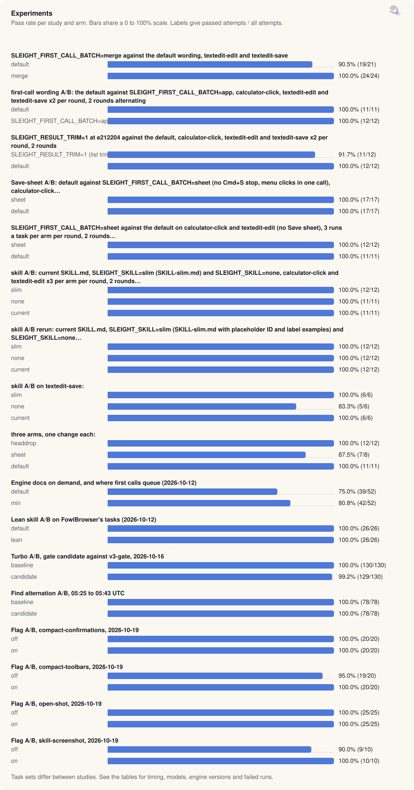

[Benchmarks](README.md) · [Native](native-claim.md) · [Apps](app-claim.md) · [Chrome and Helium](browser-turbo.md) · [Safari and Firefox](browser-race.md) · Experiments · [Validation](validation.md) · [Releases](release-passes.md) · [Insights](insights.md) · [Interactive](https://land-o-clusters.github.io/sleight/results/explore.html)

# Experiments

<picture>
  <source media="(prefers-color-scheme: dark)" srcset="charts/family-ab-tests-dark.svg">
  
</picture>

Experiments: 959 of 990 recorded attempts passed across 38 study and arm rows. Task sets differ between studies.

Each study compares sleight variants on the same tasks using the claims' expected-time scoring, with the first variant as the baseline.

Method

- Studies saved as JSON (`{ study, rounds }` or `{ study, sides }` in docs/benchmarks) are read run by run, and their model ids come from the runs. Studies saved as FowlBrowser-runner reports are parsed from their tables, and their model and effort come from the write-up.
- Expected time is the mean seconds per attempt divided by the pass rate (`bench/claim-score.mjs`). A failed run adds its time to the mean and lowers the rate. A task an arm never passed has no expected time, and that arm then has no total. Median and range are over passing runs, and p90 (nearest rank) appears only at 5 or more runs.
- Rounds alternate the variants, but load and model variation still move single rounds. Each write-up says what its study controlled, and the summary gives the runs per task.

## Summary

| Date | Study | Model | Runs per task | Variants: passed, total s | Write-up |
| --- | --- | --- | --- | --- | --- |
| 2026-10-10 | `2026-10-10-merge-ab` | `claude-haiku-5-5`, `claude-sonnet-5-5` | 10 to 12 | default 19/21 passed, 1,649 s. merge 24/24 passed, 1,667 s | [2026-10-10-merge-ab.md](../benchmarks/2026-10-10-merge-ab.md) |
| 2026-10-11 | `2026-10-11-firstcall-ab` | `claude-haiku-5-5` | 3 to 4 | default 11/11 passed, 355 s. SLEIGHT_FIRST_CALL_BATCH=app 12/12 passed, 343 s | [benchmark.md](../benchmark.md) |
| 2026-10-11 | `2026-10-11-result-trim-ab` | `claude-haiku-5-5` | 4 | SLEIGHT_RESULT_TRIM=1 (list trim and acquisition-tree drop) 11/12 passed, 386 s. default 12/12 passed, 340 s | [benchmark.md](../benchmark.md) |
| 2026-10-11 | `2026-10-11-sheet-ab` | `claude-haiku-5-5` | 5 to 6 | sheet 17/17 passed, 532 s. default 17/17 passed, 402 s | [benchmark.md](../benchmark.md) |
| 2026-10-11 | `2026-10-11-sheet-edit-ab` | `claude-haiku-5-5` | 5 to 6 | sheet 12/12 passed, 191 s. default 11/11 passed, 190 s | [benchmark.md](../benchmark.md) |
| 2026-10-11 | `2026-10-11-skill-ab` | `claude-haiku-5-5` | 5 to 6 | slim 12/12 passed, 209 s. none 11/11 passed, 230 s. current 11/11 passed, 176 s | [benchmark.md](../benchmark.md) |
| 2026-10-11 | `2026-10-11-skill-ab-2` | `claude-haiku-5-5` | 6 | slim 12/12 passed, 191 s. none 12/12 passed, 240 s. current 12/12 passed, 204 s | [benchmark.md](../benchmark.md) |
| 2026-10-11 | `2026-10-11-skill-ab-save` | `claude-haiku-5-5` | 6 | slim 6/6 passed, 242 s. none 5/6 passed, 284 s. current 6/6 passed, 277 s | [benchmark.md](../benchmark.md) |
| 2026-10-11 | `2026-10-11-three-arm-ab` | `claude-haiku-5-5` | 2 to 4 | headdrop 12/12 passed, 322 s. sheet 7/8 passed, 198 s. default 11/11 passed, 278 s | [benchmark.md](../benchmark.md) |
| 2026-10-12 | `2026-10-12-d5-min-ab` | `claude-haiku-4-5` | 4 | default 39/52 passed, 5,820 s. min 42/52 passed, 5,714 s | [2026-10-12-d5-min-ab.md](../benchmarks/2026-10-12-d5-min-ab.md) |
| 2026-10-12 | `2026-10-12-lean-skill-ab` | `claude-opus-5-5` | 2 | default 26/26 passed, 1,006 s. lean 26/26 passed, 981 s | [2026-10-12-lean-skill-ab.md](../benchmarks/2026-10-12-lean-skill-ab.md) |
| 2026-10-16 | `2026-10-16-turbo-ab` | `claude-haiku-5-5` | 10 | baseline 130/130 passed, 2,921 s. candidate 129/130 passed, 2,698 s | [2026-10-16-turbo-ab.md](../benchmarks/2026-10-16-turbo-ab.md) |
| 2026-10-16 | `2026-10-16-turbo-ab-find` | `claude-haiku-5-5` | 6 | baseline 78/78 passed, 1,824 s. candidate 78/78 passed, 1,656 s | [2026-10-16-turbo-ab.md](../benchmarks/2026-10-16-turbo-ab.md) |
| 2026-10-19 | `2026-10-19-flag-ab-compact-confirmations` | `claude-haiku-5-5` | 5 | off 20/20 passed, 454 s. on 20/20 passed, 461 s | [2026-10-19-flag-ab.md](../benchmarks/2026-10-19-flag-ab.md) |
| 2026-10-19 | `2026-10-19-flag-ab-compact-toolbars` | `claude-haiku-5-5` | 5 | off 19/20 passed, 1,150 s. on 20/20 passed, 1,103 s | [2026-10-19-flag-ab.md](../benchmarks/2026-10-19-flag-ab.md) |
| 2026-10-19 | `2026-10-19-flag-ab-open-shot` | `claude-haiku-5-5` | 5 to 10 | off 25/25 passed, 355 s. on 25/25 passed, 325 s | [2026-10-19-flag-ab.md](../benchmarks/2026-10-19-flag-ab.md) |
| 2026-10-19 | `2026-10-19-flag-ab-skill-screenshot` | `claude-haiku-5-5` | 5 | off 9/10 passed, 860 s. on 10/10 passed, 810 s | [2026-10-19-flag-ab.md](../benchmarks/2026-10-19-flag-ab.md) |

Totals add every run, failures included, so a variant with more runs has a larger total. Per-task expected times account for the different run counts.

## Studies

2026-10-10-merge-ab

`SLEIGHT_FIRST_CALL_BATCH=merge against the default wording, textedit-edit and textedit-save`. The baseline is `default`. Write-up: [2026-10-10-merge-ab.md](../benchmarks/2026-10-10-merge-ab.md).

| Arm | Model ids in the runs | Effort | Versions recorded |
| --- | --- | --- | --- |
| default | `claude-haiku-5-5`, `claude-sonnet-5-5` | high, medium | not recorded |
| merge | `claude-haiku-5-5` | high, medium | not recorded |

| Task | default | merge |
| --- | --- | --- |
| `textedit-edit` | 50.1 (9/10) | 44.4 (12/12) |
| `textedit-save` | 119.9 (10/11) | 94.6 (12/12) |
| Lowest expected time on | 0 of 2 | 2 of 2 |
| Total expected s | 169.9 | 139.0 |

2026-10-11-firstcall-ab

`first-call wording A/B: the default against SLEIGHT_FIRST_CALL_BATCH=app, calculator-click, textedit-edit and textedit-save x2 per round, 2 rounds alternating`. The baseline is `default`. Commit `4ee20df`. Write-up: [benchmark.md](../benchmark.md).

| Arm | Model ids in the runs | Effort | Versions recorded |
| --- | --- | --- | --- |
| default | `claude-haiku-5-5` | high | not recorded |
| SLEIGHT_FIRST_CALL_BATCH=app | `claude-haiku-5-5` | high | not recorded |

| Task | default | SLEIGHT_FIRST_CALL_BATCH=app |
| --- | --- | --- |
| `calculator-click` | 14.4 (4/4) | 12.6 (4/4) |
| `textedit-edit` | 22.4 (3/3) | 22.4 (4/4) |
| `textedit-save` | 57.5 (4/4) | 50.9 (4/4) |
| Lowest expected time on | 0 of 3 | 3 of 3 |
| Total expected s | 94.2 | 85.9 |

2026-10-11-result-trim-ab

`SLEIGHT_RESULT_TRIM=1 at e212204 against the default, calculator-click, textedit-edit and textedit-save x2 per round, 2 rounds`. The baseline is `SLEIGHT_RESULT_TRIM=1 (list trim and acquisition-tree drop)`. Commit `e212204`. Write-up: [benchmark.md](../benchmark.md).

| Arm | Model ids in the runs | Effort | Versions recorded |
| --- | --- | --- | --- |
| SLEIGHT_RESULT_TRIM=1 (list trim and acquisition-tree drop) | `claude-haiku-5-5` | high | not recorded |
| default | `claude-haiku-5-5` | high | not recorded |

| Task | SLEIGHT_RESULT_TRIM=1 (list trim and acquisition-tree drop) | default |
| --- | --- | --- |
| `calculator-click` | 14.3 (4/4) | 12.5 (4/4) |
| `textedit-edit` | 20.4 (4/4) | 20.9 (4/4) |
| `textedit-save` | 82.4 (3/4) | 51.7 (4/4) |
| Lowest expected time on | 1 of 3 | 2 of 3 |
| Total expected s | 117.1 | 85.0 |

2026-10-11-sheet-ab

`Save-sheet A/B: default against SLEIGHT_FIRST_CALL_BATCH=sheet (no Cmd+S stop, menu clicks in one call), calculator-click…`. The baseline is `sheet`. Commit `ebedb7e`. Write-up: [benchmark.md](../benchmark.md).

| Arm | Model ids in the runs | Effort | Versions recorded |
| --- | --- | --- | --- |
| sheet | `claude-haiku-5-5` | high | not recorded |
| default | `claude-haiku-5-5` | high | not recorded |

| Task | sheet | default |
| --- | --- | --- |
| `calculator-click` | 14.0 (6/6) | 13.7 (6/6) |
| `textedit-edit` | 19.5 (5/5) | 21.4 (6/6) |
| `textedit-save` | 58.4 (6/6) | 38.4 (5/5) |
| Lowest expected time on | 1 of 3 | 2 of 3 |
| Total expected s | 91.9 | 73.4 |

2026-10-11-sheet-edit-ab

`SLEIGHT_FIRST_CALL_BATCH=sheet against the default on calculator-click and textedit-edit (no Save sheet), 3 runs a task per arm per round, 2 rounds…`. The baseline is `sheet`. Commit `f328943`. Write-up: [benchmark.md](../benchmark.md).

| Arm | Model ids in the runs | Effort | Versions recorded |
| --- | --- | --- | --- |
| sheet | `claude-haiku-5-5` | high | not recorded |
| default | `claude-haiku-5-5` | high | not recorded |

| Task | sheet | default |
| --- | --- | --- |
| `calculator-click` | 11.9 (6/6) | 13.2 (6/6) |
| `textedit-edit` | 19.9 (6/6) | 22.2 (5/5) |
| Lowest expected time on | 2 of 2 | 0 of 2 |
| Total expected s | 31.8 | 35.3 |

2026-10-11-skill-ab

`skill A/B: current SKILL.md, SLEIGHT_SKILL=slim (SKILL-slim.md) and SLEIGHT_SKILL=none, calculator-click and textedit-edit x3 per arm per round, 2 rounds…`. The baseline is `slim`. Commit `b03b5a7`. Write-up: [benchmark.md](../benchmark.md).

| Arm | Model ids in the runs | Effort | Versions recorded |
| --- | --- | --- | --- |
| slim | `claude-haiku-5-5` | high | not recorded |
| none | `claude-haiku-5-5` | high | not recorded |
| current | `claude-haiku-5-5` | high | not recorded |

| Task | slim | none | current |
| --- | --- | --- | --- |
| `calculator-click` | 14.6 (6/6) | 22.3 (6/6) | 12.7 (6/6) |
| `textedit-edit` | 20.2 (6/6) | 19.3 (5/5) | 19.9 (5/5) |
| Lowest expected time on | 0 of 2 | 1 of 2 | 1 of 2 |
| Total expected s | 34.8 | 41.6 | 32.6 |

2026-10-11-skill-ab-2

`skill A/B rerun: current SKILL.md, SLEIGHT_SKILL=slim (SKILL-slim.md with placeholder ID and label examples) and SLEIGHT_SKILL=none…`. The baseline is `slim`. Commit `ebedb7e`. Write-up: [benchmark.md](../benchmark.md).

| Arm | Model ids in the runs | Effort | Versions recorded |
| --- | --- | --- | --- |
| slim | `claude-haiku-5-5` | high | not recorded |
| none | `claude-haiku-5-5` | high | not recorded |
| current | `claude-haiku-5-5` | high | not recorded |

| Task | slim | none | current |
| --- | --- | --- | --- |
| `calculator-click` | 12.8 (6/6) | 21.1 (6/6) | 13.2 (6/6) |
| `textedit-edit` | 19.0 (6/6) | 18.9 (6/6) | 20.9 (6/6) |
| Lowest expected time on | 1 of 2 | 1 of 2 | 0 of 2 |
| Total expected s | 31.8 | 40.0 | 34.0 |

2026-10-11-skill-ab-save

`skill A/B on textedit-save:`. The baseline is `slim`. Commit `ebedb7e`. Write-up: [benchmark.md](../benchmark.md).

| Arm | Model ids in the runs | Effort | Versions recorded |
| --- | --- | --- | --- |
| slim | `claude-haiku-5-5` | high | not recorded |
| none | `claude-haiku-5-5` | high | not recorded |
| current | `claude-haiku-5-5` | high | not recorded |

| Task | slim | none | current |
| --- | --- | --- | --- |
| `textedit-save` | 40.3 (6/6) | 56.9 (5/6) | 46.2 (6/6) |
| Lowest expected time on | 1 of 1 | 0 of 1 | 0 of 1 |
| Total expected s | 40.3 | 56.9 | 46.2 |

2026-10-11-three-arm-ab

`three arms, one change each:`. The baseline is `headdrop`. Commit `7f49b40`. Write-up: [benchmark.md](../benchmark.md).

| Arm | Model ids in the runs | Effort | Versions recorded |
| --- | --- | --- | --- |
| headdrop | `claude-haiku-5-5` | high | not recorded |
| sheet | `claude-haiku-5-5` | high | not recorded |
| default | `claude-haiku-5-5` | high | not recorded |

| Task | headdrop | sheet | default |
| --- | --- | --- | --- |
| `calculator-click` | 14.5 (4/4) | 15.6 (3/3) | 13.0 (4/4) |
| `textedit-edit` | 22.1 (4/4) | 23.8 (2/2) | 21.6 (4/4) |
| `textedit-save` | 43.8 (4/4) | 52.0 (2/3) | 46.7 (3/3) |
| Lowest expected time on | 1 of 3 | 0 of 3 | 2 of 3 |
| Total expected s | 80.4 | 91.4 | 81.3 |

2026-10-12-d5-min-ab

`Engine docs on demand, and where first calls queue (2026-10-12)`. The baseline is `default`. Write-up: [2026-10-12-d5-min-ab.md](../benchmarks/2026-10-12-d5-min-ab.md).

| Arm | Model ids in the runs | Effort | Versions recorded |
| --- | --- | --- | --- |
| default | `claude-haiku-4-5` | high | not recorded |
| min | `claude-haiku-4-5` | high | not recorded |

| Task | default | min |
| --- | --- | --- |
| `demoid` | 77.8 (4/4) | 353.0 (2/4) |
| `form-checkout` | 159.0 (4/4) | 74.5 (4/4) |
| `form-settings` | 1146.0 (1/4) | 863.0 (1/4) |
| `form-settings-helium` | no pass (0/4) | 888.0 (1/4) |
| `form-travel` | 520.0 (2/4) | 210.8 (4/4) |
| `handoff` | 46.0 (4/4) | 34.3 (4/4) |
| `inject-mail` | 39.5 (4/4) | 29.5 (4/4) |
| `inject-order` | 75.0 (4/4) | 68.8 (4/4) |
| `mdn` | 31.5 (4/4) | 40.8 (4/4) |
| `mobile` | 440.0 (1/4) | 113.3 (3/4) |
| `shipping-link` | 30.8 (4/4) | 25.0 (4/4) |
| `size-guide` | 64.0 (4/4) | 233.0 (3/4) |
| `wikipedia` | 33.7 (3/4) | 71.0 (4/4) |
| Lowest expected time on | 4 of 13 | 9 of 13 |
| Total expected s | no total (a task has no pass) | 3004.8 |

2026-10-12-lean-skill-ab

`Lean skill A/B on FowlBrowser's tasks (2026-10-12)`. The baseline is `default`. Write-up: [2026-10-12-lean-skill-ab.md](../benchmarks/2026-10-12-lean-skill-ab.md).

| Arm | Model ids in the runs | Effort | Versions recorded |
| --- | --- | --- | --- |
| default | `claude-opus-5-5` | not recorded | not recorded |
| lean | `claude-opus-5-5` | not recorded | not recorded |

| Task | default | lean |
| --- | --- | --- |
| `demoid` | 29.5 (2/2) | 26.0 (2/2) |
| `form-checkout` | 75.0 (2/2) | 126.0 (2/2) |
| `form-settings` | 51.5 (2/2) | 40.5 (2/2) |
| `form-settings-helium` | 52.0 (2/2) | 49.0 (2/2) |
| `form-travel` | 76.0 (2/2) | 61.5 (2/2) |
| `handoff` | 27.5 (2/2) | 29.5 (2/2) |
| `inject-mail` | 24.5 (2/2) | 21.0 (2/2) |
| `inject-order` | 41.5 (2/2) | 33.0 (2/2) |
| `mdn` | 20.0 (2/2) | 18.0 (2/2) |
| `mobile` | 35.5 (2/2) | 24.5 (2/2) |
| `shipping-link` | 22.0 (2/2) | 19.5 (2/2) |
| `size-guide` | 28.0 (2/2) | 22.0 (2/2) |
| `wikipedia` | 20.0 (2/2) | 20.0 (2/2) |
| Lowest expected time on | 2 of 13 | 10 of 13 |
| Total expected s | 503.0 | 490.5 |

2026-10-16-turbo-ab

`Turbo A/B, gate candidate against v3-gate, 2026-10-16`. The baseline is `baseline`. Write-up: [2026-10-16-turbo-ab.md](../benchmarks/2026-10-16-turbo-ab.md).

| Arm | Model ids in the runs | Effort | Versions recorded |
| --- | --- | --- | --- |
| baseline | `claude-haiku-5-5` | not recorded | not recorded |
| candidate | `claude-haiku-5-5` | not recorded | not recorded |

| Task | baseline | candidate |
| --- | --- | --- |
| `demoid` | 14.2 (10/10) | 14.0 (10/10) |
| `form-checkout` | 40.7 (10/10) | 35.1 (10/10) |
| `form-settings` | 33.9 (10/10) | 34.7 (10/10) |
| `form-settings-helium` | 39.2 (10/10) | 33.6 (10/10) |
| `form-travel` | 68.8 (10/10) | 56.7 (10/10) |
| `handoff` | 17.3 (10/10) | 18.4 (10/10) |
| `inject-mail` | 18.4 (10/10) | 16.9 (10/10) |
| `inject-order` | 13.7 (10/10) | 13.8 (10/10) |
| `mdn` | 7.6 (10/10) | 7.1 (10/10) |
| `mobile` | 11.7 (10/10) | 14.1 (9/10) |
| `shipping-link` | 9.5 (10/10) | 8.8 (10/10) |
| `size-guide` | 10.8 (10/10) | 11.8 (10/10) |
| `wikipedia` | 6.3 (10/10) | 6.2 (10/10) |
| Lowest expected time on | 5 of 13 | 8 of 13 |
| Total expected s | 292.1 | 271.2 |

2026-10-16-turbo-ab-find

`Find alternation A/B, 05:25 to 05:43 UTC`. The baseline is `baseline`. Write-up: [2026-10-16-turbo-ab.md](../benchmarks/2026-10-16-turbo-ab.md).

| Arm | Model ids in the runs | Effort | Versions recorded |
| --- | --- | --- | --- |
| baseline | `claude-haiku-5-5` | not recorded | not recorded |
| candidate | `claude-haiku-5-5` | not recorded | not recorded |

| Task | baseline | candidate |
| --- | --- | --- |
| `demoid` | 14.8 (6/6) | 13.5 (6/6) |
| `form-checkout` | 43.3 (6/6) | 33.2 (6/6) |
| `form-settings` | 37.0 (6/6) | 37.3 (6/6) |
| `form-settings-helium` | 34.3 (6/6) | 36.3 (6/6) |
| `form-travel` | 66.5 (6/6) | 56.2 (6/6) |
| `handoff` | 18.8 (6/6) | 17.2 (6/6) |
| `inject-mail` | 21.2 (6/6) | 16.0 (6/6) |
| `inject-order` | 15.0 (6/6) | 16.0 (6/6) |
| `mdn` | 9.0 (6/6) | 7.7 (6/6) |
| `mobile` | 13.7 (6/6) | 13.5 (6/6) |
| `shipping-link` | 10.2 (6/6) | 10.0 (6/6) |
| `size-guide` | 11.8 (6/6) | 12.0 (6/6) |
| `wikipedia` | 8.3 (6/6) | 7.2 (6/6) |
| Lowest expected time on | 4 of 13 | 9 of 13 |
| Total expected s | 304.0 | 276.0 |

2026-10-19-flag-ab-compact-confirmations

`Flag A/B, compact-confirmations, 2026-10-19`. The baseline is `off`. Commit `60fe1319820053db382b26bdaecbc1db83e0c895`. Write-up: [2026-10-19-flag-ab.md](../benchmarks/2026-10-19-flag-ab.md).

| Arm | Model ids in the runs | Effort | Versions recorded |
| --- | --- | --- | --- |
| off | `claude-haiku-5-5` | high | not recorded |
| on | `claude-haiku-5-5` | high | not recorded |

| Task | off | on |
| --- | --- | --- |
| `finder-create-folder` | 20.6 (5/5) | 18.3 (5/5) |
| `preview-pdf` | 24.1 (5/5) | 22.1 (5/5) |
| `textedit-edit` | 16.2 (5/5) | 18.5 (5/5) |
| `textedit-insert-line` | 30.0 (5/5) | 33.4 (5/5) |
| Lowest expected time on | 2 of 4 | 2 of 4 |
| Total expected s | 90.9 | 92.3 |

2026-10-19-flag-ab-compact-toolbars

`Flag A/B, compact-toolbars, 2026-10-19`. The baseline is `off`. Commit `60fe1319820053db382b26bdaecbc1db83e0c895`. Write-up: [2026-10-19-flag-ab.md](../benchmarks/2026-10-19-flag-ab.md).

| Arm | Model ids in the runs | Effort | Versions recorded |
| --- | --- | --- | --- |
| off | `claude-haiku-5-5` | high | not recorded |
| on | `claude-haiku-5-5` | high | not recorded |

| Task | off | on |
| --- | --- | --- |
| `textedit-insert-line` | 34.9 (5/5) | 36.4 (5/5) |
| `textedit-replace-all` | 23.2 (5/5) | 26.9 (5/5) |
| `word-brief` | 74.7 (5/5) | 70.1 (5/5) |
| `word-memo` | 121.5 (4/5) | 87.1 (5/5) |
| Lowest expected time on | 2 of 4 | 2 of 4 |
| Total expected s | 254.3 | 220.5 |

2026-10-19-flag-ab-open-shot

`Flag A/B, open-shot, 2026-10-19`. The baseline is `off`. Commit `60fe1319820053db382b26bdaecbc1db83e0c895`. Write-up: [2026-10-19-flag-ab.md](../benchmarks/2026-10-19-flag-ab.md).

| Arm | Model ids in the runs | Effort | Versions recorded |
| --- | --- | --- | --- |
| off | `claude-haiku-5-5` | high | not recorded |
| on | `claude-haiku-5-5` | high | not recorded |

| Task | off | on |
| --- | --- | --- |
| `preview-pdf` | 27.2 (5/5) | 25.0 (5/5) |
| `preview-read` | 5.3 (10/10) | 5.0 (10/10) |
| `textedit-edit` | 23.9 (5/5) | 20.4 (5/5) |
| `textedit-replace-save` | 9.4 (5/5) | 9.6 (5/5) |
| Lowest expected time on | 1 of 4 | 3 of 4 |
| Total expected s | 65.8 | 60.0 |

2026-10-19-flag-ab-skill-screenshot

`Flag A/B, skill-screenshot, 2026-10-19`. The baseline is `off`. Commit `60fe1319820053db382b26bdaecbc1db83e0c895`. Write-up: [2026-10-19-flag-ab.md](../benchmarks/2026-10-19-flag-ab.md).

| Arm | Model ids in the runs | Effort | Versions recorded |
| --- | --- | --- | --- |
| off | `claude-haiku-5-5` | high | not recorded |
| on | `claude-haiku-5-5` | high | not recorded |

| Task | off | on |
| --- | --- | --- |
| `word-brief` | 74.7 (5/5) | 66.6 (5/5) |
| `word-memo` | 121.5 (4/5) | 95.5 (5/5) |
| Lowest expected time on | 0 of 2 | 2 of 2 |
| Total expected s | 196.2 | 162.0 |

## Other measurements

These write-ups in [docs/benchmarks](../benchmarks/) have no tables on this hub, and each states its own method. The release passes and head-to-heads are on [release-passes.md](release-passes.md).

| Date | Write-up |
| --- | --- |
| 2026-10-03 | [Background drag prototype](../benchmarks/2026-10-03-background-drag.md) |
| 2026-10-03 | [Saved-file review, 2026-10-03](../benchmarks/2026-10-03-change-review.md) |
| 2026-10-03 | [Flow rules live check](../benchmarks/2026-10-03-flow-rules.md) |
| 2026-10-04 | [Background drag product checks](../benchmarks/2026-10-04-background-drag-product.md) |
| 2026-10-04 | [Background TextEdit drag follow-up](../benchmarks/2026-10-04-background-text-drag.md) |
| 2026-10-04 | [Change review guard, 2026-10-04](../benchmarks/2026-10-04-change-review-guard.md) |
| 2026-10-04 | [Change review re-read, 2026-10-04](../benchmarks/2026-10-04-change-review-reread.md) |
| 2026-10-04 | [Clipboard probe, 2026-10-04](../benchmarks/2026-10-04-clipboard.md) |
| 2026-10-04 | [Two-engine typing investigation (2026-10-04)](../benchmarks/2026-10-04-double-keys.md) |
| 2026-10-04 | [TextEdit spacing and unnamed menu controls](../benchmarks/2026-10-04-drag-polish.md) |
| 2026-10-04 | [Named-window drag checks, 2026-10-04](../benchmarks/2026-10-04-drag-raise.md) |
| 2026-10-04 | [Drag review, round 2](../benchmarks/2026-10-04-drag-round-2.md) |
| 2026-10-04 | [TextEdit window selection and lost text](../benchmarks/2026-10-04-drag-window-guards.md) |
| 2026-10-04 | [Helper health, 2026-10-04](../benchmarks/2026-10-04-helper-health.md) |
| 2026-10-04 | [Input lease repair, October 4](../benchmarks/2026-10-04-input-lease.md) |
| 2026-10-04 | [Local hover trials, 2026-10-04](../benchmarks/2026-10-04-local-hover.md) |
| 2026-10-04 | [Preapproved apps, 2026-10-04](../benchmarks/2026-10-04-preapproved-apps.md) |
| 2026-10-04 | [Exact window selection, October 4](../benchmarks/2026-10-04-window-targeting.md) |
| 2026-10-05 | [Fewer reads per call (2026-10-05)](../benchmarks/2026-10-05-guard-reads.md) |
| 2026-10-08 | [Real-use tasks, round 5](../benchmarks/2026-10-08-real-use-tasks-5.md) |
| 2026-10-08 | [Real-use tasks, 2026-10-08](../benchmarks/2026-10-08-real-use-tasks.md) |
| 2026-10-08 | [App hangs and fresh Chess launches](../benchmarks/2026-10-08-reliability.md) |
| 2026-10-09 | [Clipboard helper reuse](../benchmarks/2026-10-09-clipboard-helper.md) |
| 2026-10-09 | [Exact replacement in TextEdit](../benchmarks/2026-10-09-exact-text.md) |
| 2026-10-09 | [Session footprint follow-up](../benchmarks/2026-10-09-footprint-spawns-2.md) |
| 2026-10-09 | [Session footprint, third review](../benchmarks/2026-10-09-footprint-spawns-3.md) |
| 2026-10-09 | [Session and call footprint](../benchmarks/2026-10-09-footprint-spawns.md) |
| 2026-10-09 | [Guard speed experiment, 2026-10-09](../benchmarks/2026-10-09-guard-speed.md) |
| 2026-10-09 | [Other hosts checks, 2026-10-09](../benchmarks/2026-10-09-other-hosts.md) |
| 2026-10-09 | [Initial Office reads, 2026-10-09](../benchmarks/2026-10-09-real-use-tasks-10.md) |
| 2026-10-09 | [Cleanup AX reads, 2026-10-09](../benchmarks/2026-10-09-real-use-tasks-11.md) |
| 2026-10-09 | [Real-use tasks, round 6](../benchmarks/2026-10-09-real-use-tasks-6.md) |
| 2026-10-09 | [Real-use tasks, round 7 (2026-10-09)](../benchmarks/2026-10-09-real-use-tasks-7.md) |
| 2026-10-09 | [Real-use harness corrections, 2026-10-09](../benchmarks/2026-10-09-real-use-tasks-8.md) |
| 2026-10-09 | [Office harness corrections, 2026-10-09](../benchmarks/2026-10-09-real-use-tasks-9.md) |
| 2026-10-09 | [Desktop replay review fixes, 2026-10-09](../benchmarks/2026-10-09-replay-desktop-2.md) |
| 2026-10-09 | [Desktop replay, 2026-10-09](../benchmarks/2026-10-09-replay-desktop.md) |
| 2026-10-09 | [TextEdit formatting and Save panel investigation](../benchmarks/2026-10-09-textedit-fixes.md) |
| 2026-10-09 | [Verified results checks](../benchmarks/2026-10-09-verified-results.md) |
| 2026-10-09 | [Waits, window identity and checked stop](../benchmarks/2026-10-09-waits-targeting.md) |
| 2026-10-10 | [Tester-away runs, 2026-10-10 night](../benchmarks/2026-10-10-away-2.md) |
| 2026-10-10 | [Tester-away runs, 2026-10-10 evening](../benchmarks/2026-10-10-away.md) |
| 2026-10-10 | [Electron and Firefox tree counts](../benchmarks/2026-10-10-electron-firefox.md) |
| 2026-10-10 | [Guard and app-probe CPU (2026-10-10)](../benchmarks/2026-10-10-footprint-parity.md) |
| 2026-10-10 | [Head-to-heads and shop runs, 2026-10-10 afternoon](../benchmarks/2026-10-10-h2h-afternoon.md) |
| 2026-10-10 | [Head-to-head after the guard changes, 2026-10-10](../benchmarks/2026-10-10-h2h-guard.md) |
| 2026-10-10 | [Generic benchmark arms, 2026-10-10](../benchmarks/2026-10-10-plugin-arm.md) |
| 2026-10-10 | [Simulator launch handoff, 2026-10-10](../benchmarks/2026-10-10-real-use-tasks-12.md) |
| 2026-10-10 | [Simulator readiness and Helium control file, 2026-10-10](../benchmarks/2026-10-10-real-use-tasks-13.md) |
| 2026-10-10 | [Receipt review follow-up](../benchmarks/2026-10-10-review-receipts-2.md) |
| 2026-10-10 | [Turn receipts and unsaved review](../benchmarks/2026-10-10-review-receipts.md) |
| 2026-10-10 | [Routines and demonstration recording, 2026-10-10](../benchmarks/2026-10-10-routines-demo.md) |
| 2026-10-10 | [Routines, first live run](../benchmarks/2026-10-10-routines-live.md) |
| 2026-10-10 | [TextEdit save-lock experiment, 2026-10-10](../benchmarks/2026-10-10-save-lock.md) |
| 2026-10-10 | [Simulator and turn cleanup review, 2026-10-10](../benchmarks/2026-10-10-sim-savelock-2.md) |
| 2026-10-10 | [Simulator, save lock and turn cleanup, 2026-10-10](../benchmarks/2026-10-10-sim-savelock.md) |
| 2026-10-10 | [Simulator coordinates and focus, 2026-10-10](../benchmarks/2026-10-10-simulator-focus.md) |
| 2026-10-10 | [Startup and per-call costs of the code-audit candidates (2026-10-10)](../benchmarks/2026-10-10-startup-costs.md) |
| 2026-10-10 | [Browser extension against accessibility reads (2026-10-10)](../benchmarks/2026-10-10-surface-ab.md) |
| 2026-10-10 | [TextEdit review follow-up](../benchmarks/2026-10-10-textedit-fixes-2.md) |
| 2026-10-10 | [TextEdit third review](../benchmarks/2026-10-10-textedit-fixes-3.md) |
| 2026-10-10 | [Desktop turn cleanup, 2026-10-10](../benchmarks/2026-10-10-turn-lifecycle.md) |
| 2026-10-10 | [Verified results memory, reset and degraded reads](../benchmarks/2026-10-10-verified-results-lifetime.md) |
| 2026-10-10 | [Verified results review fixes](../benchmarks/2026-10-10-verified-results-review.md) |
| 2026-10-10 | [Waits, window targeting and stop: third follow-up](../benchmarks/2026-10-10-waits-targeting-3.md) |
| 2026-10-10 | [Waits, window targeting and stop: merge](../benchmarks/2026-10-10-waits-targeting-4.md) |
| 2026-10-10 | [Waits and targeting follow-up](../benchmarks/2026-10-10-waits-targeting.md) |
| 2026-10-11 | [Evidence runs for the build slate, 2026-10-11](../benchmarks/2026-10-11-evidence.md) |
| 2026-10-11 | [Select-all check: the dialog false positive, 2026-10-11](../benchmarks/2026-10-11-selectall-dialog-fix.md) |
| 2026-10-11 | [Turn study, 2026-10-11](../benchmarks/2026-10-11-turn-study.md) |
| 2026-10-12 | [REPL warm-up before the first call (2026-10-12)](../benchmarks/2026-10-12-repl-warmup.md) |
| 2026-10-14 | [Guard reads A/B, 2026-10-14](../benchmarks/2026-10-14-guard-ab.md) |
| 2026-10-14 | [Lean calls A/B, 2026-10-14](../benchmarks/2026-10-14-lean-calls-ab.md) |
| 2026-10-19 | [App-class speed map, 2026-10-19](../benchmarks/2026-10-19-speed-map.md) |
| n/a | [Battery report template](../benchmarks/battery-report-template.md) |
| n/a | [Release audit, 2026-10-11](../benchmarks/release-audit-2026-10-11.md) |

[data/ab-tests.json](data/ab-tests.json) has every counted run and the scored cells, and the [interactive page](https://land-o-clusters.github.io/sleight/results/explore.html) charts them. The ChatGPT engine version is missing from this data, which was collected before the results recorded it (2026-10-19). Rebuild every page with `node bench/results-hub.mjs`.

[Benchmarks](README.md) · [Native](native-claim.md) · [Apps](app-claim.md) · [Chrome and Helium](browser-turbo.md) · [Safari and Firefox](browser-race.md) · Experiments · [Validation](validation.md) · [Releases](release-passes.md) · [Insights](insights.md) · [Interactive](https://land-o-clusters.github.io/sleight/results/explore.html)
