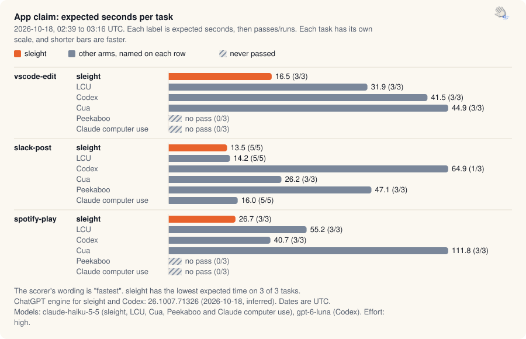

[Benchmarks](README.md) · [Native](native-claim.md) · Apps · [Chrome and Helium](browser-turbo.md) · [Safari and Firefox](browser-race.md) · [Experiments](ab-tests.md) · [Validation](validation.md) · [Releases](release-passes.md) · [Insights](insights.md) · [Interactive](https://land-o-clusters.github.io/sleight/results/explore.html)

# App claim

The app tasks run on the native path with the same arms and rules as the native claim. In VS Code the agent edits a fixture file in a separate instance with a temporary profile. In Slack it posts one fixed message to a test channel of a throwaway account. In the tester's personal Spotify account it finds a track, plays it and pauses it. The scorer's wording is "fastest". sleight has the lowest expected time on 3 of 3 tasks.

<picture>
  <source media="(prefers-color-scheme: dark)" srcset="charts/family-app-claim-dark.svg">
  
</picture>

App claim, 2026-10-18, 02:39 to 03:16 UTC. Expected seconds per task for sleight, LCU, Codex, Cua, Peekaboo and Claude computer use. sleight has the lowest expected time on 3 of 3 tasks. The scorer's wording is "fastest".

Each cell is expected seconds, then passes/runs.

| Task | sleight | LCU | Codex | Cua | Peekaboo | Claude computer use |
| --- | --- | --- | --- | --- | --- | --- |
| `vscode-edit` | 16.5 (3/3) | 31.9 (3/3) | 41.5 (3/3) | 44.9 (3/3) | no pass (0/3) | no pass (0/3) |
| `slack-post` | 13.5 (5/5) | 14.2 (5/5) | 64.9 (1/3) | 26.2 (3/3) | 47.1 (3/3) | 16.0 (5/5) |
| `spotify-play` | 26.7 (3/3) | 55.2 (3/3) | 40.7 (3/3) | 111.8 (3/3) | no pass (0/3) | no pass (0/3) |
| Lowest expected time on | 3 of 3 | 0 of 3 | 0 of 3 | 0 of 3 | 0 of 3 | 0 of 3 |
| Total expected s | 56.8 | 101.3 | 147.1 | 182.9 | no total (a task has no pass) | no total (a task has no pass) |

By the loss rule, sleight didn't lose a task.

No pair within 20% of sleight is short of 5 runs.

Method and arm versions

- 60 runs counted, from 9 results files dated 2026-10-18, 02:39 to 03:16 UTC, on the tester's account login (auth `login`).
- Expected time is the mean seconds per attempt divided by the pass rate (`bench/claim-score.mjs`). A failed run adds its time to the mean and lowers the rate. A task an arm never passed has no expected time, and that arm then has no total. Median and range are over passing runs, and p90 (nearest rank) appears only at 5 or more runs.
- The rules come from [LAWS](../status/LAWS.md). Each arm gets 3 runs per task, or 5 where sleight and another arm are within 20% (the difference over the slower expected time). "Fastest" needs the lowest expected time on a majority of tasks and the lowest total, with those 5 runs in place. Otherwise the wording is "completed every task, fastest on N". A task counts as lost when another arm has the lower expected time or a faster passing run.
- Rows come from `~/Projects/sleight-wt/app-claim/results-1018` with the exclusions in `~/Projects/sleight-wt/app-claim/scorer/bench/claim-exclusions.json`. Scoring starts at file stamp `2026-10-18T02-39`, and the reason given is `the first app-task claim pass`.
- The results files don't record sleight's commit or the Codex CLI version.

| Arm | Model ids in the runs | Effort | Versions recorded | ChatGPT engine and UTC dates |
| --- | --- | --- | --- | --- |
| sleight | `claude-haiku-5-5` | high | Claude Code 2.1.289 | engine 26.1007.71326 (11 inferred), 2026-10-18 (dates inferred) |
| LCU | `claude-haiku-5-5` | high | Claude Code 2.1.289 | not used, 2026-10-18 |
| Codex | `gpt-6-luna` | high | not recorded | engine 26.1007.71326 (9 inferred), 2026-10-18 (dates inferred) |
| Cua | `claude-haiku-5-5` | high | Claude Code 2.1.289 | not used, 2026-10-18 |
| Peekaboo | `claude-haiku-5-5` | high | @steipete/peekaboo 4.9.2, Claude Code 2.1.289 | not used, 2026-10-18 |
| Claude computer use | `claude-haiku-5-5` | high | Claude Code 2.1.289 | not used, 2026-10-18 |

The arms that use the engine ran on one engine version, 26.1007.71326. A version is "recorded" when the runner read it and "inferred" from the timeline in `bench/engine-versions.json` otherwise, and a date is inferred when it comes from a file's stamp or modification time. LCU, Cua, Peekaboo, FowlBrowser, Claude in Chrome and Claude's computer use don't use the engine.

Rows left out and scorer warnings

No rows were left out.

The scorer warned:

- `sleight's included rows come from 2 passes: 2026-10-18T02-39-41-149Z.json (9), 2026-10-18T03-14-39-374Z.json (2)`
- `regrade 2026-10-17T15-51-43-164Z.json claude-cu textedit-drag #1 matches no included failed run`

Spread of passing runs

Passing runs, median [fastest to slowest], with p90 at 5 or more runs:

| Task | sleight | LCU | Codex | Cua | Peekaboo | Claude computer use |
| --- | --- | --- | --- | --- | --- | --- |
| `vscode-edit` | 16.0 [14.1 to 19.5] | 29.9 [29.8 to 36.0] | 26.8 [24.6 to 73.2] | 40.8 [35.4 to 58.4] | no passes | no passes |
| `slack-post` | 12.4 [11.3 to 19.4], p90 19.4 | 15.1 [11.8 to 15.4], p90 15.4 | 32.3 [32.3 to 32.3] | 27.3 [23.3 to 27.9] | 50.9 [34.8 to 55.5] | 16.3 [14.4 to 16.8], p90 16.8 |
| `spotify-play` | 25.6 [24.3 to 30.2] | 49.3 [43.0 to 73.2] | 43.1 [33.1 to 45.9] | 130.0 [64.7 to 140.8] | no passes | no passes |

Failed runs (14)

| Task | Arm | File | s | Reason |
| --- | --- | --- | --- | --- |
| `slack-post` | Codex | `2026-10-18T02-48-50-037Z.json` | 17.9 | `SLACK_POST_COUNT_0` |
| `slack-post` | Codex | `2026-10-18T02-48-50-037Z.json` | 14.7 | `SLACK_POST_COUNT_0` |
| `vscode-edit` | Claude computer use | `2026-10-18T02-54-45-686Z.json` | 18.9 | `saved document does not contain the replaced word` |
| `spotify-play` | Claude computer use | `2026-10-18T02-54-45-686Z.json` | 14.6 | `SPOTIFY_NO_EVENTS` |
| `vscode-edit` | Claude computer use | `2026-10-18T02-54-45-686Z.json` | 19.3 | `saved document does not contain the replaced word` |
| `spotify-play` | Claude computer use | `2026-10-18T02-54-45-686Z.json` | 11.3 | `SPOTIFY_NO_EVENTS` |
| `vscode-edit` | Claude computer use | `2026-10-18T02-54-45-686Z.json` | 19.5 | `saved document does not contain the replaced word` |
| `spotify-play` | Claude computer use | `2026-10-18T02-54-45-686Z.json` | 10.7 | `SPOTIFY_NO_EVENTS` |
| `vscode-edit` | Peekaboo | `2026-10-18T03-08-08-477Z.json` | 17.1 | `saved document does not contain the replaced word` |
| `spotify-play` | Peekaboo | `2026-10-18T03-08-08-477Z.json` | 27.6 | `SPOTIFY_NO_EVENTS` |
| `vscode-edit` | Peekaboo | `2026-10-18T03-08-08-477Z.json` | 42.8 | `saved document does not contain the replaced word` |
| `spotify-play` | Peekaboo | `2026-10-18T03-08-08-477Z.json` | 24.6 | `SPOTIFY_NO_EVENTS` |
| `vscode-edit` | Peekaboo | `2026-10-18T03-08-08-477Z.json` | 45.1 | `saved document does not contain the replaced word` |
| `spotify-play` | Peekaboo | `2026-10-18T03-08-08-477Z.json` | 26.5 | `SPOTIFY_NO_EVENTS` |

[data/app-claim.json](data/app-claim.json) has every counted run and the scored cells, and the [interactive page](https://land-o-clusters.github.io/sleight/results/explore.html) charts them. Each arm table lists the ChatGPT engine versions its runs used, with their UTC dates. Rebuild every page with `node bench/results-hub.mjs`.

[Benchmarks](README.md) · [Native](native-claim.md) · Apps · [Chrome and Helium](browser-turbo.md) · [Safari and Firefox](browser-race.md) · [Experiments](ab-tests.md) · [Validation](validation.md) · [Releases](release-passes.md) · [Insights](insights.md) · [Interactive](https://land-o-clusters.github.io/sleight/results/explore.html)
