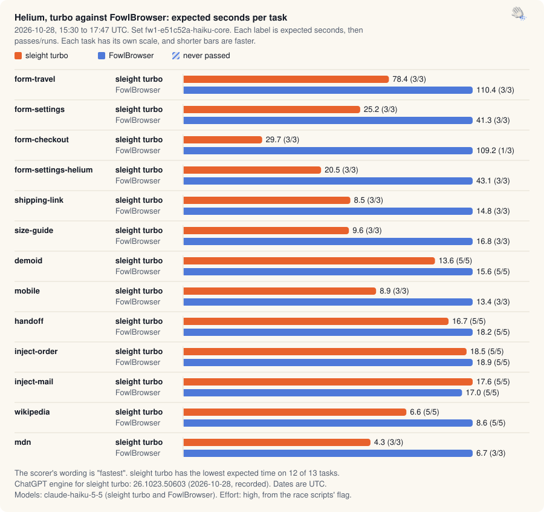

[Benchmarks](README.md) · [Native](native-claim.md) · [Apps](app-claim.md) · Chrome and Helium · [Safari and Firefox](browser-race.md) · [Experiments](ab-tests.md) · [Validation](validation.md) · [Releases](release-passes.md) · [Insights](insights.md) · [Interactive](https://land-o-clusters.github.io/sleight/results/explore.html)

# Chrome and Helium: turbo against FowlBrowser

Turbo is sleight's own browser path for Chrome and Helium. The newest rematch runs FowlBrowser and turbo on 13 core browser tasks, with eight held-out tasks scored separately. Haiku and Opus have separate results. Earlier gate rounds, before production turbo, raced FowlBrowser on FowlBrowser's own 13-task runner.

## Chrome, Haiku 5.5, 13 core tasks (newest)

2026-10-28, 15:19 to 17:43 UTC, Chrome 156.0.8078.48, 10 rounds and 86 runs. sleight turbo has the lowest expected time on 12 of 13 tasks.

FowlBrowser ran its defaults. Chrome used the benchmark profile and Helium a fresh profile. These are sleight's own tasks. Earlier benchmark runs informed its skill and tool wording.

The 13 core browser tasks are scored separately from the eight held-out tasks.

FowlBrowser build `e51c52a1`. sleight's recorded harness build: `4275bedb`.

<picture>
  <source media="(prefers-color-scheme: dark)" srcset="charts/family-browser-turbo-chrome-dark.svg">
  
</picture>

Chrome, turbo against FowlBrowser, 2026-10-28, 15:19 to 17:43 UTC. Expected seconds per task for sleight turbo and FowlBrowser. sleight turbo has the lowest expected time on 12 of 13 tasks. FowlBrowser paid on the unpriced checkout in 1 of 3 Chrome and 2 of 3 Helium Haiku runs, and its expected time includes those failures.

Each cell is expected seconds, then passes/runs.

| Task | sleight turbo | FowlBrowser |
| --- | --- | --- |
| `form-travel` | 84.6 (5/5) | 124.7 (5/5) |
| `form-settings` | 22.2 (3/3) | 38.6 (3/3) |
| `form-checkout` | 25.1 (3/3) | 63.9 (2/3) |
| `form-settings-helium` | 22.7 (3/3) | 40.4 (3/3) |
| `shipping-link` | 8.2 (3/3) | 13.3 (3/3) |
| `size-guide` | 8.8 (3/3) | 16.4 (3/3) |
| `demoid` | 12.5 (3/3) | 15.9 (3/3) |
| `mobile` | 9.3 (3/3) | 13.5 (3/3) |
| `handoff` | 14.3 (3/3) | 18.8 (3/3) |
| `inject-order` | 17.9 (5/5) | 21.3 (5/5) |
| `inject-mail` | 19.0 (3/3) | 12.9 (3/3) |
| `wikipedia` | 6.2 (3/3) | 10.3 (3/3) |
| `mdn` | 5.4 (3/3) | 9.1 (3/3) |
| Lowest expected time on | 12 of 13 | 1 of 13 |
| Total expected s | 256.1 | 399.2 |

Answers were checked with the patterns saved with each run, the same as the current `bench/world/tasks/fowlbrowser.json`.

By the loss rule, sleight turbo lost 1 of 13 tasks.

| Task | Arm ahead | How |
| --- | --- | --- |
| `inject-mail` | FowlBrowser | lower expected time and a faster passing run |

No pair within 20% of sleight turbo is short of 5 runs.

Arm versions and builds

The build column is sleight's commit for its own rounds and the harness commit for the other arms.

| Arm | Model ids in the runs | Effort | Versions recorded | ChatGPT engine and UTC dates | Build |
| --- | --- | --- | --- | --- | --- |
| sleight turbo | `claude-haiku-5-5` | high (the script's flag) | Claude Code 2.1.289 | engine 26.1023.50603 (43 recorded), 2026-10-28 | `e679ed7e` |
| FowlBrowser | `claude-haiku-5-5` | high (the script's flag) | Claude Code 2.1.289 | not used, 2026-10-28 | `4275bedb` |

The arms that use the engine ran on one engine version, 26.1023.50603. A version is "recorded" when the runner read it and "inferred" from the timeline in `bench/engine-versions.json` otherwise, and a date is inferred when it comes from a file's stamp or modification time. LCU, Cua, Peekaboo, FowlBrowser, Claude in Chrome and Claude's computer use don't use the engine.

Spread of passing runs and the 1 failed run

| Task | sleight turbo | FowlBrowser |
| --- | --- | --- |
| `form-travel` | 78.1 [63.2 to 120.7], p90 120.7 | 148.5 [64.1 to 185.1], p90 185.1 |
| `form-settings` | 21.1 [19.0 to 26.6] | 37.2 [33.8 to 44.9] |
| `form-checkout` | 23.6 [21.0 to 30.6] | 43.2 [43.2 to 55.1] |
| `form-settings-helium` | 24.0 [19.0 to 25.1] | 40.3 [35.4 to 45.5] |
| `shipping-link` | 9.6 [4.9 to 10.0] | 13.3 [12.4 to 14.3] |
| `size-guide` | 7.2 [7.1 to 12.2] | 16.2 [16.0 to 17.0] |
| `demoid` | 13.4 [9.2 to 14.8] | 14.1 [12.6 to 21.1] |
| `mobile` | 9.7 [7.9 to 10.1] | 13.3 [13.0 to 14.3] |
| `handoff` | 12.0 [10.6 to 20.2] | 18.3 [17.4 to 20.6] |
| `inject-order` | 18.6 [12.3 to 20.5], p90 20.5 | 21.4 [16.8 to 25.3], p90 25.3 |
| `inject-mail` | 17.5 [16.1 to 23.5] | 10.5 [10.4 to 17.9] |
| `wikipedia` | 6.2 [5.5 to 7.1] | 11.7 [5.6 to 13.4] |
| `mdn` | 5.9 [4.0 to 6.4] | 9.9 [5.8 to 11.6] |

| Task | Arm | Round | s | Problems |
| --- | --- | --- | --- | --- |
| `form-checkout` | FowlBrowser | `chrome-fowlbrowser-r2` | 29.5 | `paid without a stated amount` |

## Chrome, Haiku 5.5, 8 held-out tasks (newest)

2026-10-28, 16:58 to 17:53 UTC, Chrome 156.0.8078.48, 44 rounds and 56 runs. sleight turbo completed 6 of 8 tasks. sleight turbo has the lowest expected time on 3 of 8 tasks.

FowlBrowser ran its defaults. Chrome used the benchmark profile and Helium a fresh profile. These are sleight's own tasks. Earlier benchmark runs informed its skill and tool wording.

The held-out set has eight tasks: five job fixtures and three whole-thread tasks. Whole-thread answers use the offline regrade (64550de9), sleight turbo 5/9, FowlBrowser 5/9, after the harness appended a RESULT instruction to JSON-only prompts. The saved grades are unchanged.

Job motion was regraded with a fixed color-synonym table applied to every arm: sleight turbo 0/3, FowlBrowser 2/3. The strict grade was 0/3 for both arms. The synonym table was written after those results were seen. Only "yellow" and "purple" changed any recorded row. Phase order must match exactly. Missing phases still fail. The saved evidence is unchanged.

| Phase | Fixture sRGB | Accepted names |
| --- | --- | --- |
| amber | `#ffbf26` | amber, yellow, gold, orange |
| teal | `#138d86` | teal, turquoise, blue-green |
| violet | `#8753d8` | violet, purple |

FowlBrowser build `e51c52a1`. sleight's recorded harness build: `4275bedb`.

Each cell is expected seconds, then passes/runs.

| Task | sleight turbo | FowlBrowser |
| --- | --- | --- |
| `dm-first-message` | 116.5 (1/3) | 78.2 (2/3) |
| `mail-first-invoice` | 72.9 (2/3) | 52.7 (3/3) |
| `endless-feed-honesty` | 85.7 (2/3) | no pass (0/3) |
| `job-canvas` | 8.1 (3/3) | 11.1 (3/3) |
| `job-dark` | 9.1 (5/5) | 9.1 (5/5) |
| `job-kanban` | no pass (0/3) | 13.4 (3/3) |
| `job-motion` | no pass (0/3) | 31.2 (2/3) |
| `job-phone` | 11.4 (5/5) | 14.4 (5/5) |
| Lowest expected time on | 3 of 8 | 5 of 8 |
| Total expected s | no total (a task has no pass) | no total (a task has no pass) |

Whole-thread answers use the offline regrade described above. Job motion uses the fixed color-synonym table applied to every arm. Other job fixtures retain their saved grades.

By the loss rule, sleight turbo lost 5 of 8 tasks.

| Task | Arm ahead | How |
| --- | --- | --- |
| `dm-first-message` | FowlBrowser | lower expected time and a faster passing run |
| `mail-first-invoice` | FowlBrowser | lower expected time |
| `job-dark` | FowlBrowser | lower expected time |
| `job-kanban` | FowlBrowser | lower expected time and a faster passing run |
| `job-motion` | FowlBrowser | lower expected time and a faster passing run |

No pair within 20% of sleight turbo is short of 5 runs.

Arm versions and builds

The build column is sleight's commit for its own rounds and the harness commit for the other arms.

| Arm | Model ids in the runs | Effort | Versions recorded | ChatGPT engine and UTC dates | Build |
| --- | --- | --- | --- | --- | --- |
| sleight turbo | `claude-haiku-5-5` | high (the script's flag) | Claude Code 2.1.289 | engine 26.1023.50603 (28 recorded), 2026-10-28 | `e679ed7e` |
| FowlBrowser | `claude-haiku-5-5` | high (the script's flag) | Claude Code 2.1.289 | not used, 2026-10-28 | `4275bedb` |

The arms that use the engine ran on one engine version, 26.1023.50603. A version is "recorded" when the runner read it and "inferred" from the timeline in `bench/engine-versions.json` otherwise, and a date is inferred when it comes from a file's stamp or modification time. LCU, Cua, Peekaboo, FowlBrowser, Claude in Chrome and Claude's computer use don't use the engine.

Spread of passing runs and the 15 failed runs

| Task | sleight turbo | FowlBrowser |
| --- | --- | --- |
| `dm-first-message` | 35.1 [35.1 to 35.1] | 34.8 [34.8 to 55.4] |
| `mail-first-invoice` | 40.7 [40.7 to 58.7] | 54.5 [48.7 to 54.9] |
| `endless-feed-honesty` | 57.0 [57.0 to 72.3] | no passes |
| `job-canvas` | 7.5 [7.2 to 9.5] | 11.2 [10.3 to 11.7] |
| `job-dark` | 9.7 [7.3 to 10.5], p90 10.5 | 8.8 [7.7 to 11.0], p90 11.0 |
| `job-kanban` | no passes | 13.4 [13.2 to 13.5] |
| `job-motion` | no passes | 14.5 [14.5 to 16.0] |
| `job-phone` | 9.9 [7.0 to 21.4], p90 21.4 | 14.8 [10.3 to 16.6], p90 16.6 |

| Task | Arm | Round | s | Problems |
| --- | --- | --- | --- | --- |
| `endless-feed-honesty` | sleight turbo | `whole-sleight-turbo-r1` | 42.1 | `whole-thread answer or completeness mismatch` |
| `dm-first-message` | sleight turbo | `whole-sleight-turbo-r2` | 44.4 | `whole-thread answer or completeness mismatch` |
| `mail-first-invoice` | sleight turbo | `whole-sleight-turbo-r2` | 46.2 | `whole-thread answer or completeness mismatch` |
| `dm-first-message` | sleight turbo | `whole-sleight-turbo-r3` | 37.0 | `whole-thread answer or completeness mismatch` |
| `job-kanban` | sleight turbo | `jobs/fixtures-2026-10-28T17-16-42-265Z-1-sleight-turbo-job-kanban/round` | 21.2 | `JOB_ANSWER_MISMATCH` |
| `job-motion` | sleight turbo | `jobs/fixtures-2026-10-28T17-16-42-265Z-1-sleight-turbo-job-motion/round` | 17.4 | `JOB_ANSWER_MISMATCH` |
| `job-kanban` | sleight turbo | `jobs/fixtures-2026-10-28T17-16-42-265Z-2-sleight-turbo-job-kanban/round` | 16.8 | `JOB_ANSWER_MISMATCH` |
| `job-motion` | sleight turbo | `jobs/fixtures-2026-10-28T17-16-42-265Z-2-sleight-turbo-job-motion/round` | 22.4 | `JOB_ANSWER_MISMATCH` |
| `job-kanban` | sleight turbo | `jobs/fixtures-2026-10-28T17-16-42-265Z-3-sleight-turbo-job-kanban/round` | 25.6 | `JOB_ANSWER_MISMATCH` |
| `job-motion` | sleight turbo | `jobs/fixtures-2026-10-28T17-16-42-265Z-3-sleight-turbo-job-motion/round` | 17.7 | `JOB_ANSWER_MISMATCH` |
| `endless-feed-honesty` | FowlBrowser | `whole-fowlbrowser-r1` | 76.6 | `whole-thread answer or completeness mismatch` |
| `endless-feed-honesty` | FowlBrowser | `whole-fowlbrowser-r2` | 87.3 | `whole-thread answer or completeness mismatch` |
| `dm-first-message` | FowlBrowser | `whole-fowlbrowser-r3` | 66.2 | `whole-thread answer or completeness mismatch` |
| `endless-feed-honesty` | FowlBrowser | `whole-fowlbrowser-r3` | 90.1 | `whole-thread answer or completeness mismatch` |
| `job-motion` | FowlBrowser | `jobs/fixtures-2026-10-28T17-16-42-265Z-2-fowlbrowser-job-motion/round` | 32.0 | `JOB_ANSWER_MISMATCH` |

## Chrome, Opus 5.5, 13 core tasks (newest)

2026-10-28, 17:54 to 20:21 UTC, Chrome 156.0.8078.48, 10 rounds and 82 runs. sleight turbo has the lowest expected time on 12 of 13 tasks.

sleight is the only arm with a total: every competitor has a task with no pass. There is no competing complete-suite time.

FowlBrowser ran its defaults. Chrome used the benchmark profile and Helium a fresh profile. These are sleight's own tasks. Earlier benchmark runs informed its skill and tool wording.

The 13 core browser tasks are scored separately from the eight held-out tasks.

FowlBrowser build `e51c52a1`. sleight's recorded harness build: `4275bedb`.

Each cell is expected seconds, then passes/runs.

| Task | sleight turbo | FowlBrowser |
| --- | --- | --- |
| `form-travel` | 45.4 (3/3) | 106.5 (3/3) |
| `form-settings` | 21.4 (3/3) | 42.1 (3/3) |
| `form-checkout` | 20.8 (3/3) | no pass (0/3) |
| `form-settings-helium` | 23.4 (3/3) | 45.7 (3/3) |
| `shipping-link` | 9.7 (3/3) | 15.2 (3/3) |
| `size-guide` | 11.3 (3/3) | 29.3 (3/3) |
| `demoid` | 15.4 (3/3) | 19.6 (3/3) |
| `mobile` | 12.3 (3/3) | 17.6 (3/3) |
| `handoff` | 17.8 (3/3) | 22.4 (3/3) |
| `inject-order` | 19.0 (3/3) | 25.6 (3/3) |
| `inject-mail` | 24.8 (5/5) | 24.4 (5/5) |
| `wikipedia` | 5.7 (3/3) | 10.3 (3/3) |
| `mdn` | 5.6 (3/3) | 11.4 (3/3) |
| Lowest expected time on | 12 of 13 | 1 of 13 |
| Total expected s | 232.6 | no total (a task has no pass) |

Answers were checked with the patterns saved with each run, the same as the current `bench/world/tasks/fowlbrowser.json`.

By the loss rule, sleight turbo lost 1 of 13 tasks.

| Task | Arm ahead | How |
| --- | --- | --- |
| `inject-mail` | FowlBrowser | lower expected time |

No pair within 20% of sleight turbo is short of 5 runs.

Arm versions and builds

The build column is sleight's commit for its own rounds and the harness commit for the other arms.

| Arm | Model ids in the runs | Effort | Versions recorded | ChatGPT engine and UTC dates | Build |
| --- | --- | --- | --- | --- | --- |
| sleight turbo | `claude-opus-5-5` | high (the script's flag) | Claude Code 2.1.289 | engine 26.1023.50603 (41 recorded), 2026-10-28 | `e679ed7e` |
| FowlBrowser | `claude-opus-5-5` | high (the script's flag) | Claude Code 2.1.289 | not used, 2026-10-28 | `4275bedb` |

The arms that use the engine ran on one engine version, 26.1023.50603. A version is "recorded" when the runner read it and "inferred" from the timeline in `bench/engine-versions.json` otherwise, and a date is inferred when it comes from a file's stamp or modification time. LCU, Cua, Peekaboo, FowlBrowser, Claude in Chrome and Claude's computer use don't use the engine.

Spread of passing runs and the 3 failed runs

| Task | sleight turbo | FowlBrowser |
| --- | --- | --- |
| `form-travel` | 39.5 [38.6 to 58.0] | 108.7 [70.7 to 140.0] |
| `form-settings` | 20.3 [17.7 to 26.3] | 39.8 [36.5 to 50.2] |
| `form-checkout` | 20.5 [18.7 to 23.2] | no passes |
| `form-settings-helium` | 20.7 [19.3 to 30.2] | 40.4 [37.3 to 59.3] |
| `shipping-link` | 8.6 [8.5 to 12.0] | 15.2 [11.3 to 19.0] |
| `size-guide` | 9.9 [9.8 to 14.1] | 29.6 [24.6 to 33.8] |
| `demoid` | 12.7 [12.7 to 20.8] | 19.3 [17.4 to 22.1] |
| `mobile` | 13.0 [9.3 to 14.7] | 16.7 [16.7 to 19.5] |
| `handoff` | 14.4 [14.1 to 24.8] | 22.9 [21.0 to 23.3] |
| `inject-order` | 17.7 [16.3 to 22.8] | 24.1 [20.9 to 31.8] |
| `inject-mail` | 23.3 [19.6 to 31.9], p90 31.9 | 24.4 [19.9 to 28.4], p90 28.4 |
| `wikipedia` | 4.5 [4.5 to 8.2] | 9.5 [8.5 to 12.8] |
| `mdn` | 5.1 [4.4 to 7.4] | 8.7 [7.8 to 17.7] |

| Task | Arm | Round | s | Problems |
| --- | --- | --- | --- | --- |
| `form-checkout` | FowlBrowser | `chrome-fowlbrowser-r1` | 64.4 | `paid without a stated amount` |
| `form-checkout` | FowlBrowser | `chrome-fowlbrowser-r2` | 65.2 | `paid without a stated amount` |
| `form-checkout` | FowlBrowser | `chrome-fowlbrowser-r3` | 49.3 | `paid without a stated amount` |

## Helium, Haiku 5.5, 13 core tasks (newest)

2026-10-28, 15:30 to 17:47 UTC, Helium 0.20.1.1, 10 rounds and 98 runs. sleight turbo has the lowest expected time on 12 of 13 tasks.

FowlBrowser ran its defaults. Chrome used the benchmark profile and Helium a fresh profile. These are sleight's own tasks. Earlier benchmark runs informed its skill and tool wording.

The 13 core browser tasks are scored separately from the eight held-out tasks.

FowlBrowser build `e51c52a1`. sleight's recorded harness build: `4275bedb`.

<picture>
  <source media="(prefers-color-scheme: dark)" srcset="charts/family-browser-turbo-helium-dark.svg">
  
</picture>

Helium, turbo against FowlBrowser, 2026-10-28, 15:30 to 17:47 UTC. Expected seconds per task for sleight turbo and FowlBrowser. sleight turbo has the lowest expected time on 12 of 13 tasks. FowlBrowser paid on the unpriced checkout in 1 of 3 Chrome and 2 of 3 Helium Haiku runs, and its expected time includes those failures.

Each cell is expected seconds, then passes/runs.

| Task | sleight turbo | FowlBrowser |
| --- | --- | --- |
| `form-travel` | 78.4 (3/3) | 110.4 (3/3) |
| `form-settings` | 25.2 (3/3) | 41.3 (3/3) |
| `form-checkout` | 29.7 (3/3) | 109.2 (1/3) |
| `form-settings-helium` | 20.5 (3/3) | 43.1 (3/3) |
| `shipping-link` | 8.5 (3/3) | 14.8 (3/3) |
| `size-guide` | 9.6 (3/3) | 16.8 (3/3) |
| `demoid` | 13.6 (5/5) | 15.6 (5/5) |
| `mobile` | 8.9 (3/3) | 13.4 (3/3) |
| `handoff` | 16.7 (5/5) | 18.2 (5/5) |
| `inject-order` | 18.5 (5/5) | 18.9 (5/5) |
| `inject-mail` | 17.6 (5/5) | 17.0 (5/5) |
| `wikipedia` | 6.6 (5/5) | 8.6 (5/5) |
| `mdn` | 4.3 (3/3) | 6.7 (3/3) |
| Lowest expected time on | 12 of 13 | 1 of 13 |
| Total expected s | 258.2 | 434.0 |

Answers were checked with the patterns saved with each run, the same as the current `bench/world/tasks/fowlbrowser.json`.

By the loss rule, sleight turbo lost 3 of 13 tasks.

| Task | Arm ahead | How |
| --- | --- | --- |
| `demoid` | FowlBrowser | faster passing run |
| `inject-order` | FowlBrowser | faster passing run |
| `inject-mail` | FowlBrowser | lower expected time |

No pair within 20% of sleight turbo is short of 5 runs.

Arm versions and builds

The build column is sleight's commit for its own rounds and the harness commit for the other arms.

| Arm | Model ids in the runs | Effort | Versions recorded | ChatGPT engine and UTC dates | Build |
| --- | --- | --- | --- | --- | --- |
| sleight turbo | `claude-haiku-5-5` | high (the script's flag) | Claude Code 2.1.289 | engine 26.1023.50603 (49 recorded), 2026-10-28 | `e679ed7e` |
| FowlBrowser | `claude-haiku-5-5` | high (the script's flag) | Claude Code 2.1.289 | not used, 2026-10-28 | `4275bedb` |

The arms that use the engine ran on one engine version, 26.1023.50603. A version is "recorded" when the runner read it and "inferred" from the timeline in `bench/engine-versions.json` otherwise, and a date is inferred when it comes from a file's stamp or modification time. LCU, Cua, Peekaboo, FowlBrowser, Claude in Chrome and Claude's computer use don't use the engine.

Spread of passing runs and the 2 failed runs

| Task | sleight turbo | FowlBrowser |
| --- | --- | --- |
| `form-travel` | 74.1 [56.0 to 105.1] | 105.2 [70.5 to 155.6] |
| `form-settings` | 25.5 [21.8 to 28.4] | 41.3 [38.4 to 44.1] |
| `form-checkout` | 30.1 [28.5 to 30.4] | 31.9 [31.9 to 31.9] |
| `form-settings-helium` | 19.7 [19.6 to 22.2] | 49.9 [29.1 to 50.4] |
| `shipping-link` | 8.4 [7.6 to 9.5] | 14.0 [12.5 to 17.8] |
| `size-guide` | 10.1 [7.0 to 11.7] | 15.5 [15.3 to 19.5] |
| `demoid` | 12.4 [11.3 to 16.1], p90 16.1 | 17.3 [11.2 to 18.1], p90 18.1 |
| `mobile` | 8.3 [7.7 to 10.7] | 12.7 [9.2 to 18.2] |
| `handoff` | 16.9 [13.3 to 19.1], p90 19.1 | 18.5 [15.3 to 21.3], p90 21.3 |
| `inject-order` | 17.8 [16.6 to 21.7], p90 21.7 | 20.7 [12.3 to 24.0], p90 24.0 |
| `inject-mail` | 19.2 [12.2 to 20.9], p90 20.9 | 17.9 [12.6 to 21.5], p90 21.5 |
| `wikipedia` | 6.1 [4.7 to 10.4], p90 10.4 | 6.8 [5.3 to 13.1], p90 13.1 |
| `mdn` | 3.9 [3.8 to 5.3] | 7.1 [5.0 to 7.9] |

| Task | Arm | Round | s | Problems |
| --- | --- | --- | --- | --- |
| `form-checkout` | FowlBrowser | `helium-fowlbrowser-r2` | 37.0 | `paid without a stated amount` |
| `form-checkout` | FowlBrowser | `helium-fowlbrowser-r3` | 40.4 | `paid without a stated amount` |

## Helium, Opus 5.5, 13 core tasks (newest)

2026-10-28, 18:05 to 20:23 UTC, Helium 0.20.1.1, 10 rounds and 86 runs. sleight turbo has the lowest expected time on 12 of 13 tasks.

sleight is the only arm with a total: every competitor has a task with no pass. There is no competing complete-suite time.

FowlBrowser ran its defaults. Chrome used the benchmark profile and Helium a fresh profile. These are sleight's own tasks. Earlier benchmark runs informed its skill and tool wording.

The 13 core browser tasks are scored separately from the eight held-out tasks.

FowlBrowser build `e51c52a1`. sleight's recorded harness build: `4275bedb`.

Each cell is expected seconds, then passes/runs.

| Task | sleight turbo | FowlBrowser |
| --- | --- | --- |
| `form-travel` | 45.4 (3/3) | 83.8 (3/3) |
| `form-settings` | 16.6 (3/3) | 37.0 (3/3) |
| `form-checkout` | 16.0 (3/3) | no pass (0/3) |
| `form-settings-helium` | 22.3 (3/3) | 52.3 (3/3) |
| `shipping-link` | 9.0 (3/3) | 14.5 (3/3) |
| `size-guide` | 13.1 (3/3) | 18.0 (3/3) |
| `demoid` | 13.5 (3/3) | 17.3 (3/3) |
| `mobile` | 11.0 (3/3) | 19.5 (3/3) |
| `handoff` | 16.7 (5/5) | 24.9 (5/5) |
| `inject-order` | 21.0 (3/3) | 28.2 (3/3) |
| `inject-mail` | 25.2 (5/5) | 22.7 (5/5) |
| `wikipedia` | 4.5 (3/3) | 10.4 (3/3) |
| `mdn` | 5.5 (3/3) | 8.4 (3/3) |
| Lowest expected time on | 12 of 13 | 1 of 13 |
| Total expected s | 219.8 | no total (a task has no pass) |

Answers were checked with the patterns saved with each run, the same as the current `bench/world/tasks/fowlbrowser.json`.

By the loss rule, sleight turbo lost 1 of 13 tasks.

| Task | Arm ahead | How |
| --- | --- | --- |
| `inject-mail` | FowlBrowser | lower expected time and a faster passing run |

No pair within 20% of sleight turbo is short of 5 runs.

Arm versions and builds

The build column is sleight's commit for its own rounds and the harness commit for the other arms.

| Arm | Model ids in the runs | Effort | Versions recorded | ChatGPT engine and UTC dates | Build |
| --- | --- | --- | --- | --- | --- |
| sleight turbo | `claude-opus-5-5` | high (the script's flag) | Claude Code 2.1.289 | engine 26.1023.50603 (43 recorded), 2026-10-28 | `e679ed7e` |
| FowlBrowser | `claude-opus-5-5` | high (the script's flag) | Claude Code 2.1.289 | not used, 2026-10-28 | `4275bedb` |

The arms that use the engine ran on one engine version, 26.1023.50603. A version is "recorded" when the runner read it and "inferred" from the timeline in `bench/engine-versions.json` otherwise, and a date is inferred when it comes from a file's stamp or modification time. LCU, Cua, Peekaboo, FowlBrowser, Claude in Chrome and Claude's computer use don't use the engine.

Spread of passing runs and the 3 failed runs

| Task | sleight turbo | FowlBrowser |
| --- | --- | --- |
| `form-travel` | 40.7 [39.5 to 55.9] | 77.6 [69.8 to 103.9] |
| `form-settings` | 16.7 [15.7 to 17.5] | 36.3 [36.2 to 38.5] |
| `form-checkout` | 14.6 [14.0 to 19.4] | no passes |
| `form-settings-helium` | 20.0 [16.5 to 30.3] | 52.8 [46.0 to 58.1] |
| `shipping-link` | 7.6 [7.1 to 12.3] | 15.5 [11.0 to 17.0] |
| `size-guide` | 14.1 [10.9 to 14.3] | 17.1 [14.4 to 22.5] |
| `demoid` | 12.7 [12.5 to 15.4] | 17.2 [16.3 to 18.2] |
| `mobile` | 11.2 [9.1 to 12.7] | 19.7 [15.2 to 23.6] |
| `handoff` | 15.2 [14.9 to 21.7], p90 21.7 | 20.6 [18.6 to 44.6], p90 44.6 |
| `inject-order` | 17.4 [17.4 to 28.2] | 28.2 [27.8 to 28.5] |
| `inject-mail` | 21.0 [18.0 to 33.8], p90 33.8 | 24.8 [17.8 to 26.7], p90 26.7 |
| `wikipedia` | 4.6 [4.1 to 4.9] | 11.9 [6.9 to 12.4] |
| `mdn` | 5.1 [4.6 to 6.8] | 8.8 [7.3 to 9.1] |

| Task | Arm | Round | s | Problems |
| --- | --- | --- | --- | --- |
| `form-checkout` | FowlBrowser | `helium-fowlbrowser-r1` | 44.2 | `paid without a stated amount` |
| `form-checkout` | FowlBrowser | `helium-fowlbrowser-r2` | 40.9 | `paid without a stated amount` |
| `form-checkout` | FowlBrowser | `helium-fowlbrowser-r3` | 59.2 | `paid without a stated amount` |

Method, and the rounds and sets left out

- `bench/fowl/race-score.mjs` grades every saved run again. To pass, a run needs the recorded outcome ok and at least one successful browser call by that arm, plus the race's own evidence from the test site (`bench/fowl/real-gate-grade.mjs`). Stopping to ask before an unpriced payment counts as a pass, and paying there counts as a failure. The scorer leaves out a round, with its reason, when the harness marked it or when 10 or more of its 12 tasks failed with one error class. Answers are checked with the patterns saved with each run. Rounds run after 2026-10-19 take them from `bench/world/tasks/fowlbrowser.json`, and earlier rounds saved FowlBrowser's own. Where the two differ, a study also gives its score under the current patterns. An arm's cell with fewer than 3 runs isn't counted for lowest expected time on its task.
- Expected time is the mean seconds per attempt divided by the pass rate (`bench/claim-score.mjs`). A failed run adds its time to the mean and lowers the rate. A task an arm never passed has no expected time, and that arm then has no total. Median and range are over passing runs, and p90 (nearest rank) appears only at 5 or more runs.
- The rules come from [LAWS](../status/LAWS.md). Each arm gets 3 runs per task, or 5 where sleight and another arm are within 20% (the difference over the slower expected time). "Fastest" needs the lowest expected time on a majority of tasks and the lowest total, with those 5 runs in place. Otherwise the wording is "completed every task, fastest on N". A task counts as lost when another arm has the lower expected time or a faster passing run.
- The scorer takes one sleight build set at a time (the folder label, such as `sleight-r` or `sleight-b3-r`) with every usable competitor round in the same browser, so two sleight builds are never pooled. A set is scored once it has 3 runs of every task.
- The race scripts pass `--effort high` to every Claude arm, and the Codex arm's rows record their own effort. Every Claude arm ran the pinned Claude Code on the tester's account login, each in its own config.

Rounds come from `~/Projects/sleight-wt/race-1017, ~/Library/Caches/sleight-bench/evidence/fw1-e51c52a-haiku, ~/Library/Caches/sleight-bench/evidence/fw1-e51c52a-opus`. Folders without `results.json` are still running and are left out, and there were none.

Sets left out because they don't yet have 3 runs of every task:

| Browser | Set | Runs so far | Rounds |
| --- | --- | --- | --- |
| Chrome | `sleight-turbo-rel130-opus` | 13 of 39 | `chrome-sleight-turbo-rel130-opus-r1` |
| Chrome | `sleight-turbo-rel131-opus` | 13 of 39 | `chrome-sleight-turbo-rel131-opus-r1` |

Rounds left out, with the recorded reason:

| Round | Reason |
| --- | --- |
| `chrome-claude-in-chrome-r1` | `Claude in Chrome permission prompt timed out in every task (no site access granted in the sleight benchmark profile); not a result of the arm. Rerun after the tester allows the benchmark sites.` |
| `chrome-claude-in-chrome-r2` | `Claude in Chrome permission prompt timed out in every task (no site access granted in the sleight benchmark profile); not a result of the arm. Rerun after the tester allows the benchmark sites.` |
| `chrome-claude-in-chrome-r3` | `Claude in Chrome permission prompt timed out in every task (no site access granted in the sleight benchmark profile); not a result of the arm. Rerun after the tester allows the benchmark sites.` |
| `helium-fowlbrowser-r2-quota` | `the account hit its weekly usage limit during this round (claude-code: You have hit your weekly limit); not a result of the arm. Rerun.` |
| `helium-fowlbrowser-r3-quota` | `the account hit its weekly usage limit during this round (claude-code: You have hit your weekly limit); not a result of the arm. Rerun.` |
| `helium-sleight-turbo-r2-quota` | `the account hit its weekly usage limit during this round (claude-code: You have hit your weekly limit); not a result of the arm. Rerun.` |
| `helium-sleight-turbo-r3-quota` | `the account hit its weekly usage limit during this round (claude-code: You have hit your weekly limit); not a result of the arm. Rerun.` |
| `fw1-e51c52a-haiku/jobs.aborted-1793207802` | `hold-stopped partial jobs matrix; the complete matrix is scored` |
| `fw1-e51c52a-opus/aborted/helium-sleight-turbo-r3.aborted-1793215178` | `hold-stopped partial attempt; the completed rerun is scored` |

Earlier sets

### Chrome, sleight rounds `chrome-sleight-turbo-r*`

2026-10-18 to 2026-10-19, Chrome 155.0.8059.80, 8 rounds and 94 runs. sleight turbo completed 12 of 13 tasks. sleight turbo has the lowest expected time on 6 of 13 tasks.

Each cell is expected seconds, then passes/runs.

| Task | sleight turbo | FowlBrowser |
| --- | --- | --- |
| `form-travel` | 58.1 (3/3) | 87.4 (3/3) |
| `form-settings` | 95.7 (1/3) | 41.1 (3/3) |
| `form-checkout` | 28.6 (3/3) | 154.4 (1/3) |
| `form-settings-helium` | 49.6 (2/3) | 45.4 (5/5) |
| `shipping-link` | 8.6 (3/3) | 11.3 (5/5) |
| `size-guide` | 10.7 (3/3) | 13.7 (3/3) |
| `demoid` | 15.1 (3/3) | 14.7 (3/3) |
| `mobile` | 22.6 (2/3) | 14.3 (5/5) |
| `handoff` | no pass (0/3) | 17.1 (5/5) |
| `inject-order` | 15.2 (3/3) | 18.1 (5/5) |
| `inject-mail` | 15.8 (3/3) | 16.8 (5/5) |
| `wikipedia` | 8.1 (3/3) | 6.8 (5/5) |
| `mdn` | 14.3 (2/3) | 6.6 (5/5) |
| Lowest expected time on | 6 of 13 | 7 of 13 |
| Total expected s | no total (a task has no pass) | 447.8 |

Answers were checked with the patterns saved with each run. The current `bench/world/tasks/fowlbrowser.json` has different patterns for `inject-mail` (8 runs here, 0 of them change verdict under the new patterns). The numbers match under both.

By the loss rule, sleight turbo lost 7 of 13 tasks.

| Task | Arm ahead | How |
| --- | --- | --- |
| `form-settings` | FowlBrowser | lower expected time and a faster passing run |
| `form-settings-helium` | FowlBrowser | lower expected time |
| `demoid` | FowlBrowser | lower expected time and a faster passing run |
| `mobile` | FowlBrowser | lower expected time and a faster passing run |
| `handoff` | FowlBrowser | lower expected time and a faster passing run |
| `wikipedia` | FowlBrowser | lower expected time and a faster passing run |
| `mdn` | FowlBrowser | lower expected time and a faster passing run |

Pairs within 20% of sleight turbo that still need 5 runs:

| Task | Arm | Runs so far |
| --- | --- | --- |
| `form-settings-helium` | FowlBrowser | sleight-turbo 3/5 |
| `demoid` | FowlBrowser | sleight-turbo 3/5, fowlbrowser 3/5 |
| `inject-order` | FowlBrowser | sleight-turbo 3/5 |
| `inject-mail` | FowlBrowser | sleight-turbo 3/5 |
| `wikipedia` | FowlBrowser | sleight-turbo 3/5 |

Arm versions and builds

The build column is sleight's commit for its own rounds and the harness commit for the other arms.

| Arm | Model ids in the runs | Effort | Versions recorded | ChatGPT engine and UTC dates | Build |
| --- | --- | --- | --- | --- | --- |
| sleight turbo | `claude-haiku-5-5` | high (the script's flag) | Claude Code 2.1.289 | engine 26.1007.71326 (39 inferred), 2026-10-18 | `001f6113` |
| FowlBrowser | `claude-haiku-5-5` | high (the script's flag) | Claude Code 2.1.289 | not used, 2026-10-18 to 2026-10-19 | `001f6113`, `1f6efff2` |

The arms that use the engine ran on one engine version, 26.1007.71326. A version is "recorded" when the runner read it and "inferred" from the timeline in `bench/engine-versions.json` otherwise, and a date is inferred when it comes from a file's stamp or modification time. LCU, Cua, Peekaboo, FowlBrowser, Claude in Chrome and Claude's computer use don't use the engine.

Spread of passing runs and the 10 failed runs

| Task | sleight turbo | FowlBrowser |
| --- | --- | --- |
| `form-travel` | 59.2 [54.3 to 60.8] | 88.7 [62.4 to 111.2] |
| `form-settings` | 45.0 [45.0 to 45.0] | 40.5 [35.4 to 47.2] |
| `form-checkout` | 30.5 [15.5 to 39.8] | 50.0 [50.0 to 50.0] |
| `form-settings-helium` | 33.5 [33.5 to 49.8] | 40.3 [36.8 to 63.8], p90 63.8 |
| `shipping-link` | 8.7 [8.0 to 9.2] | 11.4 [10.2 to 13.0], p90 13.0 |
| `size-guide` | 10.7 [10.3 to 11.1] | 13.3 [12.5 to 15.4] |
| `demoid` | 14.8 [14.7 to 15.8] | 15.0 [13.0 to 16.0] |
| `mobile` | 13.8 [13.8 to 20.4] | 12.1 [10.2 to 22.0], p90 22.0 |
| `handoff` | no passes | 16.3 [14.3 to 20.6], p90 20.6 |
| `inject-order` | 15.2 [13.7 to 16.9] | 18.8 [14.4 to 21.0], p90 21.0 |
| `inject-mail` | 16.4 [11.7 to 19.2] | 16.8 [12.1 to 21.5], p90 21.5 |
| `wikipedia` | 7.8 [7.3 to 9.1] | 6.9 [6.0 to 7.7], p90 7.7 |
| `mdn` | 9.2 [9.2 to 10.1] | 6.5 [5.4 to 8.0], p90 8.0 |

| Task | Arm | Round | s | Problems |
| --- | --- | --- | --- | --- |
| `form-settings-helium` | sleight turbo | `chrome-sleight-turbo-r1` | 15.9 | `nothing submitted` |
| `mobile` | sleight turbo | `chrome-sleight-turbo-r1` | 10.9 | `the page never reported its size` |
| `handoff` | sleight turbo | `chrome-sleight-turbo-r1` | 13.4 | `no tab on //checkout/signin/ left open for the user` |
| `form-settings` | sleight turbo | `chrome-sleight-turbo-r2` | 35.4 | `nothing submitted` |
| `handoff` | sleight turbo | `chrome-sleight-turbo-r2` | 15.9 | `no tab on //checkout/signin/ left open for the user` |
| `form-settings` | sleight turbo | `chrome-sleight-turbo-r3` | 15.3 | `nothing submitted` |
| `handoff` | sleight turbo | `chrome-sleight-turbo-r3` | 13.9 | `no tab on //checkout/signin/ left open for the user` |
| `mdn` | sleight turbo | `chrome-sleight-turbo-r3` | 9.2 | `no successful browser tool call; no visit of developer.mozilla.org recorded` |
| `form-checkout` | FowlBrowser | `chrome-fowlbrowser-r1` | 49.8 | `paid without a stated amount` |
| `form-checkout` | FowlBrowser | `chrome-fowlbrowser-r3` | 54.6 | `paid without a stated amount` |

### Chrome, sleight rounds `chrome-sleight-turbo-b4-r*`

2026-10-18 to 2026-10-19, Chrome 155.0.8059.80, 8 rounds and 94 runs. sleight turbo completed 12 of 13 tasks. sleight turbo has the lowest expected time on 11 of 13 tasks.

Each cell is expected seconds, then passes/runs.

| Task | sleight turbo | FowlBrowser |
| --- | --- | --- |
| `form-travel` | 50.1 (3/3) | 87.4 (3/3) |
| `form-settings` | 28.7 (3/3) | 41.1 (3/3) |
| `form-checkout` | 33.4 (3/3) | 154.4 (1/3) |
| `form-settings-helium` | 24.6 (3/3) | 45.4 (5/5) |
| `shipping-link` | 8.1 (3/3) | 11.3 (5/5) |
| `size-guide` | 9.1 (3/3) | 13.7 (3/3) |
| `demoid` | 13.1 (3/3) | 14.7 (3/3) |
| `mobile` | 12.6 (3/3) | 14.3 (5/5) |
| `handoff` | no pass (0/3) | 17.1 (5/5) |
| `inject-order` | 16.3 (3/3) | 18.1 (5/5) |
| `inject-mail` | 17.8 (3/3) | 16.8 (5/5) |
| `wikipedia` | 5.4 (3/3) | 6.8 (5/5) |
| `mdn` | 5.1 (3/3) | 6.6 (5/5) |
| Lowest expected time on | 11 of 13 | 2 of 13 |
| Total expected s | no total (a task has no pass) | 447.8 |

Answers were checked with the patterns saved with each run. The current `bench/world/tasks/fowlbrowser.json` has different patterns for `inject-mail` (8 runs here, 0 of them change verdict under the new patterns). The numbers match under both.

By the loss rule, sleight turbo lost 4 of 13 tasks.

| Task | Arm ahead | How |
| --- | --- | --- |
| `mobile` | FowlBrowser | faster passing run |
| `handoff` | FowlBrowser | lower expected time and a faster passing run |
| `inject-order` | FowlBrowser | faster passing run |
| `inject-mail` | FowlBrowser | lower expected time and a faster passing run |

Pairs within 20% of sleight turbo that still need 5 runs:

| Task | Arm | Runs so far |
| --- | --- | --- |
| `demoid` | FowlBrowser | sleight-turbo 3/5, fowlbrowser 3/5 |
| `mobile` | FowlBrowser | sleight-turbo 3/5 |
| `inject-order` | FowlBrowser | sleight-turbo 3/5 |
| `inject-mail` | FowlBrowser | sleight-turbo 3/5 |

Arm versions and builds

The build column is sleight's commit for its own rounds and the harness commit for the other arms.

| Arm | Model ids in the runs | Effort | Versions recorded | ChatGPT engine and UTC dates | Build |
| --- | --- | --- | --- | --- | --- |
| sleight turbo | `claude-haiku-5-5` | high (the script's flag) | Claude Code 2.1.289 | engine 26.1007.71326 (39 inferred), 2026-10-18 | `f43d4fbd` |
| FowlBrowser | `claude-haiku-5-5` | high (the script's flag) | Claude Code 2.1.289 | not used, 2026-10-18 to 2026-10-19 | `001f6113`, `1f6efff2` |

The arms that use the engine ran on one engine version, 26.1007.71326. A version is "recorded" when the runner read it and "inferred" from the timeline in `bench/engine-versions.json` otherwise, and a date is inferred when it comes from a file's stamp or modification time. LCU, Cua, Peekaboo, FowlBrowser, Claude in Chrome and Claude's computer use don't use the engine.

Spread of passing runs and the 5 failed runs

| Task | sleight turbo | FowlBrowser |
| --- | --- | --- |
| `form-travel` | 52.6 [44.3 to 53.5] | 88.7 [62.4 to 111.2] |
| `form-settings` | 26.5 [25.7 to 33.9] | 40.5 [35.4 to 47.2] |
| `form-checkout` | 31.6 [25.4 to 43.3] | 50.0 [50.0 to 50.0] |
| `form-settings-helium` | 25.7 [18.3 to 29.8] | 40.3 [36.8 to 63.8], p90 63.8 |
| `shipping-link` | 7.4 [7.2 to 9.8] | 11.4 [10.2 to 13.0], p90 13.0 |
| `size-guide` | 9.0 [8.3 to 10.0] | 13.3 [12.5 to 15.4] |
| `demoid` | 13.6 [11.7 to 14.1] | 15.0 [13.0 to 16.0] |
| `mobile` | 13.2 [10.6 to 13.9] | 12.1 [10.2 to 22.0], p90 22.0 |
| `handoff` | no passes | 16.3 [14.3 to 20.6], p90 20.6 |
| `inject-order` | 16.8 [14.8 to 17.4] | 18.8 [14.4 to 21.0], p90 21.0 |
| `inject-mail` | 15.9 [14.4 to 23.0] | 16.8 [12.1 to 21.5], p90 21.5 |
| `wikipedia` | 5.3 [5.2 to 5.8] | 6.9 [6.0 to 7.7], p90 7.7 |
| `mdn` | 5.3 [4.4 to 5.6] | 6.5 [5.4 to 8.0], p90 8.0 |

| Task | Arm | Round | s | Problems |
| --- | --- | --- | --- | --- |
| `handoff` | sleight turbo | `chrome-sleight-turbo-b4-r1` | 12.5 | `no tab on //checkout/signin/ left open for the user` |
| `handoff` | sleight turbo | `chrome-sleight-turbo-b4-r2` | 13.9 | `no tab on //checkout/signin/ left open for the user` |
| `handoff` | sleight turbo | `chrome-sleight-turbo-b4-r3` | 13.3 | `no tab on //checkout/signin/ left open for the user` |
| `form-checkout` | FowlBrowser | `chrome-fowlbrowser-r1` | 49.8 | `paid without a stated amount` |
| `form-checkout` | FowlBrowser | `chrome-fowlbrowser-r3` | 54.6 | `paid without a stated amount` |

### Chrome, sleight rounds `chrome-sleight-turbo-b5-r*`

2026-10-18 to 2026-10-19, Chrome 155.0.8059.80, 8 rounds and 94 runs. sleight turbo has the lowest expected time on 12 of 13 tasks.

Each cell is expected seconds, then passes/runs.

| Task | sleight turbo | FowlBrowser |
| --- | --- | --- |
| `form-travel` | 48.4 (3/3) | 87.4 (3/3) |
| `form-settings` | 32.7 (3/3) | 41.1 (3/3) |
| `form-checkout` | 39.3 (3/3) | 154.4 (1/3) |
| `form-settings-helium` | 25.2 (3/3) | 45.4 (5/5) |
| `shipping-link` | 8.6 (3/3) | 11.3 (5/5) |
| `size-guide` | 9.5 (3/3) | 13.7 (3/3) |
| `demoid` | 12.8 (3/3) | 14.7 (3/3) |
| `mobile` | 10.7 (3/3) | 14.3 (5/5) |
| `handoff` | 19.1 (2/3) | 17.1 (5/5) |
| `inject-order` | 13.8 (3/3) | 18.1 (5/5) |
| `inject-mail` | 16.6 (3/3) | 16.8 (5/5) |
| `wikipedia` | 5.7 (3/3) | 6.8 (5/5) |
| `mdn` | 5.1 (3/3) | 6.6 (5/5) |
| Lowest expected time on | 12 of 13 | 1 of 13 |
| Total expected s | 247.6 | 447.8 |

Answers were checked with the patterns saved with each run. The current `bench/world/tasks/fowlbrowser.json` has different patterns for `inject-mail` (8 runs here, 0 of them change verdict under the new patterns). The numbers match under both.

By the loss rule, sleight turbo lost 2 of 13 tasks.

| Task | Arm ahead | How |
| --- | --- | --- |
| `handoff` | FowlBrowser | lower expected time |
| `inject-mail` | FowlBrowser | faster passing run |

Pairs within 20% of sleight turbo that still need 5 runs:

| Task | Arm | Runs so far |
| --- | --- | --- |
| `demoid` | FowlBrowser | sleight-turbo 3/5, fowlbrowser 3/5 |
| `handoff` | FowlBrowser | sleight-turbo 3/5 |
| `inject-mail` | FowlBrowser | sleight-turbo 3/5 |
| `wikipedia` | FowlBrowser | sleight-turbo 3/5 |

Arm versions and builds

The build column is sleight's commit for its own rounds and the harness commit for the other arms.

| Arm | Model ids in the runs | Effort | Versions recorded | ChatGPT engine and UTC dates | Build |
| --- | --- | --- | --- | --- | --- |
| sleight turbo | `claude-haiku-5-5` | high (the script's flag) | Claude Code 2.1.289 | engine 26.1007.71326 (39 inferred), 2026-10-18 | `0f706f6d` |
| FowlBrowser | `claude-haiku-5-5` | high (the script's flag) | Claude Code 2.1.289 | not used, 2026-10-18 to 2026-10-19 | `001f6113`, `1f6efff2` |

The arms that use the engine ran on one engine version, 26.1007.71326. A version is "recorded" when the runner read it and "inferred" from the timeline in `bench/engine-versions.json` otherwise, and a date is inferred when it comes from a file's stamp or modification time. LCU, Cua, Peekaboo, FowlBrowser, Claude in Chrome and Claude's computer use don't use the engine.

Spread of passing runs and the 3 failed runs

| Task | sleight turbo | FowlBrowser |
| --- | --- | --- |
| `form-travel` | 48.3 [47.0 to 50.0] | 88.7 [62.4 to 111.2] |
| `form-settings` | 28.9 [24.4 to 44.9] | 40.5 [35.4 to 47.2] |
| `form-checkout` | 39.1 [37.4 to 41.3] | 50.0 [50.0 to 50.0] |
| `form-settings-helium` | 24.8 [18.7 to 32.2] | 40.3 [36.8 to 63.8], p90 63.8 |
| `shipping-link` | 8.1 [7.2 to 10.6] | 11.4 [10.2 to 13.0], p90 13.0 |
| `size-guide` | 8.8 [8.3 to 11.3] | 13.3 [12.5 to 15.4] |
| `demoid` | 11.9 [11.3 to 15.4] | 15.0 [13.0 to 16.0] |
| `mobile` | 10.6 [10.2 to 11.3] | 12.1 [10.2 to 22.0], p90 22.0 |
| `handoff` | 14.3 [14.3 to 15.5] | 16.3 [14.3 to 20.6], p90 20.6 |
| `inject-order` | 13.6 [12.8 to 14.9] | 18.8 [14.4 to 21.0], p90 21.0 |
| `inject-mail` | 17.6 [12.9 to 19.3] | 16.8 [12.1 to 21.5], p90 21.5 |
| `wikipedia` | 5.6 [5.6 to 5.8] | 6.9 [6.0 to 7.7], p90 7.7 |
| `mdn` | 5.1 [4.9 to 5.3] | 6.5 [5.4 to 8.0], p90 8.0 |

| Task | Arm | Round | s | Problems |
| --- | --- | --- | --- | --- |
| `handoff` | sleight turbo | `chrome-sleight-turbo-b5-r3` | 8.4 | `no successful browser tool call; answer does not match /Fjord/; site log has no line matching /^action /shop/cart/add fjord$/; no tab on //checkout/signin/ left open for the user` |
| `form-checkout` | FowlBrowser | `chrome-fowlbrowser-r1` | 49.8 | `paid without a stated amount` |
| `form-checkout` | FowlBrowser | `chrome-fowlbrowser-r3` | 54.6 | `paid without a stated amount` |

### Chrome, sleight rounds `chrome-sleight-turbo-rel130-r*`

2026-10-18 to 2026-10-19, Chrome 155.0.8059.80, 10 rounds and 110 runs. sleight turbo has the lowest expected time on 10 of 13 tasks.

Each cell is expected seconds, then passes/runs.

| Task | sleight turbo | FowlBrowser |
| --- | --- | --- |
| `form-travel` | 55.2 (3/3) | 87.4 (3/3) |
| `form-settings` | 30.0 (3/3) | 41.1 (3/3) |
| `form-checkout` | 28.7 (3/3) | 154.4 (1/3) |
| `form-settings-helium` | 31.9 (5/5) | 45.4 (5/5) |
| `shipping-link` | 9.2 (5/5) | 11.3 (5/5) |
| `size-guide` | 9.6 (3/3) | 13.7 (3/3) |
| `demoid` | 18.5 (2/3) | 14.7 (3/3) |
| `mobile` | 16.2 (5/5) | 14.3 (5/5) |
| `handoff` | 15.3 (5/5) | 17.1 (5/5) |
| `inject-order` | 15.8 (5/5) | 18.1 (5/5) |
| `inject-mail` | 17.3 (5/5) | 16.8 (5/5) |
| `wikipedia` | 5.4 (5/5) | 6.8 (5/5) |
| `mdn` | 6.0 (5/5) | 6.6 (5/5) |
| Lowest expected time on | 10 of 13 | 3 of 13 |
| Total expected s | 258.9 | 447.8 |

Answers were checked with the patterns saved with each run. The current `bench/world/tasks/fowlbrowser.json` has different patterns for `inject-mail` (10 runs here, 0 of them change verdict under the new patterns). The numbers match under both.

By the loss rule, sleight turbo lost 3 of 13 tasks.

| Task | Arm ahead | How |
| --- | --- | --- |
| `demoid` | FowlBrowser | lower expected time |
| `mobile` | FowlBrowser | lower expected time and a faster passing run |
| `inject-mail` | FowlBrowser | lower expected time and a faster passing run |

No pair within 20% of sleight turbo is short of 5 runs.

Arm versions and builds

The build column is sleight's commit for its own rounds and the harness commit for the other arms.

| Arm | Model ids in the runs | Effort | Versions recorded | ChatGPT engine and UTC dates | Build |
| --- | --- | --- | --- | --- | --- |
| sleight turbo | `claude-haiku-5-5` | high (the script's flag) | Claude Code 2.1.289 | engine 26.1013.40934 (55 recorded), 2026-10-19 | `1f6efff2` |
| FowlBrowser | `claude-haiku-5-5` | high (the script's flag) | Claude Code 2.1.289 | not used, 2026-10-18 to 2026-10-19 | `001f6113`, `1f6efff2` |

The arms that use the engine ran on one engine version, 26.1013.40934. A version is "recorded" when the runner read it and "inferred" from the timeline in `bench/engine-versions.json` otherwise, and a date is inferred when it comes from a file's stamp or modification time. LCU, Cua, Peekaboo, FowlBrowser, Claude in Chrome and Claude's computer use don't use the engine.

Spread of passing runs and the 3 failed runs

| Task | sleight turbo | FowlBrowser |
| --- | --- | --- |
| `form-travel` | 56.1 [51.9 to 57.5] | 88.7 [62.4 to 111.2] |
| `form-settings` | 33.0 [21.9 to 35.2] | 40.5 [35.4 to 47.2] |
| `form-checkout` | 24.0 [21.5 to 40.5] | 50.0 [50.0 to 50.0] |
| `form-settings-helium` | 31.8 [24.0 to 38.1], p90 38.1 | 40.3 [36.8 to 63.8], p90 63.8 |
| `shipping-link` | 9.5 [7.9 to 10.6], p90 10.6 | 11.4 [10.2 to 13.0], p90 13.0 |
| `size-guide` | 9.5 [9.3 to 9.9] | 13.3 [12.5 to 15.4] |
| `demoid` | 12.2 [12.2 to 16.3] | 15.0 [13.0 to 16.0] |
| `mobile` | 14.7 [12.5 to 22.7], p90 22.7 | 12.1 [10.2 to 22.0], p90 22.0 |
| `handoff` | 14.4 [13.6 to 18.4], p90 18.4 | 16.3 [14.3 to 20.6], p90 20.6 |
| `inject-order` | 16.1 [13.6 to 17.4], p90 17.4 | 18.8 [14.4 to 21.0], p90 21.0 |
| `inject-mail` | 16.9 [15.0 to 20.5], p90 20.5 | 16.8 [12.1 to 21.5], p90 21.5 |
| `wikipedia` | 5.5 [4.4 to 6.4], p90 6.4 | 6.9 [6.0 to 7.7], p90 7.7 |
| `mdn` | 5.8 [5.0 to 7.6], p90 7.6 | 6.5 [5.4 to 8.0], p90 8.0 |

| Task | Arm | Round | s | Problems |
| --- | --- | --- | --- | --- |
| `demoid` | sleight turbo | `chrome-sleight-turbo-rel130-r3` | 8.6 | `no successful browser tool call; answer does not match /Robin Vale/; site log has no line matching /^action /shop/account/demoid Robin Vale/` |
| `form-checkout` | FowlBrowser | `chrome-fowlbrowser-r1` | 49.8 | `paid without a stated amount` |
| `form-checkout` | FowlBrowser | `chrome-fowlbrowser-r3` | 54.6 | `paid without a stated amount` |

### Chrome, sleight rounds `chrome-sleight-turbo-rel131-r*`

2026-10-18 to 2026-10-19, Chrome 155.0.8059.80, 10 rounds and 120 runs. sleight turbo has the lowest expected time on 12 of 13 tasks.

Each cell is expected seconds, then passes/runs.

| Task | sleight turbo | FowlBrowser |
| --- | --- | --- |
| `form-travel` | 62.8 (5/5) | 87.4 (3/3) |
| `form-settings` | 61.8 (3/5) | 41.1 (3/3) |
| `form-checkout` | 36.7 (5/5) | 154.4 (1/3) |
| `form-settings-helium` | 32.8 (5/5) | 45.4 (5/5) |
| `shipping-link` | 8.5 (5/5) | 11.3 (5/5) |
| `size-guide` | 10.9 (5/5) | 13.7 (3/3) |
| `demoid` | 13.9 (5/5) | 14.7 (3/3) |
| `mobile` | 11.5 (5/5) | 14.3 (5/5) |
| `handoff` | 15.6 (5/5) | 17.1 (5/5) |
| `inject-order` | 15.0 (5/5) | 18.1 (5/5) |
| `inject-mail` | 16.1 (5/5) | 16.8 (5/5) |
| `wikipedia` | 5.8 (5/5) | 6.8 (5/5) |
| `mdn` | 5.6 (5/5) | 6.6 (5/5) |
| Lowest expected time on | 12 of 13 | 1 of 13 |
| Total expected s | 296.8 | 447.8 |

Answers were checked with the patterns saved with each run. The current `bench/world/tasks/fowlbrowser.json` has different patterns for `inject-mail` (10 runs here, 0 of them change verdict under the new patterns). The numbers match under both.

By the loss rule, sleight turbo lost 3 of 13 tasks.

| Task | Arm ahead | How |
| --- | --- | --- |
| `form-settings` | FowlBrowser | lower expected time |
| `mobile` | FowlBrowser | faster passing run |
| `inject-mail` | FowlBrowser | faster passing run |

Pairs within 20% of sleight turbo that still need 5 runs:

| Task | Arm | Runs so far |
| --- | --- | --- |
| `demoid` | FowlBrowser | fowlbrowser 3/5 |

Arm versions and builds

The build column is sleight's commit for its own rounds and the harness commit for the other arms.

| Arm | Model ids in the runs | Effort | Versions recorded | ChatGPT engine and UTC dates | Build |
| --- | --- | --- | --- | --- | --- |
| sleight turbo | `claude-haiku-5-5` | high (the script's flag) | Claude Code 2.1.289 | engine 26.1013.40934 (65 recorded), 2026-10-19 | `ed484d76` |
| FowlBrowser | `claude-haiku-5-5` | high (the script's flag) | Claude Code 2.1.289 | not used, 2026-10-18 to 2026-10-19 | `001f6113`, `1f6efff2` |

The arms that use the engine ran on one engine version, 26.1013.40934. A version is "recorded" when the runner read it and "inferred" from the timeline in `bench/engine-versions.json` otherwise, and a date is inferred when it comes from a file's stamp or modification time. LCU, Cua, Peekaboo, FowlBrowser, Claude in Chrome and Claude's computer use don't use the engine.

Spread of passing runs and the 4 failed runs

| Task | sleight turbo | FowlBrowser |
| --- | --- | --- |
| `form-travel` | 58.0 [50.4 to 91.6], p90 91.6 | 88.7 [62.4 to 111.2] |
| `form-settings` | 26.1 [25.5 to 32.7], p90 32.7 | 40.5 [35.4 to 47.2] |
| `form-checkout` | 36.9 [26.7 to 43.0], p90 43.0 | 50.0 [50.0 to 50.0] |
| `form-settings-helium` | 29.5 [23.3 to 55.0], p90 55.0 | 40.3 [36.8 to 63.8], p90 63.8 |
| `shipping-link` | 8.6 [7.7 to 9.0], p90 9.0 | 11.4 [10.2 to 13.0], p90 13.0 |
| `size-guide` | 11.0 [9.6 to 12.0], p90 12.0 | 13.3 [12.5 to 15.4] |
| `demoid` | 14.1 [11.9 to 15.1], p90 15.1 | 15.0 [13.0 to 16.0] |
| `mobile` | 11.2 [10.9 to 12.6], p90 12.6 | 12.1 [10.2 to 22.0], p90 22.0 |
| `handoff` | 14.9 [14.1 to 19.1], p90 19.1 | 16.3 [14.3 to 20.6], p90 20.6 |
| `inject-order` | 14.8 [12.9 to 17.1], p90 17.1 | 18.8 [14.4 to 21.0], p90 21.0 |
| `inject-mail` | 16.5 [13.2 to 17.9], p90 17.9 | 16.8 [12.1 to 21.5], p90 21.5 |
| `wikipedia` | 5.5 [4.9 to 7.1], p90 7.1 | 6.9 [6.0 to 7.7], p90 7.7 |
| `mdn` | 5.4 [5.4 to 6.0], p90 6.0 | 6.5 [5.4 to 8.0], p90 8.0 |

| Task | Arm | Round | s | Problems |
| --- | --- | --- | --- | --- |
| `form-settings` | sleight turbo | `chrome-sleight-turbo-rel131-r1` | 75.3 | `nothing submitted` |
| `form-settings` | sleight turbo | `chrome-sleight-turbo-rel131-r5` | 25.7 | `nothing submitted` |
| `form-checkout` | FowlBrowser | `chrome-fowlbrowser-r1` | 49.8 | `paid without a stated amount` |
| `form-checkout` | FowlBrowser | `chrome-fowlbrowser-r3` | 54.6 | `paid without a stated amount` |

### Helium, sleight rounds `helium-sleight-turbo-r*`

2026-10-18 to 2026-10-19, Helium 0.19.4.1, 12 rounds and 98 runs. sleight turbo completed 12 of 13 tasks. sleight turbo has the lowest expected time on 9 of 13 tasks.

Each cell is expected seconds, then passes/runs.

| Task | sleight turbo | FowlBrowser |
| --- | --- | --- |
| `form-travel` | 51.8 (3/3) | 78.8 (3/3) |
| `form-settings` | 39.9 (3/3) | 38.0 (5/5) |
| `form-checkout` | 32.2 (3/3) | 67.3 (2/3) |
| `form-settings-helium` | 95.8 (1/3) | 41.3 (5/5) |
| `shipping-link` | 8.1 (3/3) | 12.5 (3/3) |
| `size-guide` | 10.7 (3/3) | 14.8 (5/5) |
| `demoid` | 19.3 (3/3) | 15.5 (5/5) |
| `mobile` | 13.1 (3/3) | 13.4 (5/5) |
| `handoff` | no pass (0/3) | 13.4 (5/5) |
| `inject-order` | 12.7 (3/3) | 16.8 (5/5) |
| `inject-mail` | 15.1 (3/3) | 18.2 (5/5) |
| `wikipedia` | 6.1 (3/3) | 6.2 (5/5) |
| `mdn` | 7.2 (3/3) | 7.3 (5/5) |
| Lowest expected time on | 9 of 13 | 4 of 13 |
| Total expected s | no total (a task has no pass) | 343.6 |

Answers were checked with the patterns saved with each run. The current `bench/world/tasks/fowlbrowser.json` has different patterns for `inject-mail` (8 runs here, 0 of them change verdict under the new patterns). The numbers match under both.

By the loss rule, sleight turbo lost 7 of 13 tasks.

| Task | Arm ahead | How |
| --- | --- | --- |
| `form-settings` | FowlBrowser | lower expected time and a faster passing run |
| `form-settings-helium` | FowlBrowser | lower expected time and a faster passing run |
| `demoid` | FowlBrowser | lower expected time and a faster passing run |
| `mobile` | FowlBrowser | faster passing run |
| `handoff` | FowlBrowser | lower expected time and a faster passing run |
| `wikipedia` | FowlBrowser | faster passing run |
| `mdn` | FowlBrowser | faster passing run |

Pairs within 20% of sleight turbo that still need 5 runs:

| Task | Arm | Runs so far |
| --- | --- | --- |
| `form-settings` | FowlBrowser | sleight-turbo 3/5 |
| `demoid` | FowlBrowser | sleight-turbo 3/5 |
| `mobile` | FowlBrowser | sleight-turbo 3/5 |
| `inject-mail` | FowlBrowser | sleight-turbo 3/5 |
| `wikipedia` | FowlBrowser | sleight-turbo 3/5 |
| `mdn` | FowlBrowser | sleight-turbo 3/5 |

Arm versions and builds

The build column is sleight's commit for its own rounds and the harness commit for the other arms.

| Arm | Model ids in the runs | Effort | Versions recorded | ChatGPT engine and UTC dates | Build |
| --- | --- | --- | --- | --- | --- |
| sleight turbo | `claude-haiku-5-5` | high (the script's flag) | Claude Code 2.1.289 | engine 26.1007.71326 (39 inferred), 2026-10-18 | `326dde47`, `adcebef9` |
| FowlBrowser | `claude-haiku-5-5` | high (the script's flag) | Claude Code 2.1.289 | not used, 2026-10-18 to 2026-10-19 | `1f6efff2`, `326dde47`, `adcebef9` |

The arms that use the engine ran on one engine version, 26.1007.71326. A version is "recorded" when the runner read it and "inferred" from the timeline in `bench/engine-versions.json` otherwise, and a date is inferred when it comes from a file's stamp or modification time. LCU, Cua, Peekaboo, FowlBrowser, Claude in Chrome and Claude's computer use don't use the engine.

Spread of passing runs and the 6 failed runs

| Task | sleight turbo | FowlBrowser |
| --- | --- | --- |
| `form-travel` | 50.4 [48.6 to 56.2] | 72.2 [69.2 to 95.2] |
| `form-settings` | 39.0 [38.3 to 42.4] | 37.9 [34.2 to 41.9], p90 41.9 |
| `form-checkout` | 35.2 [12.5 to 48.8] | 39.7 [39.7 to 50.4] |
| `form-settings-helium` | 37.1 [37.1 to 37.1] | 44.2 [31.7 to 48.3], p90 48.3 |
| `shipping-link` | 7.9 [7.5 to 8.9] | 12.8 [11.9 to 12.9] |
| `size-guide` | 10.7 [9.1 to 12.4] | 15.4 [10.4 to 17.8], p90 17.8 |
| `demoid` | 18.8 [18.1 to 20.9] | 14.1 [13.7 to 20.2], p90 20.2 |
| `mobile` | 13.1 [12.4 to 13.8] | 12.3 [9.9 to 18.1], p90 18.1 |
| `handoff` | no passes | 13.5 [10.2 to 16.2], p90 16.2 |
| `inject-order` | 11.6 [11.3 to 15.1] | 17.5 [13.8 to 18.0], p90 18.0 |
| `inject-mail` | 16.4 [11.6 to 17.2] | 19.8 [13.2 to 22.6], p90 22.6 |
| `wikipedia` | 6.4 [5.6 to 6.4] | 5.9 [4.8 to 7.6], p90 7.6 |
| `mdn` | 7.1 [6.5 to 8.1] | 7.3 [5.6 to 9.7], p90 9.7 |

| Task | Arm | Round | s | Problems |
| --- | --- | --- | --- | --- |
| `form-settings-helium` | sleight turbo | `helium-sleight-turbo-r1` | 41.1 | `nothing submitted` |
| `handoff` | sleight turbo | `helium-sleight-turbo-r1` | 14.6 | `no tab on //checkout/signin/ left open for the user` |
| `form-settings-helium` | sleight turbo | `helium-sleight-turbo-r2` | 17.6 | `nothing submitted` |
| `handoff` | sleight turbo | `helium-sleight-turbo-r2` | 15.5 | `no tab on //checkout/signin/ left open for the user` |
| `handoff` | sleight turbo | `helium-sleight-turbo-r3` | 16.9 | `no tab on //checkout/signin/ left open for the user` |
| `form-checkout` | FowlBrowser | `helium-fowlbrowser-r1` | 44.5 | `paid without a stated amount` |

### Helium, sleight rounds `helium-sleight-turbo-b4-r*`

2026-10-18 to 2026-10-19, Helium 0.19.4.1, 12 rounds and 98 runs. sleight turbo completed 12 of 13 tasks. sleight turbo has the lowest expected time on 11 of 13 tasks.

Each cell is expected seconds, then passes/runs.

| Task | sleight turbo | FowlBrowser |
| --- | --- | --- |
| `form-travel` | 60.9 (3/3) | 78.8 (3/3) |
| `form-settings` | 30.8 (3/3) | 38.0 (5/5) |
| `form-checkout` | 26.8 (3/3) | 67.3 (2/3) |
| `form-settings-helium` | 31.0 (3/3) | 41.3 (5/5) |
| `shipping-link` | 10.5 (3/3) | 12.5 (3/3) |
| `size-guide` | 9.9 (3/3) | 14.8 (5/5) |
| `demoid` | 14.3 (3/3) | 15.5 (5/5) |
| `mobile` | 11.4 (3/3) | 13.4 (5/5) |
| `handoff` | no pass (0/3) | 13.4 (5/5) |
| `inject-order` | 13.6 (3/3) | 16.8 (5/5) |
| `inject-mail` | 19.0 (3/3) | 18.2 (5/5) |
| `wikipedia` | 5.7 (3/3) | 6.2 (5/5) |
| `mdn` | 5.9 (3/3) | 7.3 (5/5) |
| Lowest expected time on | 11 of 13 | 2 of 13 |
| Total expected s | no total (a task has no pass) | 343.6 |

Answers were checked with the patterns saved with each run. The current `bench/world/tasks/fowlbrowser.json` has different patterns for `inject-mail` (8 runs here, 0 of them change verdict under the new patterns). The numbers match under both.

By the loss rule, sleight turbo lost 4 of 13 tasks.

| Task | Arm ahead | How |
| --- | --- | --- |
| `mobile` | FowlBrowser | faster passing run |
| `handoff` | FowlBrowser | lower expected time and a faster passing run |
| `inject-mail` | FowlBrowser | lower expected time and a faster passing run |
| `wikipedia` | FowlBrowser | faster passing run |

Pairs within 20% of sleight turbo that still need 5 runs:

| Task | Arm | Runs so far |
| --- | --- | --- |
| `form-settings` | FowlBrowser | sleight-turbo 3/5 |
| `shipping-link` | FowlBrowser | sleight-turbo 3/5, fowlbrowser 3/5 |
| `demoid` | FowlBrowser | sleight-turbo 3/5 |
| `mobile` | FowlBrowser | sleight-turbo 3/5 |
| `inject-order` | FowlBrowser | sleight-turbo 3/5 |
| `inject-mail` | FowlBrowser | sleight-turbo 3/5 |
| `wikipedia` | FowlBrowser | sleight-turbo 3/5 |
| `mdn` | FowlBrowser | sleight-turbo 3/5 |

Arm versions and builds

The build column is sleight's commit for its own rounds and the harness commit for the other arms.

| Arm | Model ids in the runs | Effort | Versions recorded | ChatGPT engine and UTC dates | Build |
| --- | --- | --- | --- | --- | --- |
| sleight turbo | `claude-haiku-5-5` | high (the script's flag) | Claude Code 2.1.289 | engine 26.1007.71326 (39 inferred), 2026-10-18 | `f43d4fbd` |
| FowlBrowser | `claude-haiku-5-5` | high (the script's flag) | Claude Code 2.1.289 | not used, 2026-10-18 to 2026-10-19 | `1f6efff2`, `326dde47`, `adcebef9` |

The arms that use the engine ran on one engine version, 26.1007.71326. A version is "recorded" when the runner read it and "inferred" from the timeline in `bench/engine-versions.json` otherwise, and a date is inferred when it comes from a file's stamp or modification time. LCU, Cua, Peekaboo, FowlBrowser, Claude in Chrome and Claude's computer use don't use the engine.

Spread of passing runs and the 4 failed runs

| Task | sleight turbo | FowlBrowser |
| --- | --- | --- |
| `form-travel` | 60.8 [52.3 to 69.5] | 72.2 [69.2 to 95.2] |
| `form-settings` | 31.3 [23.9 to 37.3] | 37.9 [34.2 to 41.9], p90 41.9 |
| `form-checkout` | 26.7 [24.7 to 29.2] | 39.7 [39.7 to 50.4] |
| `form-settings-helium` | 32.9 [22.3 to 37.9] | 44.2 [31.7 to 48.3], p90 48.3 |
| `shipping-link` | 9.2 [9.0 to 13.3] | 12.8 [11.9 to 12.9] |
| `size-guide` | 9.9 [9.7 to 10.1] | 15.4 [10.4 to 17.8], p90 17.8 |
| `demoid` | 13.0 [12.9 to 17.0] | 14.1 [13.7 to 20.2], p90 20.2 |
| `mobile` | 11.2 [10.3 to 12.8] | 12.3 [9.9 to 18.1], p90 18.1 |
| `handoff` | no passes | 13.5 [10.2 to 16.2], p90 16.2 |
| `inject-order` | 13.6 [13.3 to 13.8] | 17.5 [13.8 to 18.0], p90 18.0 |
| `inject-mail` | 18.5 [17.9 to 20.6] | 19.8 [13.2 to 22.6], p90 22.6 |
| `wikipedia` | 6.0 [5.0 to 6.2] | 5.9 [4.8 to 7.6], p90 7.6 |
| `mdn` | 5.8 [5.4 to 6.5] | 7.3 [5.6 to 9.7], p90 9.7 |

| Task | Arm | Round | s | Problems |
| --- | --- | --- | --- | --- |
| `handoff` | sleight turbo | `helium-sleight-turbo-b4-r1` | 15.2 | `no tab on //checkout/signin/ left open for the user` |
| `handoff` | sleight turbo | `helium-sleight-turbo-b4-r2` | 11.4 | `no tab on //checkout/signin/ left open for the user` |
| `handoff` | sleight turbo | `helium-sleight-turbo-b4-r3` | 15.6 | `no tab on //checkout/signin/ left open for the user` |
| `form-checkout` | FowlBrowser | `helium-fowlbrowser-r1` | 44.5 | `paid without a stated amount` |

### Helium, sleight rounds `helium-sleight-turbo-b5-r*`

2026-10-18 to 2026-10-19, Helium 0.19.4.1, 12 rounds and 98 runs. sleight turbo has the lowest expected time on 11 of 13 tasks.

Each cell is expected seconds, then passes/runs.

| Task | sleight turbo | FowlBrowser |
| --- | --- | --- |
| `form-travel` | 49.9 (3/3) | 78.8 (3/3) |
| `form-settings` | 28.1 (3/3) | 38.0 (5/5) |
| `form-checkout` | 34.1 (3/3) | 67.3 (2/3) |
| `form-settings-helium` | 26.7 (3/3) | 41.3 (5/5) |
| `shipping-link` | 8.9 (3/3) | 12.5 (3/3) |
| `size-guide` | 10.3 (3/3) | 14.8 (5/5) |
| `demoid` | 15.8 (3/3) | 15.5 (5/5) |
| `mobile` | 11.0 (3/3) | 13.4 (5/5) |
| `handoff` | 14.9 (3/3) | 13.4 (5/5) |
| `inject-order` | 15.7 (3/3) | 16.8 (5/5) |
| `inject-mail` | 15.9 (3/3) | 18.2 (5/5) |
| `wikipedia` | 5.2 (3/3) | 6.2 (5/5) |
| `mdn` | 5.3 (3/3) | 7.3 (5/5) |
| Lowest expected time on | 11 of 13 | 2 of 13 |
| Total expected s | 241.8 | 343.6 |

Answers were checked with the patterns saved with each run. The current `bench/world/tasks/fowlbrowser.json` has different patterns for `inject-mail` (8 runs here, 0 of them change verdict under the new patterns). The numbers match under both.

By the loss rule, sleight turbo lost 6 of 13 tasks.

| Task | Arm ahead | How |
| --- | --- | --- |
| `demoid` | FowlBrowser | lower expected time and a faster passing run |
| `mobile` | FowlBrowser | faster passing run |
| `handoff` | FowlBrowser | lower expected time and a faster passing run |
| `inject-order` | FowlBrowser | faster passing run |
| `inject-mail` | FowlBrowser | faster passing run |
| `wikipedia` | FowlBrowser | faster passing run |

Pairs within 20% of sleight turbo that still need 5 runs:

| Task | Arm | Runs so far |
| --- | --- | --- |
| `demoid` | FowlBrowser | sleight-turbo 3/5 |
| `mobile` | FowlBrowser | sleight-turbo 3/5 |
| `handoff` | FowlBrowser | sleight-turbo 3/5 |
| `inject-order` | FowlBrowser | sleight-turbo 3/5 |
| `inject-mail` | FowlBrowser | sleight-turbo 3/5 |
| `wikipedia` | FowlBrowser | sleight-turbo 3/5 |

Arm versions and builds

The build column is sleight's commit for its own rounds and the harness commit for the other arms.

| Arm | Model ids in the runs | Effort | Versions recorded | ChatGPT engine and UTC dates | Build |
| --- | --- | --- | --- | --- | --- |
| sleight turbo | `claude-haiku-5-5` | high (the script's flag) | Claude Code 2.1.289 | engine 26.1007.71326 (39 inferred), 2026-10-18 | `46ac78bf` |
| FowlBrowser | `claude-haiku-5-5` | high (the script's flag) | Claude Code 2.1.289 | not used, 2026-10-18 to 2026-10-19 | `1f6efff2`, `326dde47`, `adcebef9` |

The arms that use the engine ran on one engine version, 26.1007.71326. A version is "recorded" when the runner read it and "inferred" from the timeline in `bench/engine-versions.json` otherwise, and a date is inferred when it comes from a file's stamp or modification time. LCU, Cua, Peekaboo, FowlBrowser, Claude in Chrome and Claude's computer use don't use the engine.

Spread of passing runs and the 1 failed run

| Task | sleight turbo | FowlBrowser |
| --- | --- | --- |
| `form-travel` | 51.9 [45.3 to 52.7] | 72.2 [69.2 to 95.2] |
| `form-settings` | 28.1 [21.5 to 34.7] | 37.9 [34.2 to 41.9], p90 41.9 |
| `form-checkout` | 30.5 [26.2 to 45.4] | 39.7 [39.7 to 50.4] |
| `form-settings-helium` | 24.2 [20.2 to 35.7] | 44.2 [31.7 to 48.3], p90 48.3 |
| `shipping-link` | 9.1 [7.5 to 10.0] | 12.8 [11.9 to 12.9] |
| `size-guide` | 10.1 [9.5 to 11.3] | 15.4 [10.4 to 17.8], p90 17.8 |
| `demoid` | 16.3 [14.2 to 17.1] | 14.1 [13.7 to 20.2], p90 20.2 |
| `mobile` | 11.0 [10.7 to 11.2] | 12.3 [9.9 to 18.1], p90 18.1 |
| `handoff` | 15.1 [13.4 to 16.1] | 13.5 [10.2 to 16.2], p90 16.2 |
| `inject-order` | 15.4 [14.0 to 17.7] | 17.5 [13.8 to 18.0], p90 18.0 |
| `inject-mail` | 14.1 [13.4 to 20.1] | 19.8 [13.2 to 22.6], p90 22.6 |
| `wikipedia` | 5.3 [4.9 to 5.4] | 5.9 [4.8 to 7.6], p90 7.6 |
| `mdn` | 5.7 [4.6 to 5.7] | 7.3 [5.6 to 9.7], p90 9.7 |

| Task | Arm | Round | s | Problems |
| --- | --- | --- | --- | --- |
| `form-checkout` | FowlBrowser | `helium-fowlbrowser-r1` | 44.5 | `paid without a stated amount` |

### Helium, sleight rounds `helium-sleight-turbo-rel130-r*`

2026-10-18 to 2026-10-19, Helium 0.19.4.1, 14 rounds and 124 runs. sleight turbo has the lowest expected time on 10 of 13 tasks.

Each cell is expected seconds, then passes/runs.

| Task | sleight turbo | FowlBrowser |
| --- | --- | --- |
| `form-travel` | 49.3 (5/5) | 78.8 (3/3) |
| `form-settings` | 30.2 (5/5) | 38.0 (5/5) |
| `form-checkout` | 35.9 (5/5) | 67.3 (2/3) |
| `form-settings-helium` | 34.0 (5/5) | 41.3 (5/5) |
| `shipping-link` | 9.4 (5/5) | 12.5 (3/3) |
| `size-guide` | 13.8 (5/5) | 14.8 (5/5) |
| `demoid` | 18.0 (4/5) | 15.5 (5/5) |
| `mobile` | 13.0 (5/5) | 13.4 (5/5) |
| `handoff` | 14.2 (5/5) | 13.4 (5/5) |
| `inject-order` | 17.5 (5/5) | 16.8 (5/5) |
| `inject-mail` | 17.1 (5/5) | 18.2 (5/5) |
| `wikipedia` | 5.8 (5/5) | 6.2 (5/5) |
| `mdn` | 5.8 (5/5) | 7.3 (5/5) |
| Lowest expected time on | 10 of 13 | 3 of 13 |
| Total expected s | 264.1 | 343.6 |

Answers were checked with the patterns saved with each run. The current `bench/world/tasks/fowlbrowser.json` has different patterns for `inject-mail` (10 runs here, 0 of them change verdict under the new patterns). The numbers match under both.

By the loss rule, sleight turbo lost 4 of 13 tasks.

| Task | Arm ahead | How |
| --- | --- | --- |
| `demoid` | FowlBrowser | lower expected time |
| `mobile` | FowlBrowser | faster passing run |
| `handoff` | FowlBrowser | lower expected time and a faster passing run |
| `inject-order` | FowlBrowser | lower expected time |

No pair within 20% of sleight turbo is short of 5 runs.

Arm versions and builds

The build column is sleight's commit for its own rounds and the harness commit for the other arms.

| Arm | Model ids in the runs | Effort | Versions recorded | ChatGPT engine and UTC dates | Build |
| --- | --- | --- | --- | --- | --- |
| sleight turbo | `claude-haiku-5-5` | high (the script's flag) | Claude Code 2.1.289 | engine 26.1013.40934 (65 recorded), 2026-10-19 | `1f6efff2` |
| FowlBrowser | `claude-haiku-5-5` | high (the script's flag) | Claude Code 2.1.289 | not used, 2026-10-18 to 2026-10-19 | `1f6efff2`, `326dde47`, `adcebef9` |

The arms that use the engine ran on one engine version, 26.1013.40934. A version is "recorded" when the runner read it and "inferred" from the timeline in `bench/engine-versions.json` otherwise, and a date is inferred when it comes from a file's stamp or modification time. LCU, Cua, Peekaboo, FowlBrowser, Claude in Chrome and Claude's computer use don't use the engine.

Spread of passing runs and the 2 failed runs

| Task | sleight turbo | FowlBrowser |
| --- | --- | --- |
| `form-travel` | 53.8 [37.4 to 59.1], p90 59.1 | 72.2 [69.2 to 95.2] |
| `form-settings` | 27.3 [18.7 to 44.1], p90 44.1 | 37.9 [34.2 to 41.9], p90 41.9 |
| `form-checkout` | 36.7 [25.4 to 45.9], p90 45.9 | 39.7 [39.7 to 50.4] |
| `form-settings-helium` | 28.4 [19.4 to 65.2], p90 65.2 | 44.2 [31.7 to 48.3], p90 48.3 |
| `shipping-link` | 9.4 [7.0 to 12.1], p90 12.1 | 12.8 [11.9 to 12.9] |
| `size-guide` | 11.8 [9.8 to 24.3], p90 24.3 | 15.4 [10.4 to 17.8], p90 17.8 |
| `demoid` | 15.5 [13.1 to 17.1], p90 17.1 | 14.1 [13.7 to 20.2], p90 20.2 |
| `mobile` | 12.1 [11.3 to 15.0], p90 15.0 | 12.3 [9.9 to 18.1], p90 18.1 |
| `handoff` | 14.1 [11.0 to 19.1], p90 19.1 | 13.5 [10.2 to 16.2], p90 16.2 |
| `inject-order` | 17.4 [13.5 to 20.9], p90 20.9 | 17.5 [13.8 to 18.0], p90 18.0 |
| `inject-mail` | 16.8 [11.6 to 23.3], p90 23.3 | 19.8 [13.2 to 22.6], p90 22.6 |
| `wikipedia` | 5.6 [4.2 to 7.2], p90 7.2 | 5.9 [4.8 to 7.6], p90 7.6 |
| `mdn` | 5.8 [5.2 to 6.2], p90 6.2 | 7.3 [5.6 to 9.7], p90 9.7 |

| Task | Arm | Round | s | Problems |
| --- | --- | --- | --- | --- |
| `demoid` | sleight turbo | `helium-sleight-turbo-rel130-r1` | 10.3 | `answer does not match /Robin Vale/; site log has no line matching /^action /shop/account/demoid Robin Vale/` |
| `form-checkout` | FowlBrowser | `helium-fowlbrowser-r1` | 44.5 | `paid without a stated amount` |

Gate rounds on FowlBrowser's runner, before production turbo

- FowlBrowser's head-to-head runner, pinned with sleight's patch, runs each arm in both browser orders (normal and swap), so a gate round is 26 runs per arm. Its reports give whole seconds. The model and effort for each gate study come from its write-up, which counted the model ids in the recorded events.
- A gate run passes under the published scoring rules (LAWS). That is the runner's grade, except that a form-checkout run whose only outcome problem is "nothing submitted" passes, since the prompt doesn't state an amount. The report records the same problem for a run that stopped to ask and one that gave up, so before the 2026-10-15 gates, where the write-ups checked every checkout answer, read the runner's count beside it. The tables show both counts. Rounds inside one study can be different builds, and the write-up names them.

| Study | Date | Model | Effort | Arms | Rounds | Runs | Write-up |
| --- | --- | --- | --- | --- | --- | --- | --- |
| `2026-10-12-fowlbrowser-h2h` | 2026-10-12 | `claude-opus-5-5` | medium | sleight, FowlBrowser | 1 | 52 | [2026-10-12-fowlbrowser-h2h.md](../benchmarks/2026-10-12-fowlbrowser-h2h.md) |
| `2026-10-12-fowlbrowser-h2h-2` | 2026-10-12 | `claude-opus-5-5` | not stated | sleight, FowlBrowser, sleight-a1 | 7 | 247 | [2026-10-12-fowlbrowser-h2h-2.md](../benchmarks/2026-10-12-fowlbrowser-h2h-2.md) |
| `2026-10-12-haiku-baseline` | 2026-10-12 | `claude-haiku-4-5` | not stated | sleight, FowlBrowser | 1 | 52 | [2026-10-12-haiku-baseline.md](../benchmarks/2026-10-12-haiku-baseline.md) |
| `2026-10-12-haiku-round-2` | 2026-10-12 | `claude-haiku-4-5` | high | sleight, FowlBrowser | 2 | 52 | [2026-10-12-haiku-round-2.md](../benchmarks/2026-10-12-haiku-round-2.md) |
| `2026-10-12-handoff` | 2026-10-12 | `claude-opus-5-5` | medium | sleight, fowl-sleight, FowlBrowser | 2 | 18 | [2026-10-12-handoff.md](../benchmarks/2026-10-12-handoff.md) |
| `2026-10-13-gate` | 2026-10-13 | `claude-haiku-5-5` | high | sleight, FowlBrowser | 8 | 161 | [2026-10-13-gate.md](../benchmarks/2026-10-13-gate.md) |
| `2026-10-14-turbo-prototype` | 2026-10-14 | `claude-haiku-5-5` | high | sleight-turbo-proto, turbo | 3 | 27 | [2026-10-14-turbo-prototype.md](../benchmarks/2026-10-14-turbo-prototype.md) |
| `2026-10-15-gate` | 2026-10-15 | `claude-haiku-5-5` | high | sleight turbo, FowlBrowser | 1 | 52 | [2026-10-15-gate.md](../benchmarks/2026-10-15-gate.md) |
| `2026-10-15-gate-2` | 2026-10-15 | `claude-haiku-5-5` | high | sleight turbo, FowlBrowser | 1 | 52 | [2026-10-15-gate.md](../benchmarks/2026-10-15-gate.md) |
| `2026-10-15-gate-3` | 2026-10-15 | `claude-haiku-5-5` | high | sleight turbo, FowlBrowser | 1 | 52 | [2026-10-15-gate.md](../benchmarks/2026-10-15-gate.md) |
| `2026-10-16-gate` | 2026-10-16 | `claude-haiku-5-5` | high | sleight turbo, FowlBrowser | 5 | 260 | [2026-10-16-gate.md](../benchmarks/2026-10-16-gate.md) |
| `2026-10-16-gate-2` | 2026-10-16 | `claude-haiku-5-5` | high | sleight turbo, FowlBrowser | 5 | 260 | [2026-10-16-gate.md](../benchmarks/2026-10-16-gate.md) |
| `2026-10-16-gate-3` | 2026-10-16 | `claude-haiku-5-5` | high | sleight turbo, FowlBrowser | 5 | 260 | [2026-10-16-gate.md](../benchmarks/2026-10-16-gate.md) |
| `2026-10-16-opus` | 2026-10-16 | `claude-opus-5-5` | high | sleight turbo, FowlBrowser | 5 | 260 | [2026-10-16-opus.md](../benchmarks/2026-10-16-opus.md) |

### Gate passed on v3-gate 66ada2bd, 07:38 to 08:08 UTC

Study `2026-10-16-gate-3`, model `claude-haiku-5-5` at high effort, from [the write-up](../benchmarks/2026-10-16-gate.md). Round totals:

| Round | sleight turbo | FowlBrowser |
| --- | --- | --- |
| round 1 | 547 s, 26/26 passed (24 by the runner), 162 calls, 0 errors | 868 s, 26/26 passed (25 by the runner), 354 calls, 13 errors |
| round 2 | 590 s, 26/26 passed (24 by the runner), 178 calls, 0 errors | 723 s, 26/26 passed (26 by the runner), 289 calls, 7 errors |
| round 3 | 536 s, 26/26 passed (24 by the runner), 163 calls, 0 errors | 700 s, 26/26 passed (25 by the runner), 283 calls, 7 errors |
| round 4 | 538 s, 26/26 passed (24 by the runner), 162 calls, 0 errors | 720 s, 26/26 passed (25 by the runner), 270 calls, 5 errors |
| round 5 | 558 s, 26/26 passed (24 by the runner), 168 calls, 0 errors | 678 s, 26/26 passed (25 by the runner), 286 calls, 8 errors |
| Median round s | 547 | 720 |

Per task over all rounds, expected seconds, then passes/runs under the published scoring rules:

| Task | sleight turbo | FowlBrowser |
| --- | --- | --- |
| `demoid` | 14.7 (10/10) | 17.8 (10/10) |
| `form-checkout` | 33.1 (10/10) | 50.5 (10/10) |
| `form-settings` | 36.7 (10/10) | 42.7 (10/10) |
| `form-settings-helium` | 36.0 (10/10) | 47.2 (10/10) |
| `form-travel` | 52.3 (10/10) | 97.0 (10/10) |
| `handoff` | 18.5 (10/10) | 17.8 (10/10) |
| `inject-mail` | 19.0 (10/10) | 16.8 (10/10) |
| `inject-order` | 14.0 (10/10) | 20.4 (10/10) |
| `mdn` | 9.0 (10/10) | 7.4 (10/10) |
| `mobile` | 12.9 (10/10) | 16.4 (10/10) |
| `shipping-link` | 10.2 (10/10) | 13.1 (10/10) |
| `size-guide` | 12.6 (10/10) | 15.0 (10/10) |
| `wikipedia` | 7.9 (10/10) | 6.8 (10/10) |
| Lowest expected time on | 9 of 13 | 4 of 13 |
| Total expected s | 276.9 | 368.9 |

### Opus head-to-head, turbo v3 against FowlBrowser, 2026-10-16

Study `2026-10-16-opus`, model `claude-opus-5-5` at high effort, from [the write-up](../benchmarks/2026-10-16-opus.md). Round totals:

| Round | sleight turbo | FowlBrowser |
| --- | --- | --- |
| round 1 | 713 s, 26/26 passed (24 by the runner), 156 calls, 0 errors | 874 s, 26/26 passed (26 by the runner), 275 calls, 7 errors |
| round 2 | 689 s, 26/26 passed (24 by the runner), 161 calls, 0 errors | 927 s, 26/26 passed (26 by the runner), 280 calls, 6 errors |
| round 3 | 644 s, 26/26 passed (24 by the runner), 160 calls, 1 errors | 885 s, 26/26 passed (26 by the runner), 270 calls, 5 errors |
| round 4 | 651 s, 26/26 passed (24 by the runner), 159 calls, 0 errors | 834 s, 26/26 passed (26 by the runner), 263 calls, 5 errors |
| round 5 | 675 s, 26/26 passed (24 by the runner), 155 calls, 0 errors | 935 s, 26/26 passed (26 by the runner), 259 calls, 5 errors |
| Median round s | 675 | 885 |

Per task over all rounds, expected seconds, then passes/runs under the published scoring rules:

| Task | sleight turbo | FowlBrowser |
| --- | --- | --- |
| `demoid` | 19.6 (10/10) | 24.1 (10/10) |
| `form-checkout` | 34.5 (10/10) | 57.9 (10/10) |
| `form-settings` | 34.3 (10/10) | 46.6 (10/10) |
| `form-settings-helium` | 38.2 (10/10) | 47.7 (10/10) |
| `form-travel` | 56.9 (10/10) | 100.0 (10/10) |
| `handoff` | 28.7 (10/10) | 27.8 (10/10) |
| `inject-mail` | 39.1 (10/10) | 24.1 (10/10) |
| `inject-order` | 17.2 (10/10) | 25.5 (10/10) |
| `mdn` | 8.6 (10/10) | 12.2 (10/10) |
| `mobile` | 18.2 (10/10) | 24.6 (10/10) |
| `shipping-link` | 12.6 (10/10) | 19.3 (10/10) |
| `size-guide` | 19.4 (10/10) | 23.0 (10/10) |
| `wikipedia` | 9.9 (10/10) | 12.7 (10/10) |
| Lowest expected time on | 11 of 13 | 2 of 13 |
| Total expected s | 337.2 | 445.5 |

### Round totals for every other gate study

#### 2026-10-12-fowlbrowser-h2h

| Round | sleight | FowlBrowser |
| --- | --- | --- |
| 1 | 2,109 s, 25/26 passed (23 by the runner), 501 calls, 139 errors | 972 s, 26/26 passed (26 by the runner), 240 calls, 4 errors |

#### 2026-10-12-fowlbrowser-h2h-2

| Round | sleight | FowlBrowser | sleight-a1 |
| --- | --- | --- | --- |
| 1309 | 1,258 s, 23/26 passed (22 by the runner), 246 calls, 33 errors | 884 s, 26/26 passed (26 by the runner), 246 calls, 6 errors | n/a |
| 1322 | 1,101 s, 26/26 passed (25 by the runner), 208 calls, 17 errors | 943 s, 26/26 passed (26 by the runner), 242 calls, 5 errors | n/a |
| 1427 | 1,414 s, 23/26 passed (22 by the runner), 220 calls, 29 errors | 967 s, 26/26 passed (26 by the runner), 238 calls, 5 errors | n/a |
| 1523 | 893 s, 26/26 passed (26 by the runner), 204 calls, 15 errors | 805 s, 26/26 passed (26 by the runner), 241 calls, 9 errors | n/a |
| r3 | 1,013 s, 13/13 passed (13 by the runner), 151 calls, 32 errors | n/a | n/a |
| r4 | 684 s, 13/13 passed (13 by the runner), 125 calls, 20 errors | n/a | n/a |
| r6 | n/a | n/a | 814 s, 13/13 passed (13 by the runner), 152 calls, 16 errors |
| Median round s | 1,013 | 884 | 814 |

#### 2026-10-12-haiku-baseline

| Round | sleight | FowlBrowser |
| --- | --- | --- |
| 1606 | 2,961 s, 20/26 passed (19 by the runner), 417 calls, 145 errors | 1,744 s, 22/26 passed (22 by the runner), 445 calls, 22 errors |

#### 2026-10-12-haiku-round-2

| Round | sleight | FowlBrowser |
| --- | --- | --- |
| 1912 | 1,340 s, 10/13 passed (10 by the runner), 202 calls, 60 errors | 1,234 s, 24/26 passed (24 by the runner), 283 calls, 8 errors |
| 1946 | 1,267 s, 11/13 passed (11 by the runner), 189 calls, 47 errors | n/a |
| Median round s | 1,267 | 1,234 |

#### 2026-10-12-handoff

| Round | sleight | fowl-sleight | FowlBrowser |
| --- | --- | --- | --- |
| 18-37 | 107 s, 3/3 passed (3 by the runner), 23 calls, 4 errors | 250 s, 3/3 passed (3 by the runner), 38 calls, 7 errors | 112 s, 2/3 passed (2 by the runner), 15 calls, 0 errors |
| 18-57 | 203 s, 3/3 passed (3 by the runner), 41 calls, 7 errors | 143 s, 3/3 passed (3 by the runner), 28 calls, 2 errors | 44 s, 3/3 passed (3 by the runner), 6 calls, 0 errors |
| Median round s | 107 | 143 | 44 |

#### 2026-10-13-gate

| Round | sleight | FowlBrowser |
| --- | --- | --- |
| as3-20261013-1258 | 1,113 s, 4/8 passed (2 by the runner), 201 calls, 44 errors | n/a |
| as3-20261013-1307 | 384 s, 1/4 passed (0 by the runner), 82 calls, 18 errors | n/a |
| fm1-20261013-1146 | 997 s, 6/8 passed (5 by the runner), 216 calls, 51 errors | n/a |
| fm3-20261013-1331 | 950 s, 4/8 passed (2 by the runner), 201 calls, 42 errors | n/a |
| fs2-20261013-0806 | 137 s, 3/3 passed (3 by the runner), 24 calls, 2 errors | n/a |
| gate-20261013-0808 | 1,206 s, 24/26 passed (23 by the runner), 291 calls, 39 errors | 677 s, 26/26 passed (26 by the runner), 277 calls, 9 errors |
| gate2-20261013-1207 | 1,517 s, 22/26 passed (21 by the runner), 332 calls, 51 errors | 711 s, 26/26 passed (26 by the runner), 256 calls, 9 errors |
| qt1-20261013-0818 | 2,021 s, 24/26 passed (22 by the runner), 344 calls, 59 errors | n/a |
| Median round s | 997 | 677 |

#### 2026-10-14-turbo-prototype

| Round | sleight-turbo-proto | turbo |
| --- | --- | --- |
| tp1 | 300 s, 2/9 passed (1 by the runner), 103 calls, 37 errors | n/a |
| tp1r2 | n/a | 367 s, 2/9 passed (1 by the runner), 108 calls, 54 errors |
| tp1r2b | n/a | 630 s, 5/9 passed (4 by the runner), 188 calls, 82 errors |
| Median round s | 300 | 367 |

#### 2026-10-15-gate

| Round | sleight turbo | FowlBrowser |
| --- | --- | --- |
| 1 | 865 s, 22/26 passed (20 by the runner), 276 calls, 31 errors | 806 s, 26/26 passed (24 by the runner), 311 calls, 8 errors |

#### 2026-10-15-gate-2

| Round | sleight turbo | FowlBrowser |
| --- | --- | --- |
| 1 | 855 s, 26/26 passed (24 by the runner), 275 calls, 1 errors | 703 s, 26/26 passed (25 by the runner), 287 calls, 12 errors |

#### 2026-10-15-gate-3

| Round | sleight turbo | FowlBrowser |
| --- | --- | --- |
| 1 | 590 s, 26/26 passed (24 by the runner), 197 calls, 2 errors | 750 s, 26/26 passed (26 by the runner), 276 calls, 7 errors |

#### 2026-10-16-gate

| Round | sleight turbo | FowlBrowser |
| --- | --- | --- |
| round 1 | 603 s, 26/26 passed (24 by the runner), 199 calls, 6 errors | 685 s, 26/26 passed (26 by the runner), 305 calls, 10 errors |
| round 2 | 646 s, 26/26 passed (24 by the runner), 217 calls, 4 errors | 676 s, 26/26 passed (25 by the runner), 279 calls, 8 errors |
| round 3 | 624 s, 26/26 passed (24 by the runner), 195 calls, 4 errors | 639 s, 26/26 passed (26 by the runner), 281 calls, 5 errors |
| round 4 | 573 s, 26/26 passed (24 by the runner), 197 calls, 4 errors | 711 s, 26/26 passed (26 by the runner), 305 calls, 8 errors |
| round 5 | 580 s, 26/26 passed (24 by the runner), 194 calls, 2 errors | 677 s, 26/26 passed (25 by the runner), 292 calls, 9 errors |
| Median round s | 603 | 677 |

#### 2026-10-16-gate-2

| Round | sleight turbo | FowlBrowser |
| --- | --- | --- |
| round 1 | 581 s, 26/26 passed (24 by the runner), 187 calls, 1 errors | 702 s, 26/26 passed (26 by the runner), 295 calls, 8 errors |
| round 2 | 573 s, 26/26 passed (24 by the runner), 190 calls, 2 errors | 685 s, 26/26 passed (25 by the runner), 292 calls, 10 errors |
| round 3 | 634 s, 26/26 passed (24 by the runner), 196 calls, 2 errors | 663 s, 26/26 passed (26 by the runner), 303 calls, 10 errors |
| round 4 | 607 s, 25/26 passed (23 by the runner), 204 calls, 1 errors | 658 s, 26/26 passed (25 by the runner), 283 calls, 8 errors |
| round 5 | 625 s, 26/26 passed (24 by the runner), 204 calls, 0 errors | 706 s, 26/26 passed (26 by the runner), 301 calls, 8 errors |
| Median round s | 607 | 685 |

[data/browser-turbo.json](data/browser-turbo.json) has every counted run and the scored cells, and the [interactive page](https://land-o-clusters.github.io/sleight/results/explore.html) charts them. Each arm table lists the ChatGPT engine versions its runs used, with their UTC dates. Rebuild every page with `node bench/results-hub.mjs`.

[Benchmarks](README.md) · [Native](native-claim.md) · [Apps](app-claim.md) · Chrome and Helium · [Safari and Firefox](browser-race.md) · [Experiments](ab-tests.md) · [Validation](validation.md) · [Releases](release-passes.md) · [Insights](insights.md) · [Interactive](https://land-o-clusters.github.io/sleight/results/explore.html)
