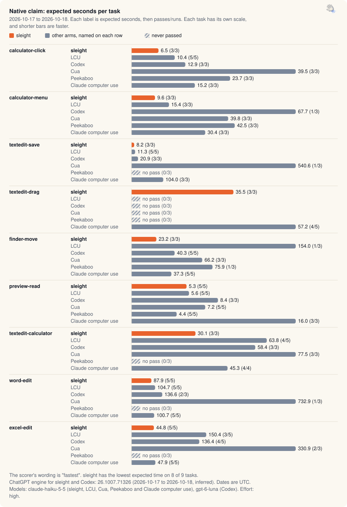

[Benchmarks](README.md) · Native · [Apps](app-claim.md) · [Chrome and Helium](browser-turbo.md) · [Safari and Firefox](browser-race.md) · [Experiments](ab-tests.md) · [Validation](validation.md) · [Releases](release-passes.md) · [Insights](insights.md) · [Interactive](https://land-o-clusters.github.io/sleight/results/explore.html)

# Native claim

The claim suite runs 9 native tasks in Calculator, TextEdit, Finder, Preview, Word and Excel, one task per skill. sleight competes against LCU, Codex, Cua, Peekaboo and Claude's own computer use in real windows with the tester away. The suite is sleight's own, its skill and tool wording were tuned on the runs of textedit-calculator, preview-read, excel-edit, word-edit, finder-move, textedit-save and textedit-drag (not calculator-click or calculator-menu), and the competitors ran their defaults. sleight has the lowest expected time on 8 of 9 tasks.

<picture>
  <source media="(prefers-color-scheme: dark)" srcset="charts/family-native-claim-dark.svg">
  
</picture>

Native claim, 2026-10-17 to 2026-10-18. Expected seconds per task for sleight, LCU, Codex, Cua, Peekaboo and Claude computer use. sleight has the lowest expected time on 8 of 9 tasks.

Each cell is expected seconds, then passes/runs.

| Task | sleight | LCU | Codex | Cua | Peekaboo | Claude computer use |
| --- | --- | --- | --- | --- | --- | --- |
| `calculator-click` | 6.5 (3/3) | 10.4 (5/5) | 12.9 (3/3) | 39.5 (3/3) | 23.7 (3/3) | 15.2 (3/3) |
| `calculator-menu` | 9.6 (3/3) | 15.4 (3/3) | 67.7 (1/3) | 39.8 (3/3) | 42.5 (3/3) | 30.4 (3/3) |
| `textedit-save` | 8.2 (3/3) | 11.3 (5/5) | 20.9 (3/3) | 540.6 (1/3) | no pass (0/3) | 104.0 (3/3) |
| `textedit-drag` | 35.5 (3/3) | no pass (0/3) | no pass (0/3) | no pass (0/3) | no pass (0/3) | 57.2 (4/5) |
| `finder-move` | 23.2 (3/3) | 154.0 (1/3) | 40.3 (5/5) | 66.2 (3/3) | 75.9 (1/3) | 37.3 (5/5) |
| `preview-read` | 5.3 (5/5) | 5.6 (5/5) | 8.4 (3/3) | 7.2 (5/5) | 4.4 (5/5) | 16.0 (3/3) |
| `textedit-calculator` | 30.1 (3/3) | 63.8 (4/5) | 58.4 (3/3) | 77.5 (3/3) | no pass (0/3) | 45.3 (4/4) |
| `word-edit` | 87.9 (5/5) | 104.7 (5/5) | 136.6 (2/3) | 732.9 (1/3) | no pass (0/3) | 100.7 (5/5) |
| `excel-edit` | 44.8 (5/5) | 150.4 (3/5) | 136.4 (4/5) | 330.9 (2/3) | no pass (0/3) | 47.9 (5/5) |
| Lowest expected time on | 8 of 9 | 0 of 9 | 0 of 9 | 0 of 9 | 1 of 9 | 0 of 9 |
| Total expected s | 251.2 | no total (a task has no pass) | no total (a task has no pass) | no total (a task has no pass) | no total (a task has no pass) | 453.9 |

By the loss rule, sleight lost 2 of 9 tasks.

| Task | Arm ahead | How |
| --- | --- | --- |
| `finder-move` | Peekaboo | faster passing run |
| `preview-read` | Peekaboo | lower expected time and a faster passing run |

No pair within 20% of sleight is short of 5 runs.

Method and arm versions

- 197 runs counted, from 48 results files dated 2026-10-17 to 2026-10-18, on the tester's account login (auth `login`).
- Expected time is the mean seconds per attempt divided by the pass rate (`bench/claim-score.mjs`). A failed run adds its time to the mean and lowers the rate. A task an arm never passed has no expected time, and that arm then has no total. Median and range are over passing runs, and p90 (nearest rank) appears only at 5 or more runs.
- The rules come from [LAWS](../status/LAWS.md). Each arm gets 3 runs per task, or 5 where sleight and another arm are within 20% (the difference over the slower expected time). "Fastest" needs the lowest expected time on a majority of tasks and the lowest total, with those 5 runs in place. Otherwise the wording is "completed every task, fastest on N". A task counts as lost when another arm has the lower expected time or a faster passing run.
- Rows come from `~/Projects/sleight-wt/app-claim/native-results-1018b` with the exclusions in `bench/claim-exclusions.json`. Scoring starts at file stamp `2026-10-17T04-03`, and the reason given is `overnight claim run on the release build (ef833641 plus the Chess drag fix 1933db78); earlier runs measured older builds`.
- The results files don't record sleight's commit or the Codex CLI version.

| Arm | Model ids in the runs | Effort | Versions recorded | ChatGPT engine and UTC dates |
| --- | --- | --- | --- | --- |
| sleight | `claude-haiku-5-5` | high | Claude Code 2.1.289 | engine 26.1007.71326 (33 inferred), 2026-10-18 (dates inferred) |
| LCU | `claude-haiku-5-5` | high | Claude Code 2.1.289 | not used, 2026-10-17 to 2026-10-18 |
| Codex | `gpt-6-luna` | high | not recorded | engine 26.1007.71326 (31 inferred), 2026-10-17 (dates inferred) |
| Cua | `claude-haiku-5-5` | high | Claude Code 2.1.289 | not used, 2026-10-17 |
| Peekaboo | `claude-haiku-5-5` | high | @steipete/peekaboo 4.9.2, Claude Code 2.1.289 | not used, 2026-10-17 |
| Claude computer use | `claude-haiku-5-5` | high | Claude Code 2.1.289 | not used, 2026-10-17 to 2026-10-18 |

The arms that use the engine ran on one engine version, 26.1007.71326. A version is "recorded" when the runner read it and "inferred" from the timeline in `bench/engine-versions.json` otherwise, and a date is inferred when it comes from a file's stamp or modification time. LCU, Cua, Peekaboo, FowlBrowser, Claude in Chrome and Claude's computer use don't use the engine.

Rows left out and scorer warnings

Rows left out, with the reasons from the exclusions file:

| Reason | Rows |
| --- | --- |
| a macOS permission prompt was on screen | 1 |
| claude-cu harness development runs before its first full claim pass (tool search, card parser, hooks) | 3 |
| claude-cu harness stopped before or during the approval card (its parser and hooks were fixed during the 2026-10-17 run); not a result of Claude's computer use | 3 |
| claude-cu harness stopped the session at 6.9 s when Claude Code refused a Read call ("No such tool available"); other arms carry on after a refused tool (harness fixed in f644b96b) | 1 |
| cua pass stopped at word-edit #1 when Word's fixture cleanup failed (a Don't Save sheet), with 7 of 27 runs done; the arm was rerun in full | 6 |
| skipped | 1 |
| the task gave the claude-cu arm no clipboard grant, so the hook denied its request_access (fixed in a4692c75) | 1 |

The scorer warned:

- `sleight's included rows come from 2 passes: 2026-10-18T03-17-17-752Z.json (27), 2026-10-18T03-33-15-135Z.json (6)`

Spread of passing runs

Passing runs, median [fastest to slowest], with p90 at 5 or more runs:

| Task | sleight | LCU | Codex | Cua | Peekaboo | Claude computer use |
| --- | --- | --- | --- | --- | --- | --- |
| `calculator-click` | 6.6 [6.0 to 6.8] | 10.8 [8.1 to 11.6], p90 11.6 | 12.6 [9.2 to 17.0] | 29.4 [28.3 to 60.9] | 23.6 [21.6 to 26.0] | 15.3 [14.3 to 16.1] |
| `calculator-menu` | 9.3 [8.1 to 11.5] | 15.2 [14.7 to 16.3] | 15.9 [15.9 to 15.9] | 28.4 [24.0 to 67.1] | 40.0 [28.8 to 58.8] | 30.4 [28.8 to 31.9] |
| `textedit-save` | 8.0 [7.5 to 9.2] | 10.5 [9.6 to 14.2], p90 14.2 | 22.1 [18.1 to 22.6] | 133.4 [133.4 to 133.4] | no passes | 104.1 [92.5 to 115.5] |
| `textedit-drag` | 33.1 [32.6 to 40.7] | no passes | no passes | no passes | no passes | 43.0 [40.7 to 60.4], p90 60.4 |
| `finder-move` | 20.9 [19.0 to 29.6] | 71.7 [71.7 to 71.7] | 40.3 [28.2 to 52.0], p90 52.0 | 29.9 [26.5 to 142.3] | 15.4 [15.4 to 15.4] | 26.5 [22.0 to 72.4], p90 72.4 |
| `preview-read` | 5.1 [4.6 to 6.7], p90 6.7 | 5.6 [5.2 to 6.2], p90 6.2 | 8.5 [7.7 to 9.0] | 6.7 [6.0 to 9.4], p90 9.4 | 4.4 [3.5 to 4.9], p90 4.9 | 14.2 [12.6 to 21.1] |
| `textedit-calculator` | 32.8 [22.8 to 34.8] | 33.4 [26.6 to 38.3], p90 38.3 | 67.1 [36.6 to 71.4] | 84.4 [51.2 to 96.8] | no passes | 38.2 [38.2 to 57.4] |
| `word-edit` | 87.7 [60.2 to 119.8], p90 119.8 | 97.3 [65.9 to 162.6], p90 162.6 | 81.2 [81.2 to 85.2] | 292.4 [292.4 to 292.4] | no passes | 100.5 [94.7 to 110.1], p90 110.1 |
| `excel-edit` | 36.8 [33.2 to 66.2], p90 66.2 | 106.9 [38.2 to 110.0], p90 110.0 | 103.7 [88.1 to 228.1], p90 228.1 | 162.5 [162.5 to 199.0] | no passes | 39.5 [36.7 to 71.4], p90 71.4 |

Failed runs (41)

| Task | Arm | File | s | Reason |
| --- | --- | --- | --- | --- |
| `textedit-drag` | LCU | `2026-10-17T04-20-31-416Z.json` | 37.7 | `file holds "alpha beta gamma"` |
| `textedit-drag` | LCU | `2026-10-17T04-20-31-416Z.json` | 38.8 | `file holds "alpha beta gamma"` |
| `finder-move` | LCU | `2026-10-17T04-20-31-416Z.json` | 45.4 | `WORLD_TREE_MISMATCH` |
| `textedit-drag` | LCU | `2026-10-17T04-20-31-416Z.json` | 42.0 | `file holds "alpha beta gamma"` |
| `excel-edit` | LCU | `2026-10-17T04-20-31-416Z.json` | 130.1 | `no reason recorded` |
| `calculator-menu` | Codex | `2026-10-17T04-43-59-223Z.json` | 15.7 | `WORLD_CALCULATOR_DISPLAY_MISMATCH` |
| `textedit-drag` | Codex | `2026-10-17T04-43-59-223Z.json` | 46.2 | `file holds "alpha beta gamma"` |
| `word-edit` | Codex | `2026-10-17T04-43-59-223Z.json` | 106.7 | `saved Office file: unexpected Word paragraphs` |
| `calculator-menu` | Codex | `2026-10-17T04-43-59-223Z.json` | 36.1 | `WORLD_CALCULATOR_MODE_MISMATCH` |
| `textedit-drag` | Codex | `2026-10-17T04-43-59-223Z.json` | 52.0 | `file holds "alpha beta gamma"` |
| `textedit-drag` | Codex | `2026-10-17T04-43-59-223Z.json` | 43.3 | `file holds "alpha beta gamma"` |
| `textedit-drag` | Cua | `2026-10-17T05-19-45-267Z.json` | 149.3 | `file holds "alpha beta gamma"` |
| `word-edit` | Cua | `2026-10-17T05-19-45-267Z.json` | 267.6 | `saved Office file: unexpected Word paragraphs` |
| `textedit-save` | Cua | `2026-10-17T05-19-45-267Z.json` | 167.6 | `WORLD_SAVE_MISMATCH` |
| `textedit-drag` | Cua | `2026-10-17T05-19-45-267Z.json` | 81.5 | `file holds "alpha beta gamma"` |
| `word-edit` | Cua | `2026-10-17T05-19-45-267Z.json` | 172.9 | `saved Office file: unexpected Word paragraphs` |
| `textedit-save` | Cua | `2026-10-17T05-19-45-267Z.json` | 239.6 | `WORLD_SAVE_MISMATCH` |
| `textedit-drag` | Cua | `2026-10-17T05-56-24-615Z.json` | 58.5 | `file holds "alpha beta gamma"` |
| `excel-edit` | Cua | `2026-10-17T05-56-24-615Z.json` | 300.2 | `saved Office file: unexpected worksheet names or order` |
| `finder-move` | LCU | `2026-10-17T06-12-16-083Z.json` | 36.9 | `WORLD_TREE_MISMATCH` |
| `textedit-save` | Peekaboo | `2026-10-17T06-13-07-674Z.json` | 23.7 | `WORLD_SAVE_MISMATCH` |
| `textedit-drag` | Peekaboo | `2026-10-17T06-13-07-674Z.json` | 36.9 | `file holds "alpha beta gamma"` |
| `textedit-calculator` | Peekaboo | `2026-10-17T06-13-07-674Z.json` | 60.0 | `WORLD_CROSS_FILE_MISMATCH` |
| `word-edit` | Peekaboo | `2026-10-17T06-13-07-674Z.json` | 92.2 | `saved Office file: unexpected Word paragraphs` |
| `excel-edit` | Peekaboo | `2026-10-17T06-22-38-474Z.json` | 38.2 | `saved Office file: unexpected worksheet names or order` |
| `finder-move` | Peekaboo | `2026-10-17T06-23-23-721Z.json` | 18.4 | `WORLD_TREE_MISMATCH` |
| `textedit-save` | Peekaboo | `2026-10-17T06-25-03-413Z.json` | 29.5 | `WORLD_SAVE_MISMATCH` |
| `textedit-drag` | Peekaboo | `2026-10-17T06-25-40-180Z.json` | 35.1 | `file holds "alpha beta gamma"` |
| `finder-move` | Peekaboo | `2026-10-17T06-26-22-606Z.json` | 42.1 | `WORLD_TREE_MISMATCH` |
| `textedit-calculator` | Peekaboo | `2026-10-17T06-27-21-043Z.json` | 105.4 | `WORLD_CROSS_FILE_MISMATCH` |
| `word-edit` | Peekaboo | `2026-10-17T06-29-14-278Z.json` | 39.3 | `saved Office file: unexpected Word paragraphs` |
| `excel-edit` | Peekaboo | `2026-10-17T06-30-00-709Z.json` | 36.3 | `saved Office file: unexpected worksheet names or order` |
| `textedit-save` | Peekaboo | `2026-10-17T06-33-48-608Z.json` | 21.6 | `WORLD_SAVE_MISMATCH` |
| `textedit-drag` | Peekaboo | `2026-10-17T06-34-17-178Z.json` | 23.5 | `file holds "alpha beta gamma"` |
| `textedit-calculator` | Peekaboo | `2026-10-17T06-35-17-194Z.json` | 101.5 | `WORLD_CROSS_FILE_MISMATCH` |
| `word-edit` | Peekaboo | `2026-10-17T06-37-06-833Z.json` | 101.7 | `saved Office file: unexpected Word paragraphs` |
| `excel-edit` | Peekaboo | `2026-10-17T06-40-06-536Z.json` | 33.5 | `saved Office file: unexpected worksheet names or order` |
| `excel-edit` | LCU | `2026-10-17T06-49-04-383Z.json` | 65.9 | `saved Office file: unexpected worksheet names or order` |
| `excel-edit` | Codex | `2026-10-17T06-52-09-961Z.json` | 14.7 | `saved Office file: unexpected worksheet names or order` |
| `textedit-drag` | Claude computer use | `2026-10-17T15-51-43-164Z.json` | 40.8 | `the word was not moved; the file was unchanged` |
| `textedit-calculator` | LCU | `2026-10-17T17-22-14-603Z.json` | 123.3 | `WORLD_CROSS_FILE_MISMATCH` |

Claim context and earlier comparisons

In sleight's own native Mac benchmark, its total expected time over 9 tasks was 251.2 s. Claude computer use, the only other arm that passed every task, took 453.9 s.

Expected time is the mean time per attempt divided by the pass rate. It estimates the time to a correct result when failed attempts are retried.

The claim is "fastest": the lowest expected time on 8 of 9 tasks and the lowest total, with 5 runs wherever sleight and another arm were within 20%.

This was measured over 197 runs dated 2026-10-17 to 2026-10-18 on `claude-haiku-5-5` at high effort (engine 26.1007.71326, 2026-10-17 to 2026-10-18). The skill was tuned on some of these tasks. Competitors ran their defaults. Codex ran `gpt-6-luna`.

Haiku 5.5 drove this native claim. Earlier Opus 5.5 runs include the [2026-10-03 native comparison against LCU](../benchmark.md#earlier-benchmarks) and the [2026-10-08 sleight-only pass at medium effort](../benchmark.md#time-per-run).

Opus browser runs include the [2026-10-12 engine comparison against FowlBrowser](../benchmarks/2026-10-12-fowlbrowser-h2h.md), its [later rounds](../benchmarks/2026-10-12-fowlbrowser-h2h-2.md), the [2026-10-12 lean-skill A/B](../benchmarks/2026-10-12-lean-skill-ab.md) and the [2026-10-16 turbo comparison against FowlBrowser](../benchmarks/2026-10-16-opus.md).

The [compatibility record](engine-compat.md) lists a newer ChatGPT release, 26.1013.40934, than these runs. Compatibility checks do not remeasure speed.

The [benchmark hub](README.md) lists each run, failures included, with the method and the model each arm ran.

[data/native-claim.json](data/native-claim.json) has every counted run and the scored cells, and the [interactive page](https://land-o-clusters.github.io/sleight/results/explore.html) charts them. Each arm table lists the ChatGPT engine versions its runs used, with their UTC dates. Rebuild every page with `node bench/results-hub.mjs`.

[Benchmarks](README.md) · Native · [Apps](app-claim.md) · [Chrome and Helium](browser-turbo.md) · [Safari and Firefox](browser-race.md) · [Experiments](ab-tests.md) · [Validation](validation.md) · [Releases](release-passes.md) · [Insights](insights.md) · [Interactive](https://land-o-clusters.github.io/sleight/results/explore.html)
