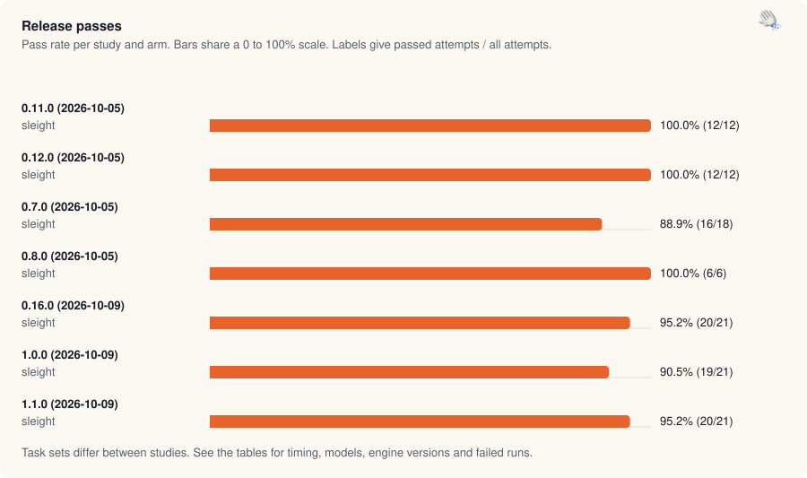

[Benchmarks](README.md) · [Native](native-claim.md) · [Apps](app-claim.md) · [Chrome and Helium](browser-turbo.md) · [Safari and Firefox](browser-race.md) · [Experiments](ab-tests.md) · [Validation](validation.md) · Releases · [Insights](insights.md) · [Interactive](https://land-o-clusters.github.io/sleight/results/explore.html)

# Release passes and the earlier head-to-heads

<picture>
  <source media="(prefers-color-scheme: dark)" srcset="charts/family-release-passes-dark.svg">
  
</picture>

<sub>Release passes: 105 of 111 recorded attempts passed across 7 study and arm rows. Task sets differ between studies.</sub>

The [benchmarks](../benchmarks/) results files supply every release-pass number. Every run the benchmark made is published, failures included ([LAWS](../status/LAWS.md), Method). See [known-problems](../known-problems.md) for quoted limits. The [interactive page](https://land-o-clusters.github.io/sleight/results/explore.html) charts every run.

<details><summary>Method</summary>

- Release passes run sleight alone on the benchmark's default suite (`bench/run.mjs`), up to 3 runs per task. Every pass ran `claude-sonnet-5-5` at medium effort.
- A run passes when the task's own checker confirms the result in the app, and a failure's reason is the checker's output.
- Each release file contributes its last pass. Where a file kept the passes made on the way to the release, Method and caveats says how many.
- The selected head-to-heads are [2026-10-10-h2h-5.json](../benchmarks/2026-10-10-h2h-5.json) and [2026-10-03-sleight-vs-lcu.json](../benchmarks/2026-10-03-sleight-vs-lcu.json), picked per rival by `buildPage` in `bench/results-page.mjs`. Every other head-to-head is also listed.
- These passes predate the claim rules, so they report pass counts and totals instead of expected time. The tables include the failed runs.

</details>

## Latest release pass

1.1.0 (2026-10-09) on claude-sonnet-5-5 at medium: 20 of 21 runs passed, 150 turns, 1,469 s in total. Raw file: [2026-10-09-release-1.1.0.json](../benchmarks/2026-10-09-release-1.1.0.json).

## Head-to-heads

### sleight and Codex (2026-10-10)

| Arm | Model | Passed | Total s | Turns | Model s | Own CPU s |
| --- | --- | --- | --- | --- | --- | --- |
| sleight | claude-haiku-5-5 | 9/9 | 313 | 79 | 189.6 | 78.2 |
| Codex | gpt-6.1-sol | 9/9 | 340 | 83 | n/a | 54.3 |

Own CPU is the run's own process group plus the shared engine helper and the target app. The groups are named by process name: engine is the engine's node and helper, "sleight's processes" is the relay, MCP servers and osascript, client is the host CLI, and other is the target app and anything unclassified.

Own CPU seconds by group:

| Arm | Engine | sleight's processes | Client | Other |
| --- | --- | --- | --- | --- |
| sleight | 33.4 | 9.5 | 21.2 | 14.0 |
| Codex | 26.5 | 1.4 | 11.7 | 14.8 |

Every process the sampler saw, per arm:

| Process | sleight | Codex |
| --- | --- | --- |
| engine helper | 20.9 | 19.6 |
| claude | 18.1 | 0.0 |
| engine node | 12.5 | 6.8 |
| TextEdit | 10.2 | 13.3 |
| mcp@latest | 5.4 | 0.0 |
| Calculator | 3.4 | 1.5 |
| codex | 3.1 | 10.8 |
| node | 2.2 | 1.4 |
| osascript | 2.0 | 0.0 |
| Python | 0.2 | 0.0 |
| python3 | 0.1 | 0.0 |
| (bash) | 0.0 | 0.0 |
| (node) | 0.0 | 0.0 |
| bash | 0.0 | 0.0 |
| (vibe-island-brid) | 0.0 | 0.0 |
| (AgentPeekBridge) | 0.0 | 0.0 |
| uv | 0.0 | 0.0 |
| (git) | 0.0 | 0.0 |
| sh | 0.0 | 0.0 |
| (sh) | 0.0 | 0.0 |
| (grep) | 0.0 | 0.0 |
| &lt;defunct&gt; | 0.0 | 0.0 |
| vibe-island-bridge | 0.0 | 0.0 |
| codex-code-mode-host | 0.0 | 0.9 |

### sleight and LCU (2026-10-03)

| Arm | Model | Passed | Total s | Turns | Model s | Own CPU s |
| --- | --- | --- | --- | --- | --- | --- |
| sleight | default | 12/15 | 545 | 172 | n/a | n/a |
| LCU | n/a | 12/15 | 524 | 142 | n/a | n/a |

Own CPU is the run's own process group plus the shared engine helper and the target app. The groups are named by process name: engine is the engine's node and helper, "sleight's processes" is the relay, MCP servers and osascript, client is the host CLI, and other is the target app and anything unclassified.

## Every run

### 1.1.0 release pass (2026-10-09)

| Task | Run | Arm | Result | s | Turns | Model s | Raw |
| --- | --- | --- | --- | --- | --- | --- | --- |
| calculator-click | 1 | sleight | pass | 94.7 | 10 | 21.0 | [json](../benchmarks/2026-10-09-release-1.1.0.json) |
| calculator-click | 2 | sleight | pass | 20.0 | 4 | 11.4 | [json](../benchmarks/2026-10-09-release-1.1.0.json) |
| calculator-click | 3 | sleight | pass | 16.3 | 4 | 8.3 | [json](../benchmarks/2026-10-09-release-1.1.0.json) |
| calculator-menu | 1 | sleight | pass | 30.3 | 8 | 16.3 | [json](../benchmarks/2026-10-09-release-1.1.0.json) |
| calculator-menu | 2 | sleight | pass | 15.3 | 5 | 7.2 | [json](../benchmarks/2026-10-09-release-1.1.0.json) |
| calculator-menu | 3 | sleight | pass | 18.6 | 5 | 10.6 | [json](../benchmarks/2026-10-09-release-1.1.0.json) |
| chess-drag | 1 | sleight | pass | 303 | n/a | n/a | [json](../benchmarks/2026-10-09-release-1.1.0.json) |
| chess-drag | 2 | sleight | pass | 303 | n/a | n/a | [json](../benchmarks/2026-10-09-release-1.1.0.json) |
| chess-drag | 3 | sleight | pass | 127 | 23 | 89.1 | [json](../benchmarks/2026-10-09-release-1.1.0.json) |
| simulator-form | 1 | sleight | pass | 51.3 | 7 | 22.0 | [json](../benchmarks/2026-10-09-release-1.1.0.json) |
| simulator-form | 2 | sleight | `failed: server received []` | 79.4 | 11 | 39.8 | [json](../benchmarks/2026-10-09-release-1.1.0.json) |
| simulator-form | 3 | sleight | pass | 48.5 | 7 | 20.9 | [json](../benchmarks/2026-10-09-release-1.1.0.json) |
| textedit-drag | 1 | sleight | pass | 55.3 | 9 | 31.1 | [json](../benchmarks/2026-10-09-release-1.1.0.json) |
| textedit-drag | 2 | sleight | pass | 57.9 | 10 | 37.6 | [json](../benchmarks/2026-10-09-release-1.1.0.json) |
| textedit-drag | 3 | sleight | pass | 34.0 | 8 | 15.9 | [json](../benchmarks/2026-10-09-release-1.1.0.json) |
| textedit-edit | 1 | sleight | pass | 30.7 | 6 | 16.4 | [json](../benchmarks/2026-10-09-release-1.1.0.json) |
| textedit-edit | 2 | sleight | pass | 34.3 | 7 | 16.3 | [json](../benchmarks/2026-10-09-release-1.1.0.json) |
| textedit-edit | 3 | sleight | pass | 26.0 | 5 | 9.4 | [json](../benchmarks/2026-10-09-release-1.1.0.json) |
| textedit-save | 1 | sleight | pass | 42.8 | 7 | 18.1 | [json](../benchmarks/2026-10-09-release-1.1.0.json) |
| textedit-save | 2 | sleight | pass | 44.5 | 7 | 19.2 | [json](../benchmarks/2026-10-09-release-1.1.0.json) |
| textedit-save | 3 | sleight | pass | 37.1 | 7 | 13.3 | [json](../benchmarks/2026-10-09-release-1.1.0.json) |

### sleight and Codex (2026-10-10)

| Task | Run | Arm | Result | s | Turns | Model s | Raw |
| --- | --- | --- | --- | --- | --- | --- | --- |
| calculator-click | 1 | sleight | pass | 24.3 | 5 | 10.4 | [json](../benchmarks/2026-10-10-h2h-5.json) |
| calculator-click | 1 | Codex | pass | 16.1 | 4 | n/a | [json](../benchmarks/2026-10-10-h2h-5.json) |
| calculator-click | 2 | sleight | pass | 26.4 | 6 | 13.7 | [json](../benchmarks/2026-10-10-h2h-5.json) |
| calculator-click | 2 | Codex | pass | 14.9 | 4 | n/a | [json](../benchmarks/2026-10-10-h2h-5.json) |
| calculator-click | 3 | sleight | pass | 16.8 | 4 | 7.6 | [json](../benchmarks/2026-10-10-h2h-5.json) |
| calculator-click | 3 | Codex | pass | 15.1 | 4 | n/a | [json](../benchmarks/2026-10-10-h2h-5.json) |
| textedit-edit | 1 | sleight | pass | 21.7 | 7 | 12.9 | [json](../benchmarks/2026-10-10-h2h-5.json) |
| textedit-edit | 1 | Codex | pass | 40.6 | 10 | n/a | [json](../benchmarks/2026-10-10-h2h-5.json) |
| textedit-edit | 2 | sleight | pass | 28.1 | 9 | 19.5 | [json](../benchmarks/2026-10-10-h2h-5.json) |
| textedit-edit | 2 | Codex | pass | 29.4 | 9 | n/a | [json](../benchmarks/2026-10-10-h2h-5.json) |
| textedit-edit | 3 | sleight | pass | 23.9 | 7 | 14.1 | [json](../benchmarks/2026-10-10-h2h-5.json) |
| textedit-edit | 3 | Codex | pass | 26.8 | 7 | n/a | [json](../benchmarks/2026-10-10-h2h-5.json) |
| textedit-save | 1 | sleight | pass | 51.8 | 11 | 32.0 | [json](../benchmarks/2026-10-10-h2h-5.json) |
| textedit-save | 1 | Codex | pass | 50.2 | 11 | n/a | [json](../benchmarks/2026-10-10-h2h-5.json) |
| textedit-save | 2 | sleight | pass | 50.7 | 12 | 31.8 | [json](../benchmarks/2026-10-10-h2h-5.json) |
| textedit-save | 2 | Codex | pass | 110 | 24 | n/a | [json](../benchmarks/2026-10-10-h2h-5.json) |
| textedit-save | 3 | sleight | pass | 69.6 | 18 | 47.7 | [json](../benchmarks/2026-10-10-h2h-5.json) |
| textedit-save | 3 | Codex | pass | 37.1 | 10 | n/a | [json](../benchmarks/2026-10-10-h2h-5.json) |

### sleight and LCU (2026-10-03)

| Task | Run | Arm | Result | s | Turns | Model s | Raw |
| --- | --- | --- | --- | --- | --- | --- | --- |
| calculator-click | 1 | sleight | pass | 16.1 | 6 | n/a | [json](../benchmarks/2026-10-03-sleight-vs-lcu.json) |
| calculator-click | 1 | LCU | pass | 20.6 | 4 | n/a | [json](../benchmarks/2026-10-03-sleight-vs-lcu.json) |
| calculator-click | 2 | sleight | pass | 11.6 | 6 | n/a | [json](../benchmarks/2026-10-03-sleight-vs-lcu.json) |
| calculator-click | 2 | LCU | pass | 11.1 | 4 | n/a | [json](../benchmarks/2026-10-03-sleight-vs-lcu.json) |
| calculator-click | 3 | sleight | pass | 14.3 | 6 | n/a | [json](../benchmarks/2026-10-03-sleight-vs-lcu.json) |
| calculator-click | 3 | LCU | pass | 15.4 | 4 | n/a | [json](../benchmarks/2026-10-03-sleight-vs-lcu.json) |
| calculator-menu | 1 | sleight | pass | 22.8 | 8 | n/a | [json](../benchmarks/2026-10-03-sleight-vs-lcu.json) |
| calculator-menu | 1 | LCU | pass | 16.1 | 6 | n/a | [json](../benchmarks/2026-10-03-sleight-vs-lcu.json) |
| calculator-menu | 2 | sleight | pass | 17.0 | 8 | n/a | [json](../benchmarks/2026-10-03-sleight-vs-lcu.json) |
| calculator-menu | 2 | LCU | pass | 22.9 | 6 | n/a | [json](../benchmarks/2026-10-03-sleight-vs-lcu.json) |
| calculator-menu | 3 | sleight | pass | 19.3 | 8 | n/a | [json](../benchmarks/2026-10-03-sleight-vs-lcu.json) |
| calculator-menu | 3 | LCU | pass | 26.2 | 6 | n/a | [json](../benchmarks/2026-10-03-sleight-vs-lcu.json) |
| textedit-drag | 1 | sleight | `failed: file holds "alpha beta gamma"` | 53.4 | 15 | n/a | [json](../benchmarks/2026-10-03-sleight-vs-lcu.json) |
| textedit-drag | 1 | LCU | `failed: file holds "alpha beta gamma"` | 66.0 | 16 | n/a | [json](../benchmarks/2026-10-03-sleight-vs-lcu.json) |
| textedit-drag | 2 | sleight | `failed: file holds "alpha beta gamma"` | 63.6 | 16 | n/a | [json](../benchmarks/2026-10-03-sleight-vs-lcu.json) |
| textedit-drag | 2 | LCU | `failed: file holds "alpha beta gamma"` | 44.7 | 11 | n/a | [json](../benchmarks/2026-10-03-sleight-vs-lcu.json) |
| textedit-drag | 3 | sleight | `failed: file holds "alpha beta gamma"` | 35.5 | 12 | n/a | [json](../benchmarks/2026-10-03-sleight-vs-lcu.json) |
| textedit-drag | 3 | LCU | `failed: file holds "alpha beta gamma"` | 33.6 | 10 | n/a | [json](../benchmarks/2026-10-03-sleight-vs-lcu.json) |
| textedit-edit | 1 | sleight | pass | 31.6 | 11 | n/a | [json](../benchmarks/2026-10-03-sleight-vs-lcu.json) |
| textedit-edit | 1 | LCU | pass | 32.2 | 9 | n/a | [json](../benchmarks/2026-10-03-sleight-vs-lcu.json) |
| textedit-edit | 2 | sleight | pass | 21.2 | 9 | n/a | [json](../benchmarks/2026-10-03-sleight-vs-lcu.json) |
| textedit-edit | 2 | LCU | pass | 31.3 | 10 | n/a | [json](../benchmarks/2026-10-03-sleight-vs-lcu.json) |
| textedit-edit | 3 | sleight | pass | 18.1 | 9 | n/a | [json](../benchmarks/2026-10-03-sleight-vs-lcu.json) |
| textedit-edit | 3 | LCU | pass | 25.0 | 8 | n/a | [json](../benchmarks/2026-10-03-sleight-vs-lcu.json) |
| textedit-save | 1 | sleight | pass | 74.7 | 21 | n/a | [json](../benchmarks/2026-10-03-sleight-vs-lcu.json) |
| textedit-save | 1 | LCU | pass | 75.5 | 20 | n/a | [json](../benchmarks/2026-10-03-sleight-vs-lcu.json) |
| textedit-save | 2 | sleight | pass | 106 | 23 | n/a | [json](../benchmarks/2026-10-03-sleight-vs-lcu.json) |
| textedit-save | 2 | LCU | pass | 33.8 | 11 | n/a | [json](../benchmarks/2026-10-03-sleight-vs-lcu.json) |
| textedit-save | 3 | sleight | pass | 39.4 | 14 | n/a | [json](../benchmarks/2026-10-03-sleight-vs-lcu.json) |
| textedit-save | 3 | LCU | pass | 69.8 | 17 | n/a | [json](../benchmarks/2026-10-03-sleight-vs-lcu.json) |

## Release history

| Version | Date | Passed | Turns | Total s | Model s a turn |
| --- | --- | --- | --- | --- | --- |
| 0.7.0 | 2026-10-05 | 16/18 | 242 | 915 | n/a |
| 0.8.0 | 2026-10-05 | 6/6 | 96 | 353 | n/a |
| 0.11.0 | 2026-10-05 | 12/12 | 170 | 648 | n/a |
| 0.12.0 | 2026-10-05 | 12/12 | 170 | 525 | n/a |
| 0.16.0 | 2026-10-09 | 20/21 | 178 | 1,355 | 2.3 |
| 1.0.0 | 2026-10-09 | 19/21 | 165 | 912 | 2.6 |
| 1.1.0 | 2026-10-09 | 20/21 | 150 | 1,469 | 2.8 |

Run counts differ between versions: the task set grew from 18 runs to 21, and 0.8.0 and 0.11.0 ran partial sets.

<details><summary>Method and caveats</summary>

- [2026-10-05-release-0.7.0.json](../benchmarks/2026-10-05-release-0.7.0.json): 2026-10-05, claude-sonnet-5-5 at medium, arm sleight, tester presence not in the file, last of 6 passes in the file. write-up [2026-10-05-release-0.7.0.md](../benchmarks/2026-10-05-release-0.7.0.md). Every benchmark run made for the 0.7.0 release on 2026-10-05, in order, failures included. sleight arm only, Sonnet 5.5 at medium effort, Claude Code 2.1.289, engine 26.930.31730, tester away from the Mac.
- [2026-10-05-release-0.8.0.json](../benchmarks/2026-10-05-release-0.8.0.json): 2026-10-05, claude-sonnet-5-5 at medium, arm sleight, tester presence not in the file, last of 3 passes in the file. write-up [2026-10-05-release-0.8.0.md](../benchmarks/2026-10-05-release-0.8.0.md). Every benchmark run made for the 0.8.0 release on 2026-10-05, in order, failures included. sleight arm only (folder outside any repo), Sonnet 5.5 at medium effort, Claude Code 2.1.289, engine 26.930.31730, ComputerUseAllowForbiddenTargets on (it only affects terminals and OpenAI's apps).
- [2026-10-05-release-0.11.0.json](../benchmarks/2026-10-05-release-0.11.0.json): 2026-10-05, claude-sonnet-5-5 at medium, arm sleight, tester presence not in the file, last of 4 passes in the file. Every benchmark run for 0.11.0 on 2026-10-05, in order, failures included. sleight arm only, folder outside any repo, Sonnet 5.5 medium, tester away.
- [2026-10-05-release-0.12.0.json](../benchmarks/2026-10-05-release-0.12.0.json): 2026-10-05, claude-sonnet-5-5 at medium, arm sleight, tester presence not in the file. Benchmark on the 0.12.0 in-call stale-number check, 2026-10-05, tester away. sleight arm only, folder outside any repo, Sonnet 5.5 medium.
- [2026-10-09-release-0.16.0.json](../benchmarks/2026-10-09-release-0.16.0.json): 2026-10-09, claude-sonnet-5-5 at medium, arm sleight, tester presence not in the file.
- [2026-10-09-release-1.0.0.json](../benchmarks/2026-10-09-release-1.0.0.json): 2026-10-09, claude-sonnet-5-5 at medium, arm sleight, tester presence not in the file.
- [2026-10-09-release-1.1.0.json](../benchmarks/2026-10-09-release-1.1.0.json): 2026-10-09, claude-sonnet-5-5 at medium, arm sleight, tester presence not in the file.
- [2026-10-10-h2h-5.json](../benchmarks/2026-10-10-h2h-5.json): 2026-10-10, claude-haiku-5-5 at high, arm sleight and Codex, auth api, tester presence not in the file.
- [2026-10-03-sleight-vs-lcu.json](../benchmarks/2026-10-03-sleight-vs-lcu.json): 2026-10-03, default, arm sleight and LCU, tester presence not in the file.

The standard results files don't record an engine version or load figures. Passes that measured them state them in a write-up or note. Turns differ between harnesses.

</details>

## Every head-to-head and sleight-only pass

Every results file in [docs/benchmarks](../benchmarks/) in the benchmark runner's format, with its totals per arm. Totals add every run, failures included.

| File | Date | Kind | Model | Effort | Per arm: passed/runs, total s | ChatGPT engine and UTC dates |
| --- | --- | --- | --- | --- | --- | --- |
| [2026-10-03-sleight-vs-lcu.json](../benchmarks/2026-10-03-sleight-vs-lcu.json) | 2026-10-03 | head-to-head | `default` | n/a | sleight 12/15, 545 s, LCU 12/15, 524 s | sleight: engine 26.930.31730 (15 inferred), 2026-10-03 (dates inferred) · LCU: not used, 2026-10-03 |
| [2026-10-04-drag-tool.json](../benchmarks/2026-10-04-drag-tool.json) | 2026-10-04 | sleight only | `claude-sonnet-5-5` | medium | sleight 3/3, 167 s | sleight: engine 26.930.31730 (3 inferred), 2026-10-04 (dates inferred) |
| [2026-10-04-input-lease-before-fix.json](../benchmarks/2026-10-04-input-lease-before-fix.json) | 2026-10-04 | sleight only | `claude-sonnet-5-5` | medium | sleight 1/6, 358 s | sleight: engine 26.930.31730 (6 inferred), 2026-10-04 (dates inferred) |
| [2026-10-04-input-lease-general-attempt-1.json](../benchmarks/2026-10-04-input-lease-general-attempt-1.json) | 2026-10-04 | sleight only | `claude-sonnet-5-5` | medium | sleight 0/3, 136 s | sleight: engine 26.930.31730 (3 inferred), 2026-10-04 (dates inferred) |
| [2026-10-04-input-lease-owner-baseline.json](../benchmarks/2026-10-04-input-lease-owner-baseline.json) | 2026-10-04 | sleight only | `claude-sonnet-5-5` | medium | sleight 0/6, 427 s | sleight: engine 26.930.31730 (6 inferred), 2026-10-04 (dates inferred) |
| [2026-10-05-compact-reads-0.10.0.json](../benchmarks/2026-10-05-compact-reads-0.10.0.json) | 2026-10-05 | sleight only | `claude-sonnet-5-5` | medium | sleight 12/12, 602 s | sleight: 12 ambiguous, 2026-10-05 (dates inferred) |
| [2026-10-05-compact-reads-0.9.1.json](../benchmarks/2026-10-05-compact-reads-0.9.1.json) | 2026-10-05 | sleight only | `claude-sonnet-5-5` | medium | sleight 12/12, 571 s | sleight: 12 ambiguous, 2026-10-05 (dates inferred) |
| [2026-10-05-compact-reads.json](../benchmarks/2026-10-05-compact-reads.json) | 2026-10-05 | sleight only | `claude-sonnet-5-5` | medium | sleight 12/12, 526 s | sleight: 12 ambiguous, 2026-10-05 (dates inferred) |
| [2026-10-05-release-0.11.0.json](../benchmarks/2026-10-05-release-0.11.0.json) | 2026-10-05 | release 0.11.0 | `claude-sonnet-5-5` | medium | sleight 12/12, 648 s | sleight: 12 ambiguous, 2026-10-05 (dates inferred) |
| [2026-10-05-release-0.12.0.json](../benchmarks/2026-10-05-release-0.12.0.json) | 2026-10-05 | release 0.12.0 | `claude-sonnet-5-5` | medium | sleight 12/12, 525 s | sleight: 12 ambiguous, 2026-10-05 (dates inferred) |
| [2026-10-05-release-0.7.0.json](../benchmarks/2026-10-05-release-0.7.0.json) | 2026-10-05 | release 0.7.0 | `claude-sonnet-5-5` | medium | sleight 16/18, 915 s | sleight: engine 26.930.31730 (18 inferred), 2026-10-05 (dates inferred) |
| [2026-10-05-release-0.8.0.json](../benchmarks/2026-10-05-release-0.8.0.json) | 2026-10-05 | release 0.8.0 | `claude-sonnet-5-5` | medium | sleight 6/6, 353 s | sleight: 6 ambiguous, 2026-10-05 (dates inferred) |
| [2026-10-07-element-ids.json](../benchmarks/2026-10-07-element-ids.json) | 2026-10-08 | sleight only | `claude-sonnet-5-5` | medium | sleight 19/21, 1,217 s | sleight: 21 ambiguous, 2026-10-08 (dates inferred) |
| [2026-10-07-errors.json](../benchmarks/2026-10-07-errors.json) | 2026-10-08 | sleight only | `claude-sonnet-5-5` | medium | sleight 21/21, 871 s | sleight: 21 ambiguous, 2026-10-08 (dates inferred) |
| [2026-10-07-simulator-form.json](../benchmarks/2026-10-07-simulator-form.json) | 2026-10-08 | sleight only | `claude-sonnet-5-5` | medium | sleight 3/3, 130 s | sleight: 3 ambiguous, 2026-10-08 (dates inferred) |
| [2026-10-07-timing.json](../benchmarks/2026-10-07-timing.json) | 2026-10-08 | sleight only | `claude-sonnet-5-5` | medium | sleight 18/21, 942 s | sleight: 21 ambiguous, 2026-10-08 (dates inferred) |
| [2026-10-08-acquire-and-act.json](../benchmarks/2026-10-08-acquire-and-act.json) | 2026-10-08 | sleight only | `claude-sonnet-5-5` | medium | sleight 21/21, 677 s | sleight: engine 26.1002.52244 (21 inferred), 2026-10-08 (dates inferred) |
| [2026-10-08-acquisition-echo-haiku.json](../benchmarks/2026-10-08-acquisition-echo-haiku.json) | 2026-10-08 | sleight only | `claude-haiku-5-5` | medium | sleight 3/3, 191 s | sleight: engine 26.1002.52244 (3 inferred), 2026-10-08 (dates inferred) |
| [2026-10-08-acquisition-echo.json](../benchmarks/2026-10-08-acquisition-echo.json) | 2026-10-08 | sleight only | `claude-sonnet-5-5` | medium | sleight 21/21, 772 s | sleight: engine 26.1002.52244 (21 inferred), 2026-10-08 (dates inferred) |
| [2026-10-08-await-split-view.json](../benchmarks/2026-10-08-await-split-view.json) | 2026-10-08 | sleight only | `claude-sonnet-5-5` | medium | sleight 13/21, 794 s | sleight: engine 26.1002.52244 (21 inferred), 2026-10-08 (dates inferred) |
| [2026-10-08-await-stopped.json](../benchmarks/2026-10-08-await-stopped.json) | 2026-10-08 | sleight only | `claude-sonnet-5-5` | medium | sleight 2/5, 262 s | sleight: engine 26.1002.52244 (5 inferred), 2026-10-08 (dates inferred) |
| [2026-10-08-covered-drags.json](../benchmarks/2026-10-08-covered-drags.json) | 2026-10-08 | sleight only | `claude-sonnet-5-5` | medium | sleight 18/21, 1,077 s | sleight: engine 26.1002.52244 (21 inferred), 2026-10-08 (dates inferred) |
| [2026-10-08-engine-time-pass.json](../benchmarks/2026-10-08-engine-time-pass.json) | 2026-10-08 | sleight only | `claude-sonnet-5-5` | medium | sleight 21/21, 917 s | sleight: engine 26.1002.52244 (21 inferred), 2026-10-08 (dates inferred) |
| [2026-10-08-guard-reads.json](../benchmarks/2026-10-08-guard-reads.json) | 2026-10-08 | sleight only | `claude-sonnet-5-5` | medium | sleight 20/21, 798 s | sleight: engine 26.1002.52244 (21 inferred), 2026-10-08 (dates inferred) |
| [2026-10-08-haiku-medium.json](../benchmarks/2026-10-08-haiku-medium.json) | 2026-10-08 | sleight only | `claude-haiku-5-5` | medium | sleight 20/21, 669 s | sleight: engine 26.1002.52244 (21 inferred), 2026-10-08 (dates inferred) |
| [2026-10-08-opus-medium.json](../benchmarks/2026-10-08-opus-medium.json) | 2026-10-08 | sleight only | `claude-opus-5-5` | medium | sleight 21/21, 842 s | sleight: engine 26.1002.52244 (21 inferred), 2026-10-08 (dates inferred) |
| [2026-10-08-reliability-pass.json](../benchmarks/2026-10-08-reliability-pass.json) | 2026-10-08 | sleight only | `claude-sonnet-5-5` | medium | sleight 21/21, 628 s | sleight: engine 26.1002.52244 (21 inferred), 2026-10-08 (dates inferred) |
| [2026-10-08-retitle-calculator-unresponsive.json](../benchmarks/2026-10-08-retitle-calculator-unresponsive.json) | 2026-10-08 | sleight only | `claude-sonnet-5-5` | medium | sleight 21/21, 923 s | sleight: engine 26.1002.52244 (21 inferred), 2026-10-08 (dates inferred) |
| [2026-10-08-retitle-tools-deferred.json](../benchmarks/2026-10-08-retitle-tools-deferred.json) | 2026-10-08 | sleight only | `claude-sonnet-5-5` | medium | sleight 21/21, 648 s | sleight: engine 26.1002.52244 (21 inferred), 2026-10-08 (dates inferred) |
| [2026-10-08-retitle.json](../benchmarks/2026-10-08-retitle.json) | 2026-10-08 | sleight only | `claude-sonnet-5-5` | medium | sleight 21/21, 621 s | sleight: engine 26.1002.52244 (21 inferred), 2026-10-08 (dates inferred) |
| [2026-10-08-save-in-one-call.json](../benchmarks/2026-10-08-save-in-one-call.json) | 2026-10-08 | sleight only | `claude-sonnet-5-5` | medium | sleight 20/21, 727 s | sleight: engine 26.1002.52244 (21 inferred), 2026-10-08 (dates inferred) |
| [2026-10-08-skill-trim-first.json](../benchmarks/2026-10-08-skill-trim-first.json) | 2026-10-08 | sleight only | `claude-sonnet-5-5` | medium | sleight 21/21, 613 s | sleight: engine 26.1002.52244 (21 inferred), 2026-10-08 (dates inferred) |
| [2026-10-08-skill-trim.json](../benchmarks/2026-10-08-skill-trim.json) | 2026-10-08 | sleight only | `claude-sonnet-5-5` | medium | sleight 21/21, 567 s | sleight: engine 26.1002.52244 (21 inferred), 2026-10-08 (dates inferred) |
| [2026-10-08-sonnet-low.json](../benchmarks/2026-10-08-sonnet-low.json) | 2026-10-08 | sleight only | `claude-sonnet-5-5` | low | sleight 21/21, 864 s | sleight: engine 26.1002.52244 (21 inferred), 2026-10-08 (dates inferred) |
| [2026-10-08-turns.json](../benchmarks/2026-10-08-turns.json) | 2026-10-08 | sleight only | `claude-sonnet-5-5` | medium | sleight 21/21, 759 s | sleight: engine 26.1002.52244 (21 inferred), 2026-10-08 (dates inferred) |
| [2026-10-09-chess-glob.json](../benchmarks/2026-10-09-chess-glob.json) | 2026-10-09 | sleight only | `claude-sonnet-5-5` | medium | sleight 3/3, 663 s | sleight: engine 26.1002.52244 (3 inferred), 2026-10-09 (dates inferred) |
| [2026-10-09-chess-no-glob.json](../benchmarks/2026-10-09-chess-no-glob.json) | 2026-10-09 | sleight only | `claude-sonnet-5-5` | medium | sleight 3/3, 166 s | sleight: engine 26.1002.52244 (3 inferred), 2026-10-09 (dates inferred) |
| [2026-10-09-codex-real-first.json](../benchmarks/2026-10-09-codex-real-first.json) | 2026-10-09 | sleight only | `claude-sonnet-5-5` | medium | Codex 1/1, 37 s | Codex: engine 26.1002.52244 (1 inferred), 2026-10-09 (dates inferred) |
| [2026-10-09-first-call-batch-off-1.json](../benchmarks/2026-10-09-first-call-batch-off-1.json) | 2026-10-09 | sleight only | `claude-sonnet-5-5` | medium | sleight 12/12, 428 s | sleight: engine 26.1002.52244 (12 inferred), 2026-10-09 (dates inferred) |
| [2026-10-09-first-call-batch-off-2.json](../benchmarks/2026-10-09-first-call-batch-off-2.json) | 2026-10-09 | sleight only | `claude-sonnet-5-5` | medium | sleight 11/12, 407 s | sleight: engine 26.1002.52244 (12 inferred), 2026-10-09 (dates inferred) |
| [2026-10-09-first-call-batch-on-1.json](../benchmarks/2026-10-09-first-call-batch-on-1.json) | 2026-10-09 | sleight only | `claude-sonnet-5-5` | medium | sleight 12/12, 445 s | sleight: engine 26.1002.52244 (12 inferred), 2026-10-09 (dates inferred) |
| [2026-10-09-first-call-batch-on-2.json](../benchmarks/2026-10-09-first-call-batch-on-2.json) | 2026-10-09 | sleight only | `claude-sonnet-5-5` | medium | sleight 12/12, 335 s | sleight: engine 26.1002.52244 (12 inferred), 2026-10-09 (dates inferred) |
| [2026-10-09-first-call-hint.json](../benchmarks/2026-10-09-first-call-hint.json) | 2026-10-09 | sleight only | `claude-sonnet-5-5` | medium | sleight 12/12, 321 s | sleight: engine 26.1002.52244 (12 inferred), 2026-10-09 (dates inferred) |
| [2026-10-09-footprint.json](../benchmarks/2026-10-09-footprint.json) | 2026-10-09 | head-to-head | `claude-sonnet-5-5` | medium | sleight 6/6, 206 s, Codex 6/6, 232 s | sleight: engine 26.1002.52244 (6 inferred), 2026-10-09 (dates inferred) · Codex: engine 26.1002.52244 (6 inferred), 2026-10-09 (dates inferred) |
| [2026-10-09-full-screen-every-read.json](../benchmarks/2026-10-09-full-screen-every-read.json) | 2026-10-09 | sleight only | `claude-sonnet-5-5` | medium | sleight 0/1, 47 s | sleight: engine 26.1002.52244 (1 inferred), 2026-10-09 (dates inferred) |
| [2026-10-09-full-screen-first.json](../benchmarks/2026-10-09-full-screen-first.json) | 2026-10-09 | sleight only | `claude-sonnet-5-5` | medium | sleight 0/1, 50 s | sleight: engine 26.1002.52244 (1 inferred), 2026-10-09 (dates inferred) |
| [2026-10-09-h2h-background.json](../benchmarks/2026-10-09-h2h-background.json) | 2026-10-09 | head-to-head | `claude-sonnet-5-5` | medium | sleight 15/15, 446 s, Codex 12/15, 732 s | sleight: engine 26.1002.52244 (15 inferred), 2026-10-09 (dates inferred) · Codex: engine 26.1002.52244 (15 inferred), 2026-10-09 (dates inferred) |
| [2026-10-09-h2h-chess-simulator.json](../benchmarks/2026-10-09-h2h-chess-simulator.json) | 2026-10-09 | head-to-head | `claude-sonnet-5-5` | medium | sleight 3/6, 683 s, Codex 5/6, 646 s | sleight: engine 26.1002.52244 (6 inferred), 2026-10-09 (dates inferred) · Codex: engine 26.1002.52244 (6 inferred), 2026-10-09 (dates inferred) |
| [2026-10-09-h2h-core-stopped.json](../benchmarks/2026-10-09-h2h-core-stopped.json) | 2026-10-09 | head-to-head | `claude-sonnet-5-5` | medium | sleight 10/10, 319 s, Codex 8/9, 406 s | sleight: engine 26.1002.52244 (10 inferred), 2026-10-09 (dates inferred) · Codex: engine 26.1002.52244 (9 inferred), 2026-10-09 (dates inferred) |
| [2026-10-09-h2h-loaded.json](../benchmarks/2026-10-09-h2h-loaded.json) | 2026-10-09 | head-to-head | `claude-sonnet-5-5` | medium | sleight 2/5, 975 s, Codex 3/4, 555 s | sleight: engine 26.1002.52244 (5 inferred), 2026-10-09 (dates inferred) · Codex: engine 26.1002.52244 (4 inferred), 2026-10-09 (dates inferred) |
| [2026-10-09-h2h-normal-default.json](../benchmarks/2026-10-09-h2h-normal-default.json) | 2026-10-09 | head-to-head | `claude-sonnet-5-5` | medium | sleight 20/21, 904 s, Codex 16/21, 1,292 s | sleight: engine 26.1002.52244 (21 inferred), 2026-10-09 (dates inferred) · Codex: engine 26.1002.52244 (21 inferred), 2026-10-09 (dates inferred) |
| [2026-10-09-h2h-normal-real.json](../benchmarks/2026-10-09-h2h-normal-real.json) | 2026-10-09 | head-to-head | `claude-sonnet-5-5` | medium | sleight 12/12, 396 s, Codex 11/12, 429 s | sleight: engine 26.1002.52244 (12 inferred), 2026-10-09 (dates inferred) · Codex: engine 26.1002.52244 (12 inferred), 2026-10-09 (dates inferred) |
| [2026-10-09-office-qual-1.json](../benchmarks/2026-10-09-office-qual-1.json) | 2026-10-09 | sleight only | `claude-sonnet-5-5` | medium | sleight 1/2, 100 s | sleight: engine 26.1002.52244 (2 inferred), 2026-10-09 (dates inferred) |
| [2026-10-09-office-qual-2.json](../benchmarks/2026-10-09-office-qual-2.json) | 2026-10-09 | sleight only | `claude-sonnet-5-5` | medium | sleight 1/1, 52 s | sleight: engine 26.1002.52244 (1 inferred), 2026-10-09 (dates inferred) |
| [2026-10-09-real-use-office-10.json](../benchmarks/2026-10-09-real-use-office-10.json) | 2026-10-09 | sleight only | `claude-sonnet-5-5` | medium | sleight 0/2, 0 s | sleight: engine 26.1002.52244 (2 inferred), 2026-10-09 (dates inferred) |
| [2026-10-09-real-use-office-11.json](../benchmarks/2026-10-09-real-use-office-11.json) | 2026-10-09 | sleight only | `claude-sonnet-5-5` | medium | sleight 1/2, 100 s | sleight: engine 26.1002.52244 (2 inferred), 2026-10-09 (dates inferred) |
| [2026-10-09-real-use-tasks-7b-dry.json](../benchmarks/2026-10-09-real-use-tasks-7b-dry.json) |  | sleight only | n/a | n/a | sleight 0/5, 0 s | sleight: engine 26.1002.52244 (5 inferred), 2026-10-09 (dates inferred) |
| [2026-10-09-release-0.16.0.json](../benchmarks/2026-10-09-release-0.16.0.json) | 2026-10-09 | release 0.16.0 | `claude-sonnet-5-5` | medium | sleight 20/21, 1,355 s | sleight: engine 26.1002.52244 (21 inferred), 2026-10-09 (dates inferred) |
| [2026-10-09-release-1.0.0.json](../benchmarks/2026-10-09-release-1.0.0.json) | 2026-10-09 | release 1.0.0 | `claude-sonnet-5-5` | medium | sleight 19/21, 912 s | sleight: engine 26.1002.52244 (21 inferred), 2026-10-09 (dates inferred) |
| [2026-10-09-release-1.1.0.json](../benchmarks/2026-10-09-release-1.1.0.json) | 2026-10-09 | release 1.1.0 | `claude-sonnet-5-5` | medium | sleight 20/21, 1,469 s | sleight: engine 26.1002.52244 (21 inferred), 2026-10-09 (dates inferred) |
| [2026-10-09-reuse-smoke.json](../benchmarks/2026-10-09-reuse-smoke.json) | 2026-10-09 | sleight only | `claude-sonnet-5-5` | medium | sleight 2/2, 38 s | sleight: engine 26.1002.52244 (2 inferred), 2026-10-09 (dates inferred) |
| [2026-10-09-shots-base.json](../benchmarks/2026-10-09-shots-base.json) | 2026-10-09 | sleight only | `claude-sonnet-5-5` | medium | sleight 9/9, 475 s | sleight: engine 26.1002.52244 (9 inferred), 2026-10-09 (dates inferred) |
| [2026-10-09-shots-scaled-tap.json](../benchmarks/2026-10-09-shots-scaled-tap.json) | 2026-10-09 | sleight only | `claude-sonnet-5-5` | medium | sleight 3/3, 209 s | sleight: engine 26.1002.52244 (3 inferred), 2026-10-09 (dates inferred) |
| [2026-10-09-shots-scaled.json](../benchmarks/2026-10-09-shots-scaled.json) | 2026-10-09 | sleight only | `claude-sonnet-5-5` | medium | sleight 9/9, 485 s | sleight: engine 26.1002.52244 (9 inferred), 2026-10-09 (dates inferred) |
| [2026-10-10-away-calculator-fix.json](../benchmarks/2026-10-10-away-calculator-fix.json) | 2026-10-10 | sleight only | `claude-haiku-5-5` | high | sleight 6/6, 130 s | sleight: engine 26.1007.21159 (6 inferred), 2026-10-10 (dates inferred) |
| [2026-10-10-away-calculator-traced-2.json](../benchmarks/2026-10-10-away-calculator-traced-2.json) | 2026-10-10 | sleight only | `claude-haiku-5-5` | high | sleight 6/6, 126 s | sleight: engine 26.1007.21159 (6 inferred), 2026-10-10 (dates inferred) |
| [2026-10-10-away-calculator-traced.json](../benchmarks/2026-10-10-away-calculator-traced.json) | 2026-10-10 | sleight only | `claude-haiku-5-5` | high | sleight 3/3, 57 s | sleight: engine 26.1007.21159 (3 inferred), 2026-10-10 (dates inferred) |
| [2026-10-10-away-chess.json](../benchmarks/2026-10-10-away-chess.json) | 2026-10-10 | sleight only | `claude-haiku-5-5` | high | sleight 2/2, 151 s | sleight: engine 26.1007.21159 (2 inferred), 2026-10-10 (dates inferred) |
| [2026-10-10-away-safari-form.json](../benchmarks/2026-10-10-away-safari-form.json) | 2026-10-10 | sleight only | `claude-haiku-5-5` | high | sleight 2/2, 64 s | sleight: engine 26.1007.21159 (2 inferred), 2026-10-10 (dates inferred) |
| [2026-10-10-away-simulator-form-2.json](../benchmarks/2026-10-10-away-simulator-form-2.json) | 2026-10-10 | sleight only | `claude-haiku-5-5` | high | sleight 0/3, 0 s | sleight: engine 26.1007.21159 (3 inferred), 2026-10-10 (dates inferred) |
| [2026-10-10-away-simulator-form-3.json](../benchmarks/2026-10-10-away-simulator-form-3.json) | 2026-10-10 | sleight only | `claude-haiku-5-5` | high | sleight 0/1, 0 s | sleight: engine 26.1007.21159 (1 inferred), 2026-10-10 (dates inferred) |
| [2026-10-10-away-simulator-form.json](../benchmarks/2026-10-10-away-simulator-form.json) | 2026-10-10 | sleight only | `claude-haiku-5-5` | high | sleight 0/1, 0 s | sleight: engine 26.1007.21159 (1 inferred), 2026-10-10 (dates inferred) |
| [2026-10-10-calculator-turns.json](../benchmarks/2026-10-10-calculator-turns.json) | 2026-10-10 | sleight only | `claude-haiku-5-5` | high | sleight 3/3, 91 s | sleight: engine 26.1007.21159 (3 inferred), 2026-10-10 (dates inferred) |
| [2026-10-10-edit-focus-2.json](../benchmarks/2026-10-10-edit-focus-2.json) | 2026-10-10 | sleight only | `claude-haiku-5-5` | high | sleight 3/3, 76 s | sleight: engine 26.1007.21159 (3 inferred), 2026-10-10 (dates inferred) |
| [2026-10-10-edit-focus.json](../benchmarks/2026-10-10-edit-focus.json) | 2026-10-10 | sleight only | `claude-haiku-5-5` | high | sleight 3/3, 73 s | sleight: engine 26.1007.21159 (3 inferred), 2026-10-10 (dates inferred) |
| [2026-10-10-electron-firefox-live.json](../benchmarks/2026-10-10-electron-firefox-live.json) | 2026-10-10 | sleight only | `claude-haiku-5-5` | high | sleight 5/5, 187 s | sleight: engine 26.1007.21159 (5 inferred), 2026-10-10 to 2026-10-11 (dates inferred) |
| [2026-10-10-electron-firefox-refused.json](../benchmarks/2026-10-10-electron-firefox-refused.json) | 2026-10-10 | sleight only | `claude-haiku-5-5` | high | sleight 0/1, 7 s | sleight: engine 26.1007.21159 (1 inferred), 2026-10-10 (dates inferred) |
| [2026-10-10-exact-text-skill.json](../benchmarks/2026-10-10-exact-text-skill.json) | 2026-10-10 | sleight only | `claude-sonnet-5-5` | medium | sleight 6/6, 177 s | sleight: engine 26.1002.52244 (6 inferred), 2026-10-10 (dates inferred) |
| [2026-10-10-footprint-2.json](../benchmarks/2026-10-10-footprint-2.json) | 2026-10-10 | head-to-head | `claude-sonnet-5-5` | medium | sleight 6/6, 154 s, Codex 6/6, 239 s | sleight: engine 26.1002.52244 (6 inferred), 2026-10-10 (dates inferred) · Codex: engine 26.1002.52244 (6 inferred), 2026-10-10 (dates inferred) |
| [2026-10-10-h2h-3.json](../benchmarks/2026-10-10-h2h-3.json) | 2026-10-10 | head-to-head | `claude-haiku-5-5` | high | sleight 6/6, 357 s, Codex 6/6, 209 s | sleight: engine 26.1007.21159 (6 inferred), 2026-10-10 (dates inferred) · Codex: engine 26.1007.21159 (6 inferred), 2026-10-10 (dates inferred) |
| [2026-10-10-h2h-4.json](../benchmarks/2026-10-10-h2h-4.json) | 2026-10-10 | head-to-head | `claude-haiku-5-5` | high | sleight 8/9, 402 s, Codex 9/9, 267 s | sleight: engine 26.1007.21159 (9 inferred), 2026-10-10 (dates inferred) · Codex: engine 26.1007.21159 (9 inferred), 2026-10-10 (dates inferred) |
| [2026-10-10-h2h-5.json](../benchmarks/2026-10-10-h2h-5.json) | 2026-10-10 | head-to-head | `claude-haiku-5-5` | high | sleight 9/9, 313 s, Codex 9/9, 340 s | sleight: engine 26.1007.21159 (9 inferred), 2026-10-10 (dates inferred) · Codex: engine 26.1007.21159 (9 inferred), 2026-10-10 (dates inferred) |
| [2026-10-10-h2h-clean-arms.json](../benchmarks/2026-10-10-h2h-clean-arms.json) | 2026-10-10 | head-to-head | `claude-haiku-5-5` | high | sleight 7/9, 264 s, Codex 9/9, 266 s | sleight: engine 26.1007.21159 (9 inferred), 2026-10-10 (dates inferred) · Codex: engine 26.1007.21159 (9 inferred), 2026-10-10 (dates inferred) |
| [2026-10-10-h2h-footprint-haiku-2.json](../benchmarks/2026-10-10-h2h-footprint-haiku-2.json) | 2026-10-10 | head-to-head | `claude-haiku-5-5` | high | sleight 5/6, 276 s, Codex 6/6, 189 s | sleight: engine 26.1007.21159 (6 inferred), 2026-10-10 (dates inferred) · Codex: engine 26.1007.21159 (6 inferred), 2026-10-10 (dates inferred) |
| [2026-10-10-h2h-footprint-haiku-3.json](../benchmarks/2026-10-10-h2h-footprint-haiku-3.json) | 2026-10-10 | head-to-head | `claude-haiku-5-5` | high | sleight 6/6, 190 s, Codex 6/6, 176 s | sleight: engine 26.1007.21159 (6 inferred), 2026-10-10 (dates inferred) · Codex: engine 26.1007.21159 (6 inferred), 2026-10-10 (dates inferred) |
| [2026-10-10-h2h-footprint-haiku.json](../benchmarks/2026-10-10-h2h-footprint-haiku.json) | 2026-10-10 | head-to-head | `claude-haiku-5-5` | high | sleight 6/6, 263 s, Codex 6/6, 257 s | sleight: engine 26.1007.21159 (6 inferred), 2026-10-10 (dates inferred) · Codex: engine 26.1007.21159 (6 inferred), 2026-10-10 (dates inferred) |
| [2026-10-10-h2h-guard-1-interrupted.json](../benchmarks/2026-10-10-h2h-guard-1-interrupted.json) | 2026-10-10 | head-to-head | `claude-haiku-5-5` | high | sleight 3/3, 112 s, Codex 2/3, 143 s | sleight: engine 26.1007.21159 (3 inferred), 2026-10-10 (dates inferred) · Codex: engine 26.1007.21159 (3 inferred), 2026-10-10 (dates inferred) |
| [2026-10-10-h2h-guard-2.json](../benchmarks/2026-10-10-h2h-guard-2.json) | 2026-10-10 | head-to-head | `claude-haiku-5-5` | high | sleight 6/6, 246 s, Codex 6/6, 194 s | sleight: engine 26.1007.21159 (6 inferred), 2026-10-10 (dates inferred) · Codex: engine 26.1007.21159 (6 inferred), 2026-10-10 (dates inferred) |
| [2026-10-10-h2h-lcu-0.11.2.json](../benchmarks/2026-10-10-h2h-lcu-0.11.2.json) | 2026-10-10 | head-to-head | `claude-haiku-5-5` | high | sleight 8/8, 211 s, LCU 7/8, 299 s | sleight: engine 26.1007.21159 (8 inferred), 2026-10-10 (dates inferred) · LCU: not used, 2026-10-10 |
| [2026-10-10-h2h-normal-setup.json](../benchmarks/2026-10-10-h2h-normal-setup.json) | 2026-10-10 | head-to-head | `claude-haiku-5-5` | high | sleight 8/9, 262 s, Codex 9/9, 230 s | sleight: engine 26.1007.21159 (9 inferred), 2026-10-10 (dates inferred) · Codex: engine 26.1007.21159 (9 inferred), 2026-10-10 (dates inferred) |
| [2026-10-10-h2h-save-check.json](../benchmarks/2026-10-10-h2h-save-check.json) | 2026-10-10 | head-to-head | `claude-haiku-5-5` | high | sleight 2/2, 108 s, Codex 2/2, 85 s | sleight: engine 26.1007.21159 (2 inferred), 2026-10-10 (dates inferred) · Codex: engine 26.1007.21159 (2 inferred), 2026-10-10 (dates inferred) |
| [2026-10-10-real-shop-smoke.json](../benchmarks/2026-10-10-real-shop-smoke.json) | 2026-10-10 | sleight only | `claude-haiku-5-5` | high | sleight 0/2, 73 s | sleight: engine 26.1007.21159 (2 inferred), 2026-10-10 (dates inferred) |
| [2026-10-10-release-haiku-1.json](../benchmarks/2026-10-10-release-haiku-1.json) | 2026-10-10 | sleight only | `claude-haiku-5-5` | high | sleight 5/7, 272 s | sleight: engine 26.1007.21159 (7 inferred), 2026-10-10 (dates inferred) |
| [2026-10-10-release-haiku-2.json](../benchmarks/2026-10-10-release-haiku-2.json) | 2026-10-10 | sleight only | `claude-haiku-5-5` | high | sleight 6/7, 318 s | sleight: engine 26.1007.21159 (7 inferred), 2026-10-10 (dates inferred) |
| [2026-10-10-release-haiku-3.json](../benchmarks/2026-10-10-release-haiku-3.json) | 2026-10-10 | sleight only | `claude-haiku-5-5` | high | sleight 18/18, 964 s | sleight: engine 26.1007.21159 (18 inferred), 2026-10-10 (dates inferred) |
| [2026-10-10-shop-1.json](../benchmarks/2026-10-10-shop-1.json) | 2026-10-10 | head-to-head | `claude-haiku-5-5` | high | sleight 1/2, 53 s, Codex 1/2, 82 s | sleight: engine 26.1007.21159 (2 inferred), 2026-10-10 (dates inferred) · Codex: engine 26.1007.21159 (2 inferred), 2026-10-10 (dates inferred) |
| [2026-10-10-shop-2.json](../benchmarks/2026-10-10-shop-2.json) | 2026-10-10 | head-to-head | `claude-haiku-5-5` | high | sleight 1/1, 95 s, Codex 1/1, 84 s | sleight: engine 26.1007.21159 (1 inferred), 2026-10-10 (dates inferred) · Codex: engine 26.1007.21159 (1 inferred), 2026-10-10 (dates inferred) |
| [2026-10-10-tonight-affected.json](../benchmarks/2026-10-10-tonight-affected.json) | 2026-10-10 | sleight only | `claude-sonnet-5-5` | medium | sleight 15/15, 522 s | sleight: engine 26.1002.52244 (15 inferred), 2026-10-10 (dates inferred) |
| [2026-10-10-verified-results-live.json](../benchmarks/2026-10-10-verified-results-live.json) | 2026-10-10 | sleight only | `claude-haiku-5-5` | high | sleight 6/6, 274 s | sleight: engine 26.1007.21159 (6 inferred), 2026-10-10 (dates inferred) |
| [2026-10-10-waits-targeting-4-tasks.json](../benchmarks/2026-10-10-waits-targeting-4-tasks.json) | 2026-10-10 | sleight only | `claude-haiku-5-5` | high | sleight 6/6, 232 s | sleight: engine 26.1007.21159 (6 inferred), 2026-10-10 (dates inferred) |
| [2026-10-11-battery-partial.json](../benchmarks/2026-10-11-battery-partial.json) |  | sleight only | n/a | n/a | sleight 1/1, 21 s, Codex 1/2, 28 s | sleight: 1 ambiguous, 2026-10-11 (dates inferred) · Codex: 2 ambiguous, 2026-10-11 (dates inferred) |
| [2026-10-11-h2h-clean-arms.json](../benchmarks/2026-10-11-h2h-clean-arms.json) | 2026-10-11 | head-to-head | `claude-haiku-5-5` | high | sleight 9/9, 198 s, Codex 9/9, 401 s | sleight: engine 26.1007.21159 (9 inferred), 2026-10-11 (dates inferred) · Codex: engine 26.1007.21159 (9 inferred), 2026-10-11 (dates inferred) |
| [2026-10-11-h2h-normal-partial.json](../benchmarks/2026-10-11-h2h-normal-partial.json) | 2026-10-11 | head-to-head | `claude-haiku-5-5` | high | sleight 5/5, 123 s, Codex 4/4, 169 s | sleight: engine 26.1007.21159 (5 inferred), 2026-10-11 (dates inferred) · Codex: engine 26.1007.21159 (4 inferred), 2026-10-11 (dates inferred) |
| [2026-10-11-h2h-normal.json](../benchmarks/2026-10-11-h2h-normal.json) | 2026-10-11 | head-to-head | `claude-haiku-5-5` | high | sleight 9/9, 244 s, Codex 9/9, 325 s | sleight: engine 26.1007.21159 (9 inferred), 2026-10-11 (dates inferred) · Codex: engine 26.1007.21159 (9 inferred), 2026-10-11 (dates inferred) |
| [2026-10-11-real-shop-bestbuy-traced.json](../benchmarks/2026-10-11-real-shop-bestbuy-traced.json) | 2026-10-11 | sleight only | `claude-haiku-5-5` | high | sleight 0/1, 47 s | sleight: engine 26.1007.21159 (1 inferred), 2026-10-11 (dates inferred) |
| [2026-10-11-simulator-form-poll-1.json](../benchmarks/2026-10-11-simulator-form-poll-1.json) | 2026-10-11 | sleight only | `claude-haiku-5-5` | high | sleight 0/1, 0 s | sleight: engine 26.1007.21159 (1 inferred), 2026-10-11 (dates inferred) |
| [2026-10-11-simulator-form-poll-2.json](../benchmarks/2026-10-11-simulator-form-poll-2.json) | 2026-10-11 | sleight only | `claude-haiku-5-5` | high | sleight 0/1, 0 s | sleight: engine 26.1007.21159 (1 inferred), 2026-10-11 (dates inferred) |
| [2026-10-11-sitting-best-buy.json](../benchmarks/2026-10-11-sitting-best-buy.json) | 2026-10-11 | sleight only | `claude-haiku-5-5` | high | sleight 0/1, 39 s | sleight: 1 ambiguous, 2026-10-11 (dates inferred) |
| [2026-10-11-sitting-shop-smoke.json](../benchmarks/2026-10-11-sitting-shop-smoke.json) | 2026-10-11 | sleight only | `claude-haiku-5-5` | high | sleight 0/2, 335 s | sleight: 2 ambiguous, 2026-10-11 (dates inferred) |
| [2026-10-11-sitting-simulator-form.json](../benchmarks/2026-10-11-sitting-simulator-form.json) | 2026-10-11 | sleight only | `claude-haiku-5-5` | high | sleight 0/1, 35 s | sleight: engine 26.1007.21159 (1 inferred), 2026-10-11 (dates inferred) |
| [2026-10-11-sitting-textedit-drag.json](../benchmarks/2026-10-11-sitting-textedit-drag.json) | 2026-10-11 | sleight only | `claude-haiku-5-5` | high | sleight 3/3, 95 s | sleight: engine 26.1007.21159 (3 inferred), 2026-10-11 (dates inferred) |
| [2026-10-11-textedit-save-traced.json](../benchmarks/2026-10-11-textedit-save-traced.json) | 2026-10-11 | sleight only | `claude-haiku-5-5` | high | sleight 3/3, 128 s | sleight: engine 26.1007.21159 (3 inferred), 2026-10-11 (dates inferred) |
| [2026-10-11-web-depth-native-partial.json](../benchmarks/2026-10-11-web-depth-native-partial.json) | 2026-10-11 | head-to-head | `claude-haiku-5-5` | high | sleight 1/1, 18 s, Codex 0/1, 30 s | sleight: engine 26.1007.21159 (1 inferred), 2026-10-11 (dates inferred) · Codex: engine 26.1007.21159 (1 inferred), 2026-10-11 (dates inferred) |
| [2026-10-11-web-depth-partial.json](../benchmarks/2026-10-11-web-depth-partial.json) | 2026-10-11 | head-to-head | `claude-haiku-5-5` | high | sleight 1/3, 38 s, Codex 0/2, 29 s | sleight: engine 26.1007.21159 (3 inferred), 2026-10-11 (dates inferred) · Codex: engine 26.1007.21159 (2 inferred), 2026-10-11 (dates inferred) |
| [2026-10-11-web-h2h.json](../benchmarks/2026-10-11-web-h2h.json) | 2026-10-11 | head-to-head | `claude-haiku-5-5` | high | sleight 24/24, 685 s, Codex 24/24, 1,002 s | sleight: engine 26.1007.21159 (24 inferred), 2026-10-11 (dates inferred) · Codex: engine 26.1007.21159 (24 inferred), 2026-10-11 (dates inferred) |

## Run it yourself

```sh
npm run bench -- --runs 3                        # sleight only
npm run bench -- --arm all --runs 3              # sleight and LCU
npm run bench -- --arm sleight,codex --runs 3    # sleight against native Codex computer use

PLUGIN_ARM_RIVAL_DIR=/absolute/path/to/plugin node bench/run.mjs --arm plugin:rival,sleight --tasks calculator-click --runs 1
MCP_ARM_RIVAL_CONFIG=/absolute/path/to/mcp.json node bench/run.mjs --arm mcp:rival,sleight --tasks calculator-click --runs 1
```

A live pass auto-approves the benchmark apps and drives them unattended, and Chess and the simulator need `--owner-away`. Live runs take /tmp/sleight-live.lock and stop while /tmp/sleight-hold exists. See [benchmark.md](../benchmark.md) for the full method.

Rebuild this page after a release pass with:

```sh
node bench/results-hub.mjs
```

[data/release-passes.json](data/release-passes.json) contains every run of the release passes and of the two head-to-heads on this page, plus the totals of every file, and the [interactive page](https://land-o-clusters.github.io/sleight/results/explore.html) charts them. The ChatGPT engine version is missing from this data, which was collected before the results recorded it (2026-10-19). Rebuild every page with `node bench/results-hub.mjs`.

[Benchmarks](README.md) · [Native](native-claim.md) · [Apps](app-claim.md) · [Chrome and Helium](browser-turbo.md) · [Safari and Firefox](browser-race.md) · [Experiments](ab-tests.md) · [Validation](validation.md) · Releases · [Insights](insights.md) · [Interactive](https://land-o-clusters.github.io/sleight/results/explore.html)
